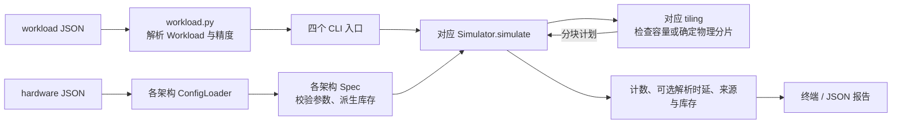
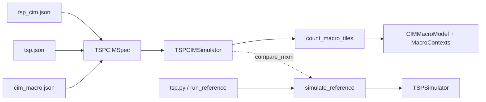

# 架构、参数与验收说明

整理日期：2026-11-15（America/Los_Angeles）。本文汇总当前本地实现；来源材料的原始版本日期和 Git blob 保持不变。

本文是四架构及共享 CIM Macro 的现行技术说明。安装与运行见 [README](README.md)，参数来源核验结果见[核验结论](#source-audit)及[逐项证据台账](calibration/parameter_source_audit.json)。参数的完整元数据以链接的 JSON 为准；本文中的未知项、假设和执行范围与代码对应。

- [四个仿真器的代码结构](#simulator-structure)
- [共同约定与报告口径](#conventions)
- [Ascend 910](#ascend)
- [TPU v4](#tpu)
- [原生 TSP](#tsp)与[完整参数来源表](#tsp-parameters)
- [共享 CIM Macro 模型](#cim-macro)
- [CIM-TSP Core / Cluster / Plane](#cim-tsp)
- [文件组织与迁移](#migration)
- [验证与 issue #2 状态](#validation)
- [待确认参数与后续工作](#remaining)

<a id="simulator-structure"></a>

## 四个仿真器的代码结构

当前有四个独立 Python 仿真器类，分别服务 Ascend、TPU v4、原生 TSP 和 CIM-TSP。它们共享 GEMM 任务定义，按各自硬件边界进行分块和统计；没有统一的 Simulator 基类或公共事件调度器。下图表示共同的职责分层，具体实现仍由各入口选择。



### 从入口到结果的调用链

四个入口均先构造硬件规格和任务，再调用仿真器；分块函数由 `simulate` 内部调用。`src/hardware` 负责描述和检查规格，`src/core` 负责分块与执行统计，`src/utils` 负责配置、任务和报告适配。

`src/core` 的 `ascend`、`tpu`、`tsp`、`tsp_cim` 四个架构包各含 `simulator.py` 和 `tiling.py`。`cim` 是 CIM-TSP 的支持包，保存 `macro_model.py` 和 Macro 聚合函数所在的 `simulator.py`，没有独立场景或 CLI。`tests` 对应四架构及 Macro 支持模型，跨架构检查归入 `tests/common`。硬件和工具层每种职责通常只有一个文件，继续采用架构前缀命名；详细位置与迁移关系见[目录迁移表](#directory-migration)。

| 仿真器 | 入口及规格装配 | 执行与分块 | 输出 |
|---|---|---|---|
| Ascend | [ascend.py](ascend.py) → [AscendConfigLoader](src/utils/ascend_config.py) → [AscendSpec](src/hardware/ascend.py) | [AscendSimulator.simulate](src/core/ascend/simulator.py) → [make_plan](src/core/ascend/tiling.py) | [ascend_report](src/utils/ascend_report.py)，报告 schema 3 |
| TPU v4 | [tpu.py](tpu.py) → [TPUConfigLoader](src/utils/tpu_config.py) → [TPUSpec](src/hardware/tpu.py) | [TPUSimulator.simulate](src/core/tpu/simulator.py) → [make_plan](src/core/tpu/tiling.py) | [tpu_report](src/utils/tpu_report.py)，报告 schema 2 |
| 原生 TSP | [tsp.py](tsp.py) → [run_reference / simulate_reference](src/utils/tsp_reference.py)；runner 使用 [TSPConfigLoader](src/utils/tsp_config.py) 构造 [TSPSpec](src/hardware/tsp.py) | [TSPSimulator.simulate](src/core/tsp/simulator.py) → [TSPTilingEngine](src/core/tsp/tiling.py) | [tsp_report](src/utils/tsp_report.py)，报告 schema 2 |
| CIM-TSP | [tsp_cim.py](tsp_cim.py) → [TSPCIMConfigLoader](src/utils/tsp_cim_config.py) → [TSPCIMSpec](src/hardware/tsp_cim.py) | [TSPCIMSimulator.simulate](src/core/tsp_cim/simulator.py) → [TSPCIMTilingEngine](src/core/tsp_cim/tiling.py) → [count_macro_tiles](src/core/cim/simulator.py) → [CIMMacroModel / MacroContexts](src/core/cim/macro_model.py) | CLI 直接输出 JSON，报告 schema 3 |

Ascend/TPU 的 `simulate` 直接接收 `Workload` 对象；TSP/CIM-TSP 内核接收 `M,K,N` 与策略参数，外层 runner/CLI 补回完整的 workload 元数据。四者返回普通字典，统一指标定义不意味着报告 schema 或 API 完全相同。

### 四个执行内核分别做什么

| 维度 | Ascend | TPU v4 | 原生 TSP | CIM-TSP |
|---|---|---|---|---|
| 执行范围 | 一个 AI Core 的 Cube GEMM 路径 | 一个 TensorCore 的逻辑 GEMM | 一个 hemisphere 的 MEM/MXM/VXM 路径 | 一个跨 20 SuperLane 的 Cluster domain，400 Macro |
| 数据/动作路径 | GM → L1 → L0A/L0B → Cube/L0C → UB → GM | HBM ↔ VMEM；聚合矩阵服务，C 在逻辑 VMEM 中跨 K 保留 | 本侧 MEM 装载权重、供给 activation → MXM；后续 K 分片读 PSUM，经 VXM 相加后回写 MEM | context 编程/复用 → Macro 逐位计算 → 局部 INT32 部分和；另计跨 SuperLane、跨 K tile 的逻辑加法义务 |
| 分块依据 | L1/L0A/L0B/L0C/UB 可用容量；M/K/N 对齐 16/32/16；L1 K panel 与 L0 K block 分开 | 整体 A/B/C 必须装入 HBM；块内 A/B/C 装入 VMEM，超限缩块；不绑定 128×128 MXU 物理映射 | 检查整个补齐 A/B/C 在所选本侧 MEM slices 驻留；K≤320、N≤640，K/N 按 16 补齐，M 不补齐 | 固定域 K320×N640，映射为 K16×N32 Macro 分片；`tile_m` 只表示逻辑行组，不保证 buffer 驻留 |
| 循环/复用 | 固定 MNK，输出驻留 L0C；不跨输出 tile 复用 A/B | 固定 MNK 的闭式求和；不跨输出块复用输入 | KNM/KMN/MKN/NKM；按 plane 权重 tag 避免重复安装 | M/K/N 六种排列；每个物理 Macro slot 的四个 context 保存独立权重 tag |
| 保留的执行状态 | 阶段 byte/MAC 累加、buffer 峰值、当前输出块 | 块数和闭式计数；不构造逐块事件 | `plane_tags` 跟踪权重驻留，`psum_progress` 检查 K 归约顺序 | `MacroContexts` 跟踪 tag、active context 和轮换替换；调用边界视为排空，无在途状态 |
| 主要结果 | 补齐 MAC、五条路径 byte/次数、buffer 峰值 | 有效 MAC、HBM/VMEM 逻辑 payload、PSUM 读写；物理补齐量未评估 | 补齐 MAC、权重安装、MEM/stream byte、VXM add | useful/issued MAC、逐位动作、编程 wordline、context 切换、逻辑广播/归约 |
| 时间模型 | 配置优先、缺项采用显式代理；计算与五阶段搬运串行相加 | 单 TensorCore 七阶段串行估算，块内 MXU 分批并行；缺失的内部服务采用显式近似 | 配置优先、缺项采用显式代理；安装 + 首行 + 后续行间隔，tile 间串行 | 单 Cluster 的装载、计算、归约与写回串行估算；近似参数逐项标记，Macro 局部校准 API 独立保留 |

三点差异直接影响结果解释：Ascend 明确模拟五条核内/核侧搬运路径，TPU 根据逻辑端点 payload 估算串行搬运；TSP 约束整任务在单侧 MEM 驻留，CIM-TSP 没有完整 MEM 分配；CIM 的 `bit_serial_cycles` 是所有 Macro 的局部动作总和，不能与任务总周期直接比较。四者的参考配置均可在所声明的假设下运行 timing；硬件未标定项继续保留，代理服务单独披露。

### 配置依赖与公共实现

Ascend、TPU、TSP 各加载一份自身的参考配置。CIM-TSP 的规格由三份配置组合：`tsp_cim.json` 提供替换后的 Core/Cluster/Plane 与 NIM/LW 设计，`cim_macro.json` 提供 Macro，`tsp.json` 提供共享 MEM、lane、stream、VXM、clock 规格及原生对比基线。Loader 解析引用，`TSPCIMSpec` 检查跨配置几何和 stream 预算一致性。



- [workload.py](src/utils/workload.py) 统一 `A[M,K] × B[K,N]`、INT8/INT32 约定、精度覆盖与路径解析；[dataformat.py](src/hardware/dataformat.py) 提供格式定义。
- [parameters.py](src/hardware/parameters.py) 的严格字段校验被 TSP、Macro、CIM-TSP 共用；Ascend/TPU 各自保留参数类及校验规则。
- [macro_model.py](src/core/cim/macro_model.py) 是 CIM-TSP 唯一的 Macro 动作实现；[simulator.py](src/core/cim/simulator.py) 的 `count_macro_tiles` 共享分片遍历、context 复用和局部动作聚合。该文件并不是四架构的统一调度器。
- [tsp_reference.py](src/utils/tsp_reference.py) 确保独立 TSP 与 CIM 原生对比使用同一个 `TSPSimulator`。比较报告保留执行范围不同、缺少共同标定时序的原因，speedup/energy_ratio 为 null。
- [parameter_source_audit.json](calibration/parameter_source_audit.json) 与对应回归绑定配置版本、参数证据和核验判断；审计台账不参与运行期性能计算。

四个仿真器均不持有真实 A/B/C 数组，不执行数值 GEMM，也没有整片任务调度、逐周期资源争用或完整能耗/面积求解。推荐读代码时从各入口的 `main` 开始，依次看 Spec、`simulate`、tiling，最后看报告和测试；详细算法与限制见后续各架构章节。

<a id="conventions"></a>

## 1. 共同约定与报告口径

本阶段对应 [issue #2](https://github.com/pku-pacific-lab-team/huawei_dfp/issues/2) 的硬件规格、参数追溯、派生约束、动作与库存输入，以及四架构独立 INT8 GEMM 入口。CIM 采用现行项目评审材料中的 Core/Cluster/Plane 方案。

### 任务、范围和单位

任务是 `A[M,K] × B[K,N] → C[M,N]`。四个入口共用 [workload 解析](src/utils/workload.py)，当前参考执行支持 INT8 输入、INT32 累加/输出。唯一自带负载为 `tiny_gemm.json`（M512/K256/N512、INT8），四入口默认加载；可用 `--workload` 指定其他 GEMM 配置，显式精度覆盖仍记录在报告中。模型统计运算、搬运和逻辑动作，不计算真实矩阵数值或验证溢出语义。

| 入口 | 默认执行范围 | 输入/输出边界 | timing 能力 |
| --- | --- | --- | --- |
| `ascend.py` | 单 AI Core 的 Cube GEMM 路径 | 预排布 A/B 在 GM → 补齐 INT32 C 在 GM | 支持串行阶段公式；缺速率时使用显式代理，缺代理基础仍拒绝 |
| `tpu.py` | 单 TensorCore 逻辑 GEMM | 逻辑 A/B 在 HBM → 逻辑 INT32 C 在 HBM | 串行任务估算，块内 MXU 分批并行，假设随报告披露 |
| `tsp.py` | 单 hemisphere | 已排布 A/B 在本侧 MEM → INT32 C/PSUM 在本侧 MEM | 支持压缩行服务公式；按任务使用配置值或显式代理 |
| `tsp_cim.py` | 单 Cluster domain | count：空权重 tag → Macro 局部部分和；timing：片上 MEM 的 A/B → MEM 中逻辑 INT32 C | 串行任务估算，假设与阶段耗时随报告披露 |

CIM-TSP 物理 Core 为 4 Macro，具体层级由 `tsp_cim.json` 定义。issue #2 的四架构指 Ascend、TPU、原生 TSP、CIM-TSP。

一次 MAC 按 2 op；有效运算为 `2MKN`。尾块补齐、物理活动和有效运算分别报告。容量采用 byte/KiB/MiB/GiB；GB/s 为十进制，Gbit/s 与 byte/s 转换须乘 8。规格峰值用实际声明的作用域和时钟推导；不把单核/单侧周期除以芯片资源数量。不同输入输出边界、执行范围和动作层级的结果不能直接排名性能或能效。

### 参数和缺项

四架构参考规格及共享 Macro 参数都记录数值、单位、作用域、来源、版本、条件和状态。Ascend/TPU 使用 `version`，TSP/Macro/CIM-TSP 使用 `source_version`，后者还包含 `verification`。已移除的通用 32 Macro 场景不属于现行硬件规格。

| 状态 | 含义 |
| --- | --- |
| `documented` | 有文档或项目要求支持；来源类型及核验状态决定证据强度 |
| `measured` | 来源明确的测量值 |
| `assumed` | 为场景或模型明确采用的假设 |
| `unknown` | 未确定；数值为 `null`，不会静默补值 |

未知值不会静默按零处理。计数不依赖的未知速率可以保留；timing 可采用逐项披露的服务代理或明确省略固定延迟，原硬件 unknown 不变。执行必需的容量或代理基础缺失时拒绝相应请求。派生结果保留输入的假设或待核验属性。`documented` 项目要求和测试通过都不等于芯片实测。

### 报告字段

各入口保持独立 schema；共享的是指标定义。消费报告时先检查 `model`、`schema_version`、`boundary` 和 `mode`。

四个 CLI 默认使用 `timing`，报告同时包含计数与解析时延；`--mode count` 仅统计工作量，核心模拟器与原生比较 API 的默认 count 不变。

四个 CLI 成功运行后默认写入工程根目录的 `results/<架构>.json`，文件名分别为 `ascend.json`、`tpu.json`、`tsp.json`、`tsp_cim.json`；输出父目录自动创建，终端同时显示报告路径。同一架构再次成功运行会覆盖对应文件，任务检查或仿真失败时不写入报告。`--output` 可覆盖默认位置，显式相对路径仍相对于启动时的工作目录；默认位置不随工作目录变化。JSON 字段、计数和模型边界保持原义。

| 内容 | 当前 JSON 位置及差异 |
| --- | --- |
| 任务与范围 | `workload`、`boundary`；分块策略在 Ascend 的 `strategy`、TPU 的 `counting_policy`、TSP/CIM 的 `policy` |
| 有效运算 | Ascend/TPU/TSP：`counts.useful_ops`；CIM-TSP：`2 × counts.useful_mac` |
| 补齐工作量 | Ascend/TSP：`counts.executed_padded_ops`；CIM：`2 × counts.issued_mac`；TPU 未评估物理补齐，该项为 null |
| 动作输入 | `action_counts`；核侧请求、逻辑 payload、Macro 捕获和逻辑归约各有边界，不等于统一的物理事务 |
| 派生量与来源 | `hardware_derived`、`parameter_provenance` |
| 硬件层级 | TPU：`hardware_hierarchy` 的 MXU/TensorCore/Chip；CIM-TSP：`topology`；结构层级不表示已执行整片任务 |
| 面积库存 | Ascend：`hardware_derived.area_inventory`；TSP：`hardware_inventory`；TPU/CIM-TSP 整片库存：`hardware_inventory.chip`；TPU 每核库存：`hardware_inventory.per_tensorcore` |
| 缺参 | Ascend/TSP 的 timing 缺项在 `timing.missing_parameters`；TPU/CIM-TSP 另有顶层 `missing_parameters`；完整状态以 provenance 为准 |
| 时间、能耗、面积 | count 下时间为 null，能耗未评估；Ascend 面积 null 位于库存，其他入口另有 `area.total_mm2`；不同 schema 的状态字符串有差异 |

动作摘要与端点动作可能描述同一工作，不能重复计费。面积库存是单元数量和存储容量，不是 mm²；成本缺失时不输出能效/面积效率。规格峰值、Macro 忙碌周期总和与模拟得到的墙钟时间是不同指标。

<a id="ascend"></a>

## 2. Ascend 910

配置：[ascend910_reference.json](configs/hardware/ascend910_reference.json)。实现：[AscendSpec](src/hardware/ascend.py)、[Tiling/Simulator](src/core/ascend/)、[入口](ascend.py)。

### 执行边界

类型为**粗粒度 analytical 性能模型**。执行范围是**单 AI Core 的 Cube GEMM 数据路径**，不是完整 AI Core 的所有算子，更不是完整芯片执行时间。

芯片规格中的 32 核用于规格推导、面积库存计数及可选 timing 的 HBM 均分代理；不将核级延迟除以 32，不将核级有效吞吐标成芯片吞吐。Vector/SFU 的规格入口已列出，尚不执行这些算子。

```text
芯片规格（仅库存与峰值推导）
  Core 数 / L2 / HBM / NoC / 互联
                 |
                 | 核级参数供下方单核使用，不进行多核调度
                 v
预排布 INT8 A、B 在 GM
          |
          | gm_l1：有效端到端搬运服务
          v
         L1
       /    \
 l1_l0a    l1_l0b
    |         |
   L0A       L0B
       \    /
        Cube       MAC 含 INT32 累加
          |
         L0C       保留同一输出块的全部 K 归约
          |
       l0c_ub
          |
          UB
          |
        ub_gm
          |
补齐后的 INT32 C 在 GM
```

不计主机传输/启动、ND 布局转换、输出去 padding；不计算真实矩阵值。L0C→UB→GM 的 INT32 导出是显式建模假设，尚未在原始 910/CANN 上核验。GM 搬运统计是核侧请求量，不是经 L2 缓存之后的真实 HBM 流量。

### 参数依据与派生约束

每个数值参数都包含 `value/unit/scope/status/source/version/conditions`，参数名称由 JSON 路径标识。

| 参数组 | 作用域 | 当前依据或状态 |
|---|---|---|
| INT8 分形 M/K/N = 16/32/16 | core | CANN 8.0.0 alpha003 Mmad 功能说明、表 3；形状与 INT8→INT32 类型支持，不保证一周期完成 |
| architectural_cores = 32；Cube/Vector 各 1 单元/core | chip / core | Huawei 2022 原文 §4.1.1、图 9 已核对；原始 Ascend 910/Ascend-Max，不能推广到 910B/910C |
| 1 GHz | core | Huawei 2022 表 5 已确认参考频率；不代表目标 SKU 的实测 DVFS |
| L1 1 MB，L0A/B 各 64 KB，L0C/UB 各 256 KB | core | 图 9 有明确物理容量标签；当前 JSON 的二进制 byte 换算仍标 assumed；usable=physical 也是场景假设 |
| 32 MiB 共享片上存储 | chip | Huawei 2020 演示第 19 页写 On-chip Buffer 32 MB；L2 映射及 MB→MiB 解释仍标 assumed |
| HBM 1.2 TB/s → 1200 byte/reference-cycle | chip | Huawei 2022 §4.1.1、§4.1.3；除以 1 GHz 参考核频率，十进制带宽，documented 派生库存；不填入单核路径 |
| HBM byte 容量 | chip | 2020 演示第 20 页写 32 GB HBM Gen2；GB/GiB 精确归一化未确定，数值保留 null，原始标签入台账 |
| L2 带宽 | chip | 2022 表 5 为 94 GB/s/core（约 3 TB/s/chip），§4.1.3 写 4 TB/s；2020 演示写 3 TB/s。口径冲突，保留 null |
| NoC / 片间互联带宽 | chip | 原文已确认 4×6 mesh、相邻链路 2 GHz/1024 bit/256 GB/s，以及接口种类；不能当作芯片聚合有效带宽 |
| Cube MAC/cycle，五条路径 byte/cycle | core | unknown；几何、端口宽度和名义芯片峰值未闭合到模型需要的持续服务率，CLI 默认 timing，缺项使用单独声明的代理；可显式选择 count |
| Vector/SFU FP32 算力、SFU 数量 | core | unknown；256 B Vector 宽度、特殊函数支持不足以确定操作吞吐及独立 SFU 数量 |

上述 **Huawei 2022** 指 [Communications of HUAWEI RESEARCH，June 2022](https://www-file.huawei.com/admin/asset/v1/pro/view/6ca306adab0a4852bacffce25f5573ec.pdf)：图 9 在 PDF 第 108 页/印刷第 104 页，表 5 与 §4.1.1–4.1.3 在 PDF 第 113–114 页/印刷第 109–110 页。**Huawei 2020** 指 [DaVinci 演示](https://www.cmc.ca/wp-content/uploads/2020/03/Zhan-Xu-Huawei.pdf)。[CANN Mmad](https://www.hiascend.com/doc_center/source/zh/CANNCommunityEdition/800alpha003/apiref/ascendcopapi/atlasascendc_api_07_0249.html)使用固定 API 版本。文件哈希、逐项位置及原始规格见[台账](calibration/parameter_source_audit.json)。

原文的 512 TOPS 名义 INT8 算力，以及表 7 的 456 mm² compute die、168 mm² I/O die 已单独记录；面积不是本模型推导结果，两者之和也不等于含 HBM/封装的整片面积。

容量检查：usable ≤ physical；分块占用不得超过 usable。面积库存使用 physical，并区分逐核 SRAM、共享 L2、片外 HBM；没有面积系数时不输出 mm²。

派生公式：

- 一次 MAC 按 2 op；单 INT8 分形有 16×32×16 = 8192 MAC。
- 核峰值 TOPS = 核 MAC/cycle × 2 × GHz / 1000。
- 芯片理论峰值 = 核峰值 × 架构核数；这不是多核仿真结果。
- 带宽 Gbit/s = byte/cycle × GHz × 8。
- 芯片各类核内单元/存储库存 = 每核物理库存 × 架构核数；共享存储只计一次。
- 所需输入缺失时对应结果为 null，其他有依据的计数仍可输出。

### 分块、动作与时间公式

1. **读取任务。** 使用公共 workload，获取 M/K/N、声明精度及显式覆盖。只支持 INT8×INT8、INT32 累加和输出。不会默默把 BF16 改成 INT8。
2. **选择分块。** 默认 tile 上界 M/K/N=64/128/64，L1 K 面板上界 256。依据容量缩小 tile；M/N 向 16、K 向 32 对齐。输入 1 byte/元素、输出 4 byte/元素。
3. **检查容量。** L1 占用 (m+n)×k1；L0A=m×k；L0B=k×n；L0C=4mn；UB 分块导出。单缓冲，不建立 buffer 槽或生命周期事件。
4. **累计搬运量。** 每个 M/N 输出块从 GM 读完其 K 面板；A、B 分别送到 L0A/L0B。不假设不同输出块间的输入复用。
5. **累计计算量。** 每个内层块执行 mkn MAC。包含乘加和 K 方向累加；无需独立的固定 Accumulate 周期。
6. **输出。** 完成整个 K 后才把 C 经 UB 写回 GM。循环中的 K 面板不反复导出部分和。
7. **汇总。** 分开记录有效运算 2MKN 与补齐后执行运算 2Σmkn；输出各路径 byte、MAC action、容量峰值、规格库存和来源表。

`count` 不计算时间。CLI 默认采用 `timing`，六项服务率（Cube 一项、搬运五项）优先使用配置值；缺失部分采用下述代理，公式保持原义：

```text
每个计算块周期 = ceil(m × k × n / core_MACs_per_cycle)
每次搬运周期   = ceil(bytes / route_bytes_per_cycle)
总周期         = Σ计算块周期 + Σ搬运周期
时间 ns        = 总周期 / GHz
有效吞吐 GOPS  = 2MKN / 时间 ns
```

这是串行阶段求和，不模拟流水重叠、指令发射、依赖间隔或存储争用。缺少时钟时仍可给出周期，ns、吞吐和峰值换算保持 null。芯片级带宽列入规格，GM 有效搬运时长已经覆盖所声明的路径成本。

### Ascend 缺项的显式代理（2026-11-16）

解析器只在本次 timing 的局部变量中选取代理，不修改配置。`timing.parameters` 的 `selection=configured` 表示直接采用原字段（保留其状态），`assumed_proxy` 表示当前缺项的显式模型近似。`proxy_parameters` 给出使用代理的字段名；`missing_parameters` 继续列原始六项硬件服务缺口。`AscendSpec.require_timing()` 仍可单独检查原始配置是否齐全，不代表模拟器禁止使用代理。

| 原字段 | 参考配置下的代理 | 条件 |
|---|---|---|
| `cube.macs_per_cycle` | 16×32×16×1 = 8192 MAC/cycle | 假设每 Cube 每周期服务一个完整 INT8 分形，含累加；不是公开资料证明的一周期指令时序 |
| `transfers.gm_l1`、`transfers.ub_gm` | 1200/32 = 37.5 B/cycle | 整片 HBM 名义 byte/reference-cycle 均分；作为完整 GM 路径代理，不另计 HBM/NoC，也不借用闲核带宽 |
| `transfers.l1_l0a`、`transfers.l1_l0b` | 16×32、32×16 = 512 B/cycle | 假设每周期搬一个输入分形，不声称等于实际端口宽度 |
| `transfers.l0c_ub` | 16×16×4 = 1024 B/cycle | 假设每周期搬一个 INT32 输出分形，不声称为有效实测带宽 |

代理依据为已核验的分形几何、Cube 数量、核数和 HBM 名义规格；新引入的周期合同全部标 assumed。若 GM 服务已显式配置，不要求 HBM 代理依据；若 GM 服务缺失且 `chip.hbm_bytes_per_cycle` 也缺失，则拒绝 timing。固定启动、填充及 DMA 延迟在代理中省略；串行化和理想速率的误差方向不同，结果不是物理上下界。

报告新增 `model=single_core_serial_proxy_v1`、`stages_cycles`、`parameters`、`proxy_parameters`、`assumptions` 和 null `chip_cycles`。count 的完整报告不变。16/32/16 的参考代理阶段为计算 1、GM→L1 28、L1→L0A 1、L1→L0B 1、L0C→UB 1、UB→GM 28，总计 **60 cycle / 60 ns**；尾块仍按原分形补齐。tiny 默认分块为 **97216 cycle / 97.216 μs**。

手算回归使用**人工参数**：Cube=8192 MAC/cycle、五条路径=512 byte/cycle。16×32×16 的任务得到 1 个计算周期、8 个搬运周期，共 9 cycle。该数值只验证公式，不是 Ascend 910 实测性能。

tiny INT8 默认分块得到 8,192 个基本分形、134,217,728 有效运算、2,097,152 byte 核侧输入请求、1,048,576 byte GM 输出。GM 核侧请求不等于经过 L2 后的真实 HBM 流量。

<a id="tpu"></a>

## 3. TPU v4

配置：[tpu_v4_reference.json](configs/hardware/tpu_v4_reference.json)。实现：[TPUSpec](src/hardware/tpu.py)、[Tiling/Simulator](src/core/tpu/)、[入口](tpu.py)。目标为 TPU v4，未采用 TPUv4i 配置替代。

整片建模采用与其他参考仿真器一致的“局部执行 + 整片规格/库存”边界：`TPUSpec` 显式给出 MXU → TensorCore → Chip 的结构、三级规格峰值以及每核/整片资源数量，执行端仍统计一个 TensorCore 的逻辑 GEMM。该扩展对应 issue #2 的硬件层级、派生算力和面积库存输入。

单 TensorCore count 使用逻辑 INT8/INT32 约定，不宣称已核验 TPU 原生整数数值语义、溢出规则或编译器实现。count 不做逐 MXU 分配或物理补齐；可选 timing 在同一逻辑程序内增加 MXU 分批和阵列填充/排空近似。不模拟 CMEM 执行、双缓冲或多核调度。`--tile M K N` 是逻辑块上界，默认 128/128/128，未引入 ISA 对齐限制。

### 整片结构与局部执行边界

```text
+------------------------------------------------------------------+
| TPU v4 Chip                 hardware_scope = chip                |
|                                                                  |
|  +------------------------------------------------------------+  |
|  | TensorCore x 2 (identical private-resource inventories)    |  |
|  |                                                            |  |
|  | +--------------------+  VPU x 1, Scalar x 1                |  |
|  | | MXU x 4            |  private VMEM: 16 MiB / TensorCore  |  |
|  | | 128 x 128 / MXU    |  SFU / SMEM / registers: unknown    |  |
|  | +--------------------+                                     |  |
|  +------------------------------------------------------------+  |
|                                                                  |
| Shared CMEM: 128 MiB       SparseCore x 4, spMEM: 10 MiB total   |
| ICI: 6 links (inventory)   External HBM: 32 GiB / chip           |
+------------------------------------------------------------------+

One logical GEMM: HBM -> one TensorCore's VMEM -> matrix service
                     -> INT32 C in that VMEM -> HBM
counting_scope = single_tensorcore; chip_execution_included = false
```

框图展示结构归属，未定义内部连接协议。`hierarchy()`、`tensorcore_inventory()`、`inventory()` 全部从同一份已校验配置派生，不另设副本配置或逐 PE 对象。芯片共有 8 个 MXU；count 不指定活跃数量，timing 只允许一个 TensorCore 内最多 4 个 MXU 分批并行，不跨核分配任务。

私有库存按 TensorCore 数聚合，CMEM、HBM、SparseCore/spMEM、ICI 只按芯片配置计一次。每核 VMEM 仍是独立的 16 MiB；整片 32 MiB 是库存总量，不是单核可用池。单核分块只用 `vmem_usable_bytes`，完整任务只检查一次芯片 `hbm_usable_bytes`；CMEM 和 spMEM 不参与本逻辑执行。

<a id="tpu-parameters"></a>

### 参数来源与场景假设

完整参数名、数值、单位、作用域及 `status/source/version/conditions` 位于 [参考配置](configs/hardware/tpu_v4_reference.json)。硬件配置保留 `schema_version=1` 和原标识 `model=tpu_v4_count`；报告仍为 schema 2，count 的 model 不变，timing 的 model 为 `tpu_v4_analytical`。现有硬件数值与来源保持不变，额外的时间模型假设仅在 `timing.parameters` 披露。

参考资料：

- **P**：[TPU v4 论文](https://arxiv.org/pdf/2304.01433)，ISCA 2023，DOI [10.1145/3579371.3589350](https://doi.org/10.1145/3579371.3589350)，PDF 第 2 页第 2 节开头、PDF 第 7 页表 4，以及第 10 页 §7.5；来源复核日期 2026-11-14（America/Los_Angeles，即 UTC 2026-11-15）。原先“§2.2”的定位已修正。
- **G**：[Google TPU v4 文档](https://docs.cloud.google.com/tpu/docs/v4)，System architecture、Memory system、TensorCores、Inter-chip interconnect；原核验记录日期 2026-11-15。
- **A**：本文声明的逻辑计数假设，版本为 TPU count model v1。

| 参数 | 数值及作用域 | 来源/状态 |
|---|---|---|
| TensorCore / MXU | 2 TC/chip，4 MXU/TC，128×128/MXU | G、P；documented |
| 时钟 / 标称 INT8 峰值 | 1.05 GHz、275 TOPS/chip | P、G；documented |
| 每 cell 每周期 MAC | 1 | A；assumed，几何峰值与公开峰值相符；timing 显式沿用为理想计算服务，未校准有效速率 |
| VPU / ALU 库存 | 1 VPU/TC，128 lane/VPU，16 ALU/lane | G、P；documented |
| Scalar 库存 | 1/TC | G；documented |
| VMEM / CMEM | 16 MiB/TC、128 MiB/chip 共享 | P；documented |
| SparseCore / spMEM | 4/chip、合计 10 MiB/chip | P；documented，仅库存 |
| HBM | 32 GiB/chip，1200 GB/s/chip | G；documented，二进制容量/十进制带宽 |
| ICI | 6 links/chip，报告值 50 GB/s/link | G、P；documented；方向口径未核实 |
| 工艺 / 面积约束 | 7 nm、die <600 mm² | P；documented，严格上界 |
| VMEM/HBM 可用容量 | 本逻辑场景设为各自物理容量 | A；assumed，运行时保留空间未计入 |
| Vector/Scalar/SFU 各类有效算力 | null | unknown；ALU 库存不等于操作吞吐 |
| 独立 SFU 库存 | null | unknown；未确认是否独立存在，不能标成不适用或零 |
| VMEM/CMEM 带宽、CMEM 可用容量 | null | unknown |
| SMEM、每 TC 寄存器容量 | null | unknown；论文表 4 与 §7.5 支持 0.25 MiB 的芯片寄存器库存，但未给出每 TC 的归属/分配 |
| ICI 单向有效载荷带宽 | null | unknown；不能直接使用报告值推导双向总带宽 |

`documented/measured/assumed/unknown` 含义与现有参考模型一致。unknown 必须为 null；每个字段必须存在，禁止 loader 静默补值。本文未确认的字段没有被宣称为实测或硬件不存在。

VMEM/HBM 全容量可用是显式计数场景，不是实际程序可分配容量保证。可在配置中减少 `usable_bytes`，其值不得超过已知物理容量。执行所需的可用容量缺失会拒绝计数；无关的未知带宽等不会阻止运算量统计。

### 规格派生和面积库存

```text
MAC = 2 op
MXU MAC/cycle = 128 × 128 × 1 = 16384
MXU peak = 16384 × 2 × 1.05e9 / 1e12 = 34.4064 TOPS
core MAC/cycle = 4 × MXU MAC/cycle = 65536
core peak = 65536 × 2 × 1.05e9 / 1e12 = 137.6256 TOPS
chip MAC/cycle = core MAC/cycle × 2 = 131072
chip peak = core peak × 2 = 275.2512 TOPS
bandwidth Gbit/s = bandwidth byte/s × 8 / 1e9
```

标称 275 TOPS 与几何推导值分别输出。上述结果不是周期预测；依赖假设参数的派生量保留假设性质，不因公式计算升级为硬件事实。INT8 不额外乘位宽加速倍数。

`hardware_hierarchy.mxu/tensorcore/chip` 中的 `int8_macs_per_cycle` 和 `int8_peak_tops` 分别对应 MAC/cycle 和 TOPS；几何与层级倍数分别位于 `rows/columns/cells`、`mxus_per_tensorcore`、`tensorcores_per_chip/mxus_per_chip`。来源沿用 `parameter_provenance`，参与峰值的假设参数列于 `hardware_hierarchy.peak_assumed_inputs`。依赖项未知时只传播到相关派生量：时钟未知不影响 MAC/cycle 或库存，芯片核数未知不影响单 MXU/单 TensorCore 规格；count 入口仍要求核数与 VMEM/HBM 可用容量明确。

库存输出 8 MXU、2 VPU、4096 VPU ALU、2 Scalar、4 SparseCore；私有 VMEM 合计 32 MiB、共享 CMEM 128 MiB、spMEM 10 MiB。共享资源只计一次，spMEM 不借给 dense GEMM。SMEM/寄存器等未知项保留 null，不把列出的存储求和冒充完整物理 SRAM。外部 HBM 与片上存储分列。面积 <600 mm² 作为约束记录，`total_area_mm2=null`。

### 报告 schema 2 与迁移

| 字段/API | 含义与迁移 |
|---|---|
| `hardware_hierarchy` | 新增 MXU、TensorCore、Chip 结构及三级规格峰值，不分配执行任务 |
| `hardware_inventory.per_tensorcore` | 新增单个 TensorCore 的私有物理库存：4 MXU、1 VPU、2048 VPU ALU、1 Scalar、16 MiB VMEM 等 |
| `hardware_inventory.chip` | schema 1 的平铺 `hardware_inventory` 移到此处，原库存字段名及含义保持；例如旧 `hardware_inventory.mxus` 改读 `.chip.mxus` |
| `boundary.hardware_scope` | `chip`，硬件规格范围 |
| `boundary.counting_scope` / `boundary.scope` | 均为 `single_tensorcore`；保留原 `scope` 便于统一读取执行范围 |
| `boundary.simulated_tensorcores` / `chip_execution_included` | 分别为 `1` / `false`，未包含整片执行 |
| `hardware_derived` | 原字段保留，增加 `mxu_int8_macs_per_cycle`、`mxu_int8_peak_tops`、`chip_int8_macs_per_cycle` |
| `TPUSpec.inventory()` | 仍返回平铺整片库存；每核库存与层级分别调用新增 `tensorcore_inventory()`、`hierarchy()` |

`counts`、`action_counts`、`memory` 和分块策略保持原义；硬件核数或 MXU 数变化不自动乘算单核动作，也不输出整片吞吐/时间。timing 中，核数影响假设分得的 HBM 带宽，MXU 数影响每批并行量。CLI 默认 `timing`，可显式选择 `--mode count`；核心 Python API 默认仍为 `count`；终端保留结构/库存摘要，timing 时另打印阶段时间与假设。

### 逻辑分块与动作公式

固定 MNK，单缓冲；同一个 C 块遍历全部 K，完成后写回 HBM。不同输出块之间不复用输入。同一输入面板在一个逻辑计算块内由聚合矩阵服务读取一次，不推测内部广播、权重装载或 PE 活动。

先把请求的块上界限制到实际尺寸。如果工作集超容量，依次减半当前最长维度，直到满足容量约束；该规则只用于获得合法逻辑块，没有搜索目标。尾块使用真实尺寸，无 padding。

```text
VMEM logical block = m*k + k*n + 4*m*n bytes
HBM logical allocation = M*K + K*N + 4*M*N bytes
```

要求 A/B/C 同时容纳于声明的 HBM 可用空间，不能用一个小块能放下替代整任务驻留检查。VMEM 只检查 A/B/C 逻辑存储，未纳入实际布局、编译器临时空间和寄存器溢出。

令 `I=ceil(M/m)`、`J=ceil(N/n)`、`R=ceil(K/k)`，对包含尾块的 MNK 循环求和：

```text
useful_MACs = M*K*N
useful_ops = 2*M*K*N
compute_blocks = I*J*R
output_blocks = I*J
A input transfers = J*M*K bytes
B input transfers = I*K*N bytes
final output = 4*M*N bytes
old PSUM reads = 4*(R-1)*M*N bytes
intermediate PSUM writes = 4*(R-1)*M*N bytes
```

实现使用上述闭式求和，结果与逐逻辑块计数一致，不保存事件列表。

C 是唯一的逻辑部分和区域。第一 K 块不读旧 C；各 K 块写出更新后的 C；最后一次写归为 final write，其余归为 intermediate PSUM write。最终另计一次 VMEM export read 和 HBM write。MAC 已包含逻辑累加，不再添加固定 VPU add 或独立归约成本。

Action 输出：`matrix_mac`，HBM read/write，VMEM input read/write，VMEM PSUM read/write，VMEM final write/export read。作用域均为 `single_tensorcore`，basis 为 `logical_arithmetic` 或 `logical_payload`。这是部分动作输入，不是完整物理能耗清单；未覆盖的内部活动没有按零能耗处理。搬运摘要与端点动作描述同一数据传输，不能同时乘能耗系数后重复相加。

`executed_padded_ops=null`，因为未评估真实执行补齐。count 的时间及两种模式的能耗、面积总量均为 null，状态 `not_evaluated`。timing 的阵列占用近似不会改变逻辑动作计数或宣称已统计物理补齐运算。

### 手算样例

16×32×16 INT8/INT32：8192 MAC、16384 op、输入搬运 1024 byte、输出 1024 byte，单块工作集 2048 byte，无跨块部分和访问。

3×5×7、逻辑块上界 2/3/4：8 个计算块、4 个输出块、105 MAC；A/B 搬运为 30/70 byte，最终输出 84 byte，部分和中间写和旧值读各 84 byte，VMEM 峰值 50 byte，HBM 驻留 134 byte。这些数值仅验证逻辑计数。

<a id="tpu-timing"></a>

### 可选任务时间模型

CLI 默认 timing，在既有逻辑分块上计算从 HBM 输入到 HBM 输出的单 TensorCore 总时间。实现仍位于现有 `src/core/tpu/simulator.py`；不增设调度器或配置文件，显式 count 的计算行为保持不变。

可以把执行过程理解为：先搬入一个逻辑块的 A/B，再读取已有的部分和，让矩阵阵列完成这一段 K，最后把结果存回 VMEM。该输出块的所有 K 段完成后，才把最终 C 搬回 HBM。每一步串行相加，输出块之间也串行执行。

```text
一个逻辑输出块 (m × n)，逐段遍历 K：
 HBM --A/B--> VMEM --A/B--> MXU
                |           ^
                +--旧 C-----+  第一段 K 无旧 C
                            |
                 阵列计算 + 填充/排空
                            |
                            v
                         VMEM C
                            |
                  最后一段 K 完成后
                            v
                          HBM C

块内输出划分：ceil(m/128) × ceil(n/128) 个 MXU 小块
每批最多 4 个小块并行；本批完成后才开始下一批。
```

结构和时钟沿用上述 P/G 来源。2026-11-16 复查的 [Google 架构文档](https://docs.cloud.google.com/tpu/docs/system-architecture-tpu-vm)支持 128×128 脉动阵列几何；[JAX 矩阵乘教程](https://docs.jax.dev/en/latest/pallas/tpu/matmul.html#matrix-multiplication-performance)提供计算量/服务率、搬运量/带宽和分块开销的分析方法。这里只采用方法，没有移植教程中其他 TPU 代际的参数。下表中的调度、服务宽度及延迟是本工程的近似，公开资料未给出相应的 TPU v4 有效指令时序。

| 时间模型输入 | 参考配置下的值 | 条件 |
|---|---|---|
| 活跃 MXU 上限 `U` | 4 | 单核库存已知；输出小块可在这 4 个单元分批并行属于假设 |
| 单核 HBM 份额 | 1200/2 = 600 GB/s | 假设两核均分，不借用另一核闲置带宽 |
| VMEM 服务率 `V` | 4×(128+128) = 1024 B/cycle | 假设按四个阵列的 INT8 行/列供给宽度服务读写；若配置提供 VMEM byte/s，则改用其除以时钟 |
| DMA 服务率 `D` | min(600e9/1.05e9, V) ≈ 571.43 B/cycle | 两端共同搬运按较慢端计一次，不将 HBM 与 VMEM 端点耗时重复相加 |
| 每批填充/排空 `F` | 128+128−2 = 254 cycle | 理想二维阵列近似，尾块也预留完整几何；不是官方指令延迟 |
| 固定 DMA/发射开销 | 0 cycle | 显式省略未知固定开销，不表示实测为零 |
| 每 cell 的 MAC 服务 `s` | 1 MAC/cycle | 沿用已有峰值假设作为计算阶段理想服务，不视为有效指令吞吐 |

令当前逻辑块实际尺寸为 `m,k,n`，`Q=ceil(m/128)×ceil(n/128)`，`W=ceil(Q/U)`。`ceil` 对每个块或每个阶段单独向上取整，不能先合并整个任务的字节数再取整：

```text
每个逻辑计算块：
 hbm_to_vmem     = ceil((m*k + k*n) / D)
 vmem_to_mxu     = ceil((m*k + k*n) / V)
 psum_read       = ceil(4*m*n / V)      # 仅第二段及后续 K
 matrix_compute  = W * ceil(k / s)
 matrix_fill_drain = W * F
 result_to_vmem  = ceil(4*m*n / V)      # 每段 K，含最后一段
每个输出块：
 vmem_to_hbm     = ceil(4*m*n / D)      # 全部 K 完成后，只计一次

总周期 = 对全部实际块求和上述七项
时间 ns = 总周期 * 1e9 / clock_hz
有效吞吐 GOPS = useful_ops / 时间 ns
```

一个逻辑块的输入只读一次，并假设可以在 MXU 间共享；不额外计广播流量。旧 C 作为累加初值进入矩阵计算，MAC 服务已包含累加，不另设未知的 VPU 加法阶段。阵列内部隐式补齐不占额外逻辑 VMEM，也不增加 action counts。尾块仍按完整阵列预留时间。实现只遍历完整块/尾块的尺寸组合，乘以重复次数，任务很大时也不展开逐块事件。

**默认块 128/128/128 每次只使用 1 个 MXU**。例如 `--tile 256 128 256` 的完整块包含 4 个输出小块，可在一批内用满单核四个 MXU；不足四个的小块批次留空，不自动从其他逻辑块补任务。报告提供 `matrix_waves`、`mxu_output_tiles` 和 `max_parallel_mxus_used`，帮助解释这种利用率差异。

手算核对：16/32/16 的七阶段为 `2+1+0+32+254+1+2=292 cycle`，约 278.10 ns；128/128/128 为 `58+32+0+128+254+64+115=651 cycle`。256/128/256（相同块上界）使用 4 个 MXU、1 批，为 1276 cycle。3/5/7、块 2/3/4 的 8 个计算块共 2084 cycle，最终 HBM 输出仍仅 84 byte。`tiny_gemm.json` 默认分块时为 20016 cycle，约 19.06 μs。

报告 `timing.status=analytical_estimate`，`model=single_tensorcore_serial_v1`，`chip_cycles=null`；七阶段位于 `stages_cycles`，所有近似列在 `parameters/assumptions`。时钟、核数、MXU 数、阵列尺寸、MAC 速率或 HBM 带宽缺失时拒绝 timing；缺时钟也不能换算 byte/s 为 byte/cycle。VMEM 物理带宽未知时允许上述显式代理，但原 `parameter_provenance` 和 `missing_parameters` 不变。六项时间策略假设与沿用的 MAC 速率单独披露，不改变来源台账中 130 项硬件参数。

模型不含搬运/计算重叠、bank 冲突、编译器调度、寄存器溢出、持续权重驻留、CMEM/SparseCore/VPU/SFU 执行、主机传输或整片调度。串行化会增加某些开销，理想服务和省略固定延迟又会减少另一些开销，因此结果既不是已校准性能，也不是实际硬件时间的可靠上界或下界。

<a id="tsp"></a>

## 4. 原生 TSP

配置：[tsp.json](configs/hardware/tsp.json)。实现：[TSPSpec](src/hardware/tsp.py)、[分块](src/core/tsp/tiling.py)、[模拟器](src/core/tsp/simulator.py)、[公共原生 runner](src/utils/tsp_reference.py)、[入口](tsp.py)。

### 规格与执行范围

```text
chip inventory / geometric peak / nominal peak / provenance
                            |
                            v
      one hemisphere: 2 MXM planes + allocated local MEM
                            |
                            v
   install weights -> compressed activation/MXM/result row service
                            |                   ^
                            v                   |
                      MEM: C / PSUM -----------+
                            |
                            v
        single-side cycles, traffic, MACs and action counts
```

参考可用 MEM 为 220 MiB/chip、110 MiB/hemisphere。memory tile 的 128 KiB 定义包含两个 bank，20 tiles/slice×44 slices/hemisphere×2 hemispheres 得到 220 MiB，不能再乘 bank_count。额外局部、备用和物理总 SRAM 缺依据时为 null。

库存为 320 lane、4 MXM plane/chip、5120 VXM ALU；单侧执行使用 2 plane，不复制中心 VXM。INT32 add 使用明确的单任务吞吐参数，不自动把 5120 ALU 当作每种操作的吞吐。参考验证仅接受不超过每 ALU 每周期一次 INT32 add 的预算上限；该上限是本模型的保守约束。

几何峰值为 737.28 TOPS，nominal 750 TOPS 单独保存。32×320=10240 byte/cycle 是单方向网络上限，不能当作单个 MEM slice 的供给。45 个 SR 坐标是结构字段，代码检查其索引范围，不据此推导所有路径均为 45 hops。

参数表见 [完整参数来源表](#tsp-parameters)，完整元数据位于 [参考配置](configs/hardware/tsp.json)。来源区分项目设计规格、公开原始论文、模型假设和 unknown。issue 指定的架构文件已恢复并核对精确 Git blob，配置已改用包含该 blob 的固定 commit 链接。documented 项目规格不等于芯片实测。

### 驻留、分块与流量

起点为已排布 A/B 位于本侧 MEM，终点为 INT32 C 位于本侧 MEM。主机传输、布局准备、外部供给、远侧 MEM 和输出裁剪不计入。超容量任务拒绝，不能以 tile 放得下代替完整驻留检查。

默认 tile 上限 M/K/N=320/320/640，是软件策略。K/N 向 16 对齐，M 保持实际行数；支持 KNM、KMN、MKN、NKM。修改 --tile 会影响重复加载和填充，不等同于硬件结构变化。

A/B/C 采用互不重叠的均匀条带逻辑地址，默认使用本侧全部 44 个 slice；可用 --mem-slices 选择明确子集。C 区域兼作 PSUM，所有活跃输出均有容量，不另配一份完整 C。--reserved-bytes 默认 0 是显式软件场景假设，不表示真实硬件没有保留空间。

MEM action 是已填充的有效负载 byte，尚不是 bank 事务计数；stream action 按 320-byte 组补齐。零填充/掩码和均匀条带是逻辑布局假设，未验证为具体 ISA ABI。逻辑 useful_ops=2MKN；executed_padded_ops 来自分块后的 MAC 计数，不预测 inactive supercell 的实际翻转/门控能量。

### 可选时间公式

#### 权重

按具体 plane 保存 (K 起点、N 起点、填充 K、列数) 标签；只安装发生变化的 plane。不同 M 块可以复用驻留权重，块间串行保证不会覆盖仍在计算的权重。

```text
B_install = min(slice_read_supply, slice_shared_supply,
                allocated_stream_supply, install_bpc)
group_bytes = stream_width * max(1, floor(B_install / stream_width))
Q = ceil(changed_weight_bytes / group_bytes)
II_install = ceil(group_bytes / B_install)
T_install = install_first_cycles + (Q-1) * II_install
```

install_first_cycles 是首组从 MEM 发起到权重可用的完整延迟，至少能容纳首组服务。一个发射组可含多条并行 stream，不能把每个 320-byte 向量各自取整为一周期后串行相加。不再额外增加相同的 SRAM、hop 和 stagger；论文的满阵列 <40 cycles 不作为纯安装端口参数。所有标签可复用时，安装时间和安装动作数均为零。

#### 行服务

每行按实际填充 K/N 计算 activation、MXM result、可选 old PSUM 和写回需求。固定的 row_io_latency_cycles 包含该 profile 路径的 SRAM/SR 固定延迟，排除显式 payload 服务及 MXM/VXM 内部时间。

```text
II_MEM = max(read_bytes / read_supply,
             write_bytes / write_supply,
             (read_bytes + write_bytes) / shared_supply), each rounded up

II_stream = max(outward_bytes / allocated_stream_supply,
                inward_bytes / allocated_stream_supply), rounded up

II_MXM = max(mxm_row_ii, ceil(padded_K * padded_N / allocated_peak_MAC_per_cycle))
II_row = max(II_MEM, II_stream, II_MXM, VXM_row_add_cycles)

L_row = row_io_latency_cycles + first_activation_transfer
        + mxm_first_cycles + first_result_transfer
        + optional_PSUM_read + optional_VXM_first + first_write

T_rows = L_row + (m_actual - 1) * II_row
T_total = sum_over_tiles(T_install_if_needed + T_rows)
```

同一聚合资源的多项需求先求和，再与其他资源取 max。方向预算保守地把 activation/write 计入同一 outward 预算，result/PSUM read 计入同一 inward 预算；不实现空间局部复用。MEM read/write 有独立上限以及共享总预算，避免一个 slice 被重复分配给多个同时满速的动作。

mxm_first_cycles 包含首结果的内部归约与错拍，结果服务不再重复加这部分。纯 GEMM 的第一个 K tile 不调用额外 VXM 激活函数；后续 K tile 读取旧 PSUM 并逐元素做 INT32 add。R 个 K tile 有 (R-1)MN 个逻辑 add、4(R-1)MN byte 逻辑 PSUM 读和中间写，以及 4MN byte 最终输出；填充动作另计。

压缩行流水是可解释的理想稳定服务假设，没有证明逐指令静态排程；不生成行/stream 事件。块间不重叠。first_row_write_cycle 可以是中间 PSUM 的首次写入，不保证是最终 C 的首次完成。

手算回归使用人工时序参数：1×16 乘 16×16 为 13 cycles，三行复用同一权重为 17 cycles；K=32 分两块为 29 cycles。这些样例验证公式，不是 TSP 实测延迟。

### 缺参和参考身份

count 不产生周期或能效。timing 只解析当前任务需要的参数，例如一个 K tile 不需要 VXM add 服务；配置有值时优先采用，缺项使用下述代理。缺 MEM 读/写/共享基础速率仍返回 2。频率未知时仍可输出 cycle，ns/GOPS 为 null。

energy/area 为 not_evaluated，总量和效率为 null；action_counts 与 hardware_inventory 作为后续成本模型输入。clock/control/SXM 物理数量没有可靠定义时，不从逻辑端点数捏造库存。

reference_id 是 profile_id 加完整配置内容哈希，防止仅文件名相同却使用不同参数。报告保存参数来源、派生公式及依赖状态、内存范围、分块、作用域和未建模限制。

### 原生 TSP 缺项的显式代理（2026-11-16）

保留上述行流水、MEM 驻留、stream 预算、权重 tag 和跨 K 累加公式。`timing.parameters` 逐项记录实际配置值或代理，`selection` 区分二者；`proxy_parameters` 列出替代项。所有代理均标 assumed，已知基础 MEM 参数保持原状态。配置有值时不会被代理覆盖，非法的首延迟/服务合同仍报错。

| 原字段 | 代理规则 | 解释 |
|---|---|---|
| `install_bpc` | 已分配 stream 数 × stream 宽度 | 作为理想安装端口上限，再与 MEM read/shared 取 min |
| `install_first_cycles` | `ceil(group_bytes/B_install) + SuperLane数 - 1` | 首个 payload 组服务加完整 command-wave 传播；尾块也预留全链，不再重复添加装载波 |
| `mxm_row_ii` | 1 cycle | 文献的驻留权重连续输出能力映射为理想计算 II；任务行 II 仍取 MEM/stream/MXM/add 的最大值 |
| `mxm_first_cycles` | SuperLane 数，即 20 cycle | 假设一条 SuperLane 一步，预留完整累加链；不另计同一归约错拍 |
| `row_io_latency_cycles` | 0 cycle | 显式省略未知固定 SRAM/SR 路由开销；payload 服务仍计算，不表示物理延迟为零 |
| `vxm_add_ops_per_cycle` | `min(总lane数, 已分配stream B/cycle / 4)` | 单任务每 lane 一次 INT32 add 的代理，不把全部 ALU 当成独立输出吞吐 |
| `vxm_add_first_cycles` | `max(1, ceil(最大实际补齐输出块N / add服务率))` | 预留完整一行 add 服务，尾块沿用该预算；未知额外 VXM 固定流水省略 |

只有跨 K 分段才解析最后两项。代理基于指定 TSP 文档 §6.5–6.7 的 LW/ACC 波传播和 §7 的 VXM 组织；原论文的“满阵列装载小于 40 拍”是完整条件下的参考，不能直接作为安装首延迟或重复加入各阶段。参考分配下 1/320/640 的安装为 20 个 payload 组加 19 拍传播，即 **39 cycle**，完整首行另需 23 拍；这只是模型算例，不声称所有布局都能达到该时延。

报告 `model=single_hem_row_proxy_v1`，阶段分解为 `install` 与 `row_service`，其和等于总周期。16/32/16 为 **20+38=58 cycle**，约 64.44 ns；1/321/16 跨 K 为 **88 cycle**；tiny 为 **588 cycle**，约 653.33 ns。显式人工时序配置的既有 13/17/29-cycle 回归仍保持原值。原始 `parameter_provenance`、缺参列表、硬件峰值和 count 报告不变。

这些代理没有加入后台装载重叠、逐 stream 排程、资源争用或实测拟合。它们提供统一披露规则下的解析估算，不构成真实硬件上下界或跨架构速度排名。

### 与 CIM-TSP 共用参考

CIM 配置通过 `native_reference=tsp.json` 引用 lane、MEM、stream、VXM 和 clock 参数及来源，并检查共享几何一致性。`--compare-mxm` 和 sweep 调用同一个原生 runner；相同 workload/策略使用相同原生结果，不再维护硬编码 MXM baseline。CIM 单域与原生单 hemisphere 的范围不同，且没有可比系统时间，`speedup`、`energy_ratio` 保持 null。

<a id="tsp-parameters"></a>

### 完整参数来源表

本表与 [tsp.json](configs/hardware/tsp.json) 对应，逐项原文位置和适用限制见[核验台账](calibration/parameter_source_audit.json)。指定原文已核对，旧 `primary_document_pending` 状态已移除。来源缩写：

- **T：TSP 架构修订稿 2026-08-05**：[固定版本](https://github.com/pku-pacific-lab-team/LPU-HUAWEI-2012/blob/700b6e6509b1742878091382df0d0df3e92732e1/docs/public/tsp_architecture_doc_20260805.md)；Git blob `a1c88357c7a14ea54da7d107cd22b6b89ad0cd8e`。
- **S：SOW Summary 2026-11-05**：[固定版本](https://github.com/pku-pacific-lab-team/LPU-HUAWEI-2012/blob/071573763db09594a85f2371e7abfc7615cfe509/docs/reference/SOW-Summary.md)；Git blob `b77cbdf8eb55ba46c990dd89060c193445cb81b2`。
- **I：ISCA 2020 Think Fast**：[固定版本](https://github.com/pku-pacific-lab-team/LPU-HUAWEI-2012/blob/1db5a44ec36b6d3c7359f283fdd7d06908b212f4/docs/reference/papers/Think_Fast_A_Tensor_Streaming_Processor_TSP_for_Accelerating_Deep_Learning_Workloads.pdf)；Git blob `de8ebc2b25c212b9c409cc88adc629b17b2af2c5`。
- **A：ASAP 2022 Answer Fast**：[固定版本](https://github.com/pku-pacific-lab-team/LPU-HUAWEI-2012/blob/1db5a44ec36b6d3c7359f283fdd7d06908b212f4/docs/reference/papers/Answer_Fast_Accelerating_BERT_on_the_Tensor_Streaming_Processor.pdf)；Git blob `31dbb2fc9531d0578d9f72fc8e0b31e8d59d72a3`。
- **H：HotChips 2022 scale-out TSP**：[固定版本](https://github.com/pku-pacific-lab-team/LPU-HUAWEI-2012/blob/1db5a44ec36b6d3c7359f283fdd7d06908b212f4/docs/reference/papers/The_Groq_Software-defined_Scale-out_Tensor_Streaming_Multiprocessor__From_chips-to-systems_architectural_overview.pdf)；Git blob `eb4fafc781b412505509f7c335b2564900049175`。

`verified_project_spec` 仅表示与项目指定原文一致；`verified_primary` 表示与原始论文一致；derived 表示公式来自已核对结构。它们都不表示完成硅后标定。unknown 行也已审阅，不代表有任意可填的默认值。

| 参数 | 值 | 单位 | 作用域 | 状态 | 原文证据 / 核验结果 |
|---|---:|---|---|---|---|
| `superlanes` | 20 | count | chip | documented | tsp_design / verified_project_spec |
| `lanes_per_superlane` | 16 | count | superlane | documented | tsp_design / verified_project_spec |
| `spare_superlanes` | null | count | chip | unknown | tsp_design, hotchips2022 / unresolved |
| `hemispheres` | 2 | count | chip | documented | tsp_design / verified_project_spec |
| `planes_per_hemisphere` | 2 | count | hemisphere | documented | tsp_design / verified_project_spec |
| `plane_dim` | 320 | count | plane | documented | tsp_design / verified_project_spec |
| `supercell_dim` | 16 | count | supercell | documented | tsp_design / verified_project_spec |
| `vxm_alus_per_lane` | 16 | count | lane | documented | tsp_design / verified_project_spec |
| `mem_slices_per_hemisphere` | 44 | count | hemisphere | documented | tsp_design / verified_project_spec |
| `mem_tiles_per_slice` | 20 | count | slice | documented | tsp_design / verified_project_spec |
| `memory_tile_bytes` | 131072 | byte | memory_tile | documented | tsp_design / verified_project_spec |
| `banks_per_memory_tile` | 2 | count | memory_tile | documented | tsp_design / verified_project_spec |
| `usable_mem_bytes` | 230686720 | byte | chip | documented | tsp_design / verified_project_spec |
| `physical_sram_bytes` | null | byte | chip | unknown | tsp_design / unresolved |
| `local_sram_bytes` | null | byte | chip | unknown | tsp_design / unresolved |
| `sr_coordinates` | 45 | count | superlane | documented | tsp_design / verified_project_spec |
| `streams_per_direction` | 32 | count | chip_stream_direction | documented | tsp_design / verified_project_spec |
| `stream_width_bytes` | 320 | byte | chip_stream_cross_section | documented | tsp_design, asap2022, isca2020 / derived_from_verified_geometry |
| `clock_ghz` | 0.9 | GHz | chip | documented | sow, isca2020 / verified_project_spec |
| `nominal_int8_tops` | 750 | TOPS | chip | documented | sow / verified_project_spec |
| `mem_read_bpc` | 320 | byte/cycle | slice | documented | isca2020, asap2022 / verified_primary |
| `mem_write_bpc` | 320 | byte/cycle | slice | documented | isca2020, asap2022 / verified_primary |
| `mem_shared_bpc` | 320 | byte/cycle | slice | assumed | isca2020 / assumption_retained |
| `install_bpc` | null | byte/cycle | hemisphere | unknown | tsp_design / unresolved |
| `install_first_cycles` | null | cycle | hemisphere | unknown | tsp_design / unresolved |
| `mxm_first_cycles` | null | cycle | hemisphere | unknown | tsp_design / unresolved |
| `mxm_row_ii` | null | cycle | hemisphere | unknown | tsp_design, cim_design / unresolved |
| `row_io_latency_cycles` | null | cycle | hemisphere | unknown | tsp_design / unresolved |
| `vxm_add_ops_per_cycle` | null | op/cycle | allocation | unknown | tsp_design / unresolved |
| `vxm_add_first_cycles` | null | cycle | allocation | unknown | tsp_design / unresolved |
| `nonlinear_ops_per_cycle` | null | op/cycle | chip | unknown | tsp_design / unresolved |
| `offchip_capacity_bytes` | null | byte | chip | unknown | tsp_design / unresolved |
| `offchip_bandwidth_bpc` | null | byte/cycle | chip | unknown | tsp_design / unresolved |
| `interchip_bandwidth_bpc` | null | byte/cycle | chip | unknown | tsp_design, isca2020 / unresolved |

32 是每方向共享的一组 stream ID；每条 SuperLane 在每个 SR 坐标提供 16 B 分量，跨 20 条 SuperLane 的完整 stream 横截面才是 320 B。45 个 SR 坐标属于每条完整 SuperLane，不是芯片总寄存器数、路由跳数或需按 hemisphere 再乘的数量。配置及 loader 已分别使用 `chip_stream_direction`、`chip_stream_cross_section`、`superlane` 作用域；旧自定义配置需同步修正这些标签。

ISCA 2020 和 ASAP 2022 支持每 MEM slice 读/写各 320 B/cycle，异 bank 可并发。模型的 `mem_shared_bpc=320` 是保守的软件合并上限，并非物理共享端口限制。原文也有 native matrix baseline II=1，但尚未闭合到本模型的单 hemisphere 任务服务约定，因此 `mxm_row_ii` 仍为 null。

900 MHz 与 750 TOPS 可追溯到 SOW；按四个 320×320 plane、每 MAC 2 op 推导得到 737.28 TOPS。差额为 12.72 TOPS，原文未解释原因，不将其断言为已证实的四舍五入。

<a id="cim-macro"></a>

## 5. 共享 CIM Macro 模型

共享实现：[CIMMacroModel](src/core/cim/macro_model.py)、[MacroContexts](src/core/cim/macro_model.py)、[CIMMacroSpec](src/hardware/macro.py)。通过 CIM-TSP 调用，或直接使用下文的 Macro Python API。

### 规格与参数来源

两个入口统一引用 [cim_macro.json](configs/hardware/cim_macro.json)，不得内嵌旧 macro 配置。每项参数记录 value、unit、scope、status、source、source_version、conditions、verification；缺失、不一致或旧 schema 均报错。结果携带完整参数与内容哈希，便于复现。

| 项目 | 当前值 | 依据与状态 |
| --- | --- | --- |
| 每 context 结构 | 16 bank × 16 subarray × 16 column | 项目文档的结构选择 |
| 权重上下文 | 4 套 | 固定当前 profile；原方案允许未来按面积调整 |
| W / A / 输出 | INT8 / INT8 / INT32 | 项目 INT8 模式 |
| K / N | 16 / 32 | N = 16 bank × (16 column / 8 bit) |
| 每 context / 总驻留 | 512 B / 2048 B | 由物理组织推导；四套不会增加瞬时吞吐 |
| 每行 MAC / II / 峰值 | 512 / 8 cycle / 64 MAC/cycle | 完整 MAC 计数；按 2 ops/MAC 为 128 ops/cycle |
| 每行输入 / 局部输出 | 16 B / 128 B | 16 个 INT8 activation；32 个 INT32 局部和 |
| 写入 wordline | 32 B，16 条/context | 详稿 §3.3.4 明确的写组织设计，不是已验证写带宽 |
| 首结果、首字写入、连续字写间隔、context 切换 | 未知 | 默认 null；禁止推导或补入旧系数 |

设计来源与冻结版本见 [CIM 来源表](#cim-sources)。Macro 几何依据方案详稿 §3.1、§3.5，32 B 写组织依据最终 LW 设计 §3.3.4；已逐项核对原文。

`documented` 表示有项目文档依据，不表示经过流片测量或 ASIC 时序验证。这里不沿用材料中的跨精度能耗假设，也不把材料的整机结果移植为本模型预测。

<a id="cim-parameter-policy"></a>
参数政策：没有校准来源的成本不产生数值。32 B 写字组织已从 assumed 更新为 documented 项目设计；首结果/写入/切换时序仍标为 unknown。之后补参必须同时更新来源、版本、条件和验证说明。

### 计数、context 与局部时序

唯一 Macro 计算实现位于 [macro_model.py](src/core/cim/macro_model.py)。输入 rows 表示共享同一权重分片的 activation 行数；k≤16、n≤32。完整 INT8 操作数通过 8 个逐位输入阶段计算，输出是局部 INT32 部分和。

对 r 行：

- useful MAC = r × k × n；issued MAC = r × 16 × 32。
- bit-serial Macro cycles = r × 8；它是忙碌动作总数，不是端到端延迟。
- activation capture = r × 16 B；result = r × 128 B。
- W8×A1 word-bit product = r × 16 × 32 × 8；该项不是单 bitcell 翻转数。
- 局部 K 加法树 = r × 32 × 15 × 8 次 add；移位累加 = r × 32 × 8 次 update。
- 每次整 context 装载为 512 B / 16 条 wordline。尾块先补零，仍按整 context 装载。

尾块不假定免费门控或跳过 bit-serial 阶段。上述逻辑电路动作只作为后续成本模型的输入；bit 宽度、符号位处理电路、真实翻转率、能耗均未校准。不仿真数值结果或 INT32 溢出。

局部 `mode="timing"` 仅在对应参数齐全时可用：

```text
compute_cycles = compute_first_cycles + (rows - 1) × input_ii_cycles
program_cycles = write_first_cycles + (16 - 1) × write_wordline_ii_cycles
switch_cycles  = context_switch_cycles
```

compute_first 必须至少覆盖 8 个输入位，write_first 不小于写入间隔。II=8 不代表首结果恰好 8 拍；不自动加树深度，也不自动加 19 拍错峰。测试中的 11/2/1/0 拍均为人工参数，只用于核对公式。

`MacroContexts` 只记录权重 tag、active 指针及轮转替换位置：未装载 context 不可激活，active context 不可覆盖。调用发生在上一个任务已排空的边界；它不跟踪逐拍 busy、Cluster readiness 或运行中 IW，也不声称后台装载重叠。tag 必须唯一标识权重内容；聚合入口使用本次 GEMM 的 K/N 分片坐标，每次 simulate 从空状态开始。

### CIM-TSP 的 Macro 聚合

`tsp_cim.py` 通过 `count_macro_tiles` 调用 Macro 计算与 tag 复用逻辑。完整 K/N tile 的物理 slot 固定，尾块不重编号。四套 context 内驻留分片不重复装载，超过容量时轮转替换非 active 项。

聚合函数支持 M/K/N 六种循环排列。计数止于 Macro 局部部分和；跨 Macro / 跨 tile K 加法记录逻辑义务。Macro cycles 之和不是墙钟时间，局部输出 bytes 也不是最终 C 写回流量。可选 `on_tile` 观察器向 CIM-TSP 时间模型传递本次实际编程/切换次数，避免重复实现 context 状态机；不传观察器时仍只计数。上层时间模型使用单独披露的粗粒度假设，不调用或填充 Macro 未标定的局部 timing 参数。

### Python API

```python
import json
from pathlib import Path
from src.hardware.macro import CIMMacroSpec
from src.core.cim.macro_model import CIMMacroModel

# 在工程根目录运行，直接读取单个 Macro 的规格。
profile = json.loads(Path("configs/hardware/cim_macro.json").read_text(encoding="utf-8"))
spec = CIMMacroSpec.from_dict(profile)
macro = CIMMacroModel(spec)
result = macro.compute(rows=3, k=16, n=32)  # 1536 MAC, 384 B output
program = macro.program_context()           # 512 B, 16 wordlines
# macro.compute(3, mode="timing") 默认报缺少 compute_first_cycles
```

<a id="cim-tsp"></a>

## 6. CIM-TSP Core / Cluster / Plane

配置：[tsp_cim.json](configs/hardware/tsp_cim.json)。实现：[TSPCIMSpec](src/hardware/tsp_cim.py)、[分块](src/core/tsp_cim/tiling.py)、[模拟器](src/core/tsp_cim/simulator.py)、[入口](tsp_cim.py)。当前执行限定单 Cluster 任务域，整片规格和峰值独立报告。

<a id="cim-sources"></a>

### 设计来源与版本

本轮已逐项复核下面的冻结原文；文件内容与记录的 Git blob 完全一致，链接已固定到实际 commit：

| 来源 | 冻结的 Git blob | 用途 |
| --- | --- | --- |
| [评审材料](https://github.com/pku-pacific-lab-team/LPU-HUAWEI-2012/blob/7383ae43cefcddc04d01c189794356ca62eb7101/docs/public/cim-mxm-patent-idea-review-slides-20261110.md) | aa8f3377d1203ec070a46fe3038627af730ce78b | 技术方案页 1–5：层级、独立任务域、NIM 与时序设计边界 |
| [方案详稿](https://github.com/pku-pacific-lab-team/LPU-HUAWEI-2012/blob/7383ae43cefcddc04d01c189794356ca62eb7101/docs/legacy/patent-idea-review.md) | acf4798e3d0a5ed57bec576849d6c3ffb4679ab7 | §3.2–3.5：结构数量、K/N 组织、stream/LW、context 和 NIM 规格 |
| [原生 TSP 参数表](#tsp-parameters)及 [tsp.json](configs/hardware/tsp.json) | 随报告携带 native_reference_id | MEM、lane、stream、VXM、clock 等公共系统口径；保留原来源状态 |
| [Macro profile](configs/hardware/cim_macro.json) | 随报告携带 macro_reference_id | INT8 K16×N32、四套 context、64 MAC/cycle；详见 [Macro 说明](#cim-macro) |

固定链接、Git blob 与报告内容哈希共同用于复现。项目设计规格不等于 ASIC 实测；原生 profile 中的假设和未知项经 CIM 继承后保持原状态。详稿早期 §3.1 的“400 Macro/hemisphere”与最终拓扑冲突，当前采用后续 §3.2、§5.1 及评审材料一致的 6400 Macro/chip；该选择已入逐项台账。

2026-11-16 再次核对远端 `main`（commit `c641844c1d213d02a7d961d889838cae9b9dc8aa`）：上面两份文档的 blob 未变化。详稿 §5.1–5.2 及配套 [latency_model.py](https://github.com/pku-pacific-lab-team/LPU-HUAWEI-2012/blob/c641844c1d213d02a7d961d889838cae9b9dc8aa/tools/qwen3_ffn_cim_eval/latency_model.py) 已有 Qwen3 FFN 全芯片分析式评估，四格式、四个 M 的 16 组延迟对比已复现。本工程采纳 INT8 占用、LW 规格及其排空公式，在现有单 Cluster GEMM 入口中做串行任务估算；不移植专用 FFN 负载、多精度或全芯片调度器。

### 层级、任务域与放置

| 层级 | 组成 | INT8 K×N | Macro 数 | 稳态规格 MAC/cycle |
| --- | --- | --- | ---: | ---: |
| Macro | 共享 Macro profile | 16×32 | 1 | 64 |
| Core | 4 Macro，N 方向分片 | 16×128 | 4 | 256 |
| Cluster slice | 一条 SuperLane 上的 5 Core | 16×640 | 20 | 1,280 |
| Cluster domain | 同一 Cluster 编号跨 20 条 SuperLane | 320×640 | 400 | 25,600 |
| Plane | 4 个独立 Cluster domain | 每域 320×640 | 1,600 | 102,400 |
| hemisphere | 2 Plane | 8 个独立域 | 3,200 | 204,800 |
| chip | 2 hemisphere、4 Plane | 16 个独立域 | 6,400 | 409,600 |

文档中的“Cluster = 5 Core”是单 SuperLane 局部组织；“Cluster 任务 K=320”跨 20 条 SuperLane。代码显式使用 cluster_slice / cluster_domain 区分，两者不能互换。每 Plane 有 80 个局部 slice、400 Core，但只有 4 个独立任务域；全芯片共有 1,600 Core。

Core 内四个 Macro 保存不同 N 分片，结果并列，不互相相加。同一任务域跨 SuperLane 的对应 N 分片沿 K 累加；不同 Cluster 域之间不归并 PSUM。Plane 的四域 N 宽度总和不表示一个任务自动获得 N2560。

放置地址为 `(hemisphere, plane, cluster, superlane, core, macro)`，索引范围为 `2×2×4×20×5×4`。域内 slot 为 `superlane×20 + core×4 + macro`；K/N 区间分别为 `[superlane×16, (superlane+1)×16)` 和 `[(core×4+macro)×32, (core×4+macro+1)×32)`。尾块始终沿用完整域的 slot 跨度。

### 参数、派生带宽与 SRAM 库存

[tsp_cim.json](configs/hardware/tsp_cim.json) 使用 schema 2，每项参数都有 value、unit、scope、status、source、source_version、conditions、verification。表中详稿章节均指上面的固定 blob；评审材料用于交叉核对。当前是冻结的 INT8 profile，几何不一致、单位/作用域错误、布尔或非整数计数、遗漏字段及旧 overlay 字段均拒绝。

| 参数 | 值 | 作用域 / 来源 | 解释 |
| --- | --- | --- | --- |
| macros_per_core | 4 | core / §3.2 | N 分片 |
| cores_per_cluster | 5 | cluster_slice / §3.2 | 单 SuperLane 局部组 |
| clusters_per_superlane | 4 | superlane_in_plane / §3.2.6 | 四个独立广播域 |
| superlanes_per_plane | 20 | plane / §3.2 | K 方向 |
| planes_per_hemisphere、hemispheres | 2、2 | hemisphere、chip / §3.2、§5.1 | 与引用的原生 TSP 检查一致性 |
| nim_units_per_plane | 1 | plane / §3.2.6 | 一个共享物理 NIM |
| nim_tiles_per_plane | 20 | plane / §3.4 | 沿 SuperLane 分布 |
| nim_channels_per_tile | 4 | nim_tile / §3.4 | 四域独立上下文 |
| nim_conversion_lanes | 64 | plane / §3.4.5 | FP32 转换结构库存，不执行浮点转换 |
| nim_output_bpc | 256 byte/cycle | plane / §3.4.5 | NIM writer 目标；不是已校准的系统服务率 |
| streams_per_plane | 16 | superlane_plane_direction / §3.3 | 每 Plane 在每 SuperLane 的 LW stream 分配 |
| lw_cores_per_cycle | 2 core/cycle | superlane_plane / §3.3.4 | 设计的 LW 捕获宽度，不生成编程完成时间 |
| core_stagger_cycles | 1 cycle | cluster_slice / §3.2.5–3.2.6 | 启动偏移目标，不自动加入延迟 |
| physical_sram_bytes | null | chip / §3.4.4，未确认 | 不能用已知容量小计替代 |
| additional_local_sram_bytes | null | chip / §3.4.4，未确认 | 不继承旧 32 MiB 假设 |
| collector_buffer_bytes | null | plane / §3.4.4，未确认 | 文档有缓冲份额示例；实际分配与复制数量尚未闭合 |

MEM 容量/切片/tile/bank、lane、stream 方向宽度、SR 坐标、VXM ALU、Vector/Nonlinear 有效速率、片外容量/带宽、互联、clock 从同一个原生 profile 引用，完整保留来源。禁止在 CIM 配置中用旧 mem/streams/sram 字段覆盖它们。缺少的数值出现在 missing_parameters 中；Macro 局部时序缺项也包含在该列表。

#### 派生规格与带宽边界

整片 INT8 峰值为 `6400×64=409600 MAC/cycle`，按 `2 ops/MAC`、原生参考时钟 `0.9 GHz` 得 `737.28 TOPS`；单域对应 `46.08 TOPS`。这些都是规格算术，不是本模拟器得到的吞吐。时钟未知时 TOPS 为 null，MAC/cycle 保留。材料中的 800 MHz 能耗评估工作点没有替换原生系统参考时钟，也不作为 Fmax。

- 单方向 stream 结构宽度：`32×320 = 10240 byte/cycle`。
- 每 SuperLane、每 Plane 的 LW 捕获目标：`2 Core×4 Macro×32 B = 256 byte/cycle`，占 `16 stream×16 lane`。
- 一个 Plane 的分布式 LW 捕获宽度：`20×256 = 5120 byte/cycle`；同半区两个 Plane 合计占满一个方向的 10240 byte/cycle，不能再把全部 stream 带宽重复分给 activation。
- 整片四个 Plane 的分布式 LW 捕获宽度：`4×5120 = 20480 byte/cycle`；各处并行捕获的宽度之和，不是单 Cluster 可独占的带宽。
- NIM 的 `64 FP32 lane×4 B = 256 byte/cycle/Plane` 是结果 writer 目标，与上述分布式 LW 捕获宽度分别报告。原材料跨层级表述不能据此合并成一个系统带宽。

当前没有 MEM 分配、端口预约、共享 stream 调度或写入完成时序。上述结构宽度不用于计算真实装载时间，也不叠加成整片“有效带宽”。

详稿 §3.3.4 明确了 wordline 为外层、Core 为内层的 LW 轮转。沿用现有配置可得：每条 SuperLane、每个 Plane 共 `4×5=20` 个 Core，每拍服务 2 个 Core，所以扫描一轮为 10 拍；每 Macro 的一套 context 有 `512/32=16` 条 wordline，完整扫描预算为 `10×16=160` 拍。这个 160 拍覆盖整行四个 Cluster，不表示选中一个 Cluster、任意尾块或一次实际编程必定耗时 160 拍。

对应报告字段位于 `hardware_derived`：`lw_capture_bpc_per_chip`、`lw_scan_cycles_per_wordline`、`lw_full_context_scan_cycles`。每项保留 value、unit、scope、formula、source 和 source_version，且不改变 Macro 的首字写入及连续写间隔 unknown 状态。

写回侧继续保留现有硬件参数：评估脚本使用全芯片 writer 20480 B/cycle，详稿 §3.4.5–3.4.6 同时描述局部 256 B/cycle 接口及不同 writer SuperLane 的并行分配。本工程不把脚本总带宽填入 NIM 字段；单域时间估算暂按一条独占的 256 B/cycle INT32 服务通道处理写回和部分和读取，明确标记为 assumed，不乘 20 个 NIM tile。

#### SRAM 与面积库存

全芯片活动 context 的权重容量为 `6400×512 B = 3.125 MiB`，四套驻留总量为 `6400×2048 B = 12.5 MiB`。两者是包含关系，不相加。单域四套驻留为 800 KiB。

220 MiB MEM 加 12.5 MiB Macro 权重 SRAM 得到 232.5 MiB 已知小计；额外局部缓冲、collector 的实际分配和物理 SRAM 总量仍为 null。配置物理总量时必须覆盖已知小计及已知额外 local 容量。没有面积密度/系数时不输出 mm² 或 TOPS/mm²。

库存还报告 4 个 NIM、80 个 NIM tile、256 条转换 lane、5120 VXM ALU、88 MEM slice 和 1760 memory tile。memory tile 容量已经包括双 bank，容量不再乘以 2。SXM 实体数量、stream 物理端点、clock/control domain 数量保持未知。

### 单 Cluster 域执行与计数

默认执行范围 `single_cluster`，选中一个 `(H,P,C)` 域。K/N tile 固定为 320×640，所有 tile 在该域上依次计数，不向其他 15 个域分派任务。默认把全部 M 行作为一个逻辑行组；可用 tile_m 改变循环顺序下的复用策略。这不是 M 行能同时驻留某个 buffer 的承诺。

继续调用共享 CIMMacroModel 和 MacroContexts，不另写 Macro 算术公式。每次 simulate 从空 tag 开始，同一 slot 内已有权重不重复装载，超出四套 context 后轮转替换非 active 项。调用边界假定旧任务已排空；不模拟 Cluster ready、运行中覆盖、后台 LW 或滚动 IW。

| 输出 | 口径 |
| --- | --- |
| useful_mac | M×K×N |
| issued_mac | M×ceil(K/16)×ceil(N/32)×512，Macro 尾块补零 |
| program_bytes / program_wordlines | 实际发生的整 context 装载，每次 512 B / 16 wordline |
| activation_capture_bytes | Macro 端捕获动作之和；包含广播 fanout |
| logical_activation_broadcast_bytes | M×ceil(K/16)×16×ceil(N/640)，每域输入一次；含 K 补零，不宣称 MEM 事务 |
| result_bytes | 所有 Macro 局部 INT32 输出之和 |
| logical_inter_superlane_adds | 各 K320 段内，对有效 N 的对应 SuperLane 分片归约义务 |
| logical_inter_k_tile_adds | M×N×(ceil(K/320)−1)，段间累加义务 |
| logical_cluster_partial_bytes | 4×M×N×ceil(K/320)，有效通道的段结果逻辑大小 |
| logical_output_bytes | 4×M×N，最终 C 的逻辑大小 |

两级 K 加法合计为 `M×N×(ceil(K/16)−1)`。它们是完整 GEMM 必需的逻辑次数，未计实际树/链的 padding 操作、PSUM buffer 读写或传输，不能直接当作物理活动能耗。保留的 cross_macro_k_adds / cross_tile_k_adds 是同一逻辑次数的旧名称，不能与新名称重复相加计费。

验算例：`M=1,K=320,N=640` 使用 400 Macro，useful/issued 都为 204800 MAC，首次编程 204800 B，域输入广播 320 B，Macro 端捕获 6400 B，Macro 局部输出 51200 B，域结果逻辑大小 2560 B，跨 SuperLane 归约 12160 次。`3×321×641` 的 useful/issued 分别为 617283 / 677376 MAC，两级 K 加法为 36537 / 1923 次。

`timing.compute_occupancy` 新增单域 ACC 占用派生量，依据详稿 §5.1 的每任务 `M×II`：

```text
K/N 任务数 = ceil(K/320) × ceil(N/640)
计算占用周期 = M × K/N 任务数 × 8
```

每个尾块仍占完整 II，域内 Macro 并行，不能再乘 Macro 数量。`tile_m` 和循环顺序可能改变权重编程/复用次数，但不会减少全部 K/N 任务处理的 M 行数；本项不计算这些编程或切换等待。比如 `1×320×640` 的 Macro 周期累计是 3200，而单域计算占用为 8；`3×321×641` 有四个 K/N 任务，计算占用为 96。占用项带 value/unit/scope/status/formula/source/source_version，不作为新的能耗 action 重复计费。

count 模式仍不产生总时间，`timing.status=not_computed`。timing 模式由下面的阶段模型计算 total_cycles、time_ns 和 throughput_gops；chip_cycles、energy、area 总量仍为 null。原生对比调用独立 tsp.py 同一个 reference runner；CIM 单域与原生单 hemisphere 的 scope 不同且没有共同标定时序，speedup 和 energy_ratio 保持 null。

### 单 Cluster 串行任务时间模型

CLI 默认启用（也可显式指定 `--mode timing`），模型标识为 `single_cluster_serial_v1`，状态为 `analytical_estimate`。边界是已位于本地 MEM 的 INT8 A/B 到本地 MEM 中逻辑 INT32 C；不包含主机搬运或打包。每次运行的权重 context 初始为空，沿用 count 的 K/N 分块、M 行分组、循环顺序与四套 context 替换规则。各 tile 及其阶段完全串行：

```text
装载新权重 → 切换 context → ACC 计算 → 流水排空
                                      ↓
           首个 K 段：                写回 C 部分和
           后续 K 段：读已有部分和 → INT32 累加 → 覆盖写回
```

设当前 tile 的有效尺寸为 `m,k,n`，`W=ceil(4*m*n/256)`。`timing.stages_cycles` 按下表逐 tile 累加，`total_cycles` 为七项之和，因此等于最后写回结束时刻减首次装载开始时刻。

| 阶段 | 每个 tile 的周期 | 依据与简化 |
| --- | --- | --- |
| load | 有任意新权重时 160，否则 0 | §3.3.4 完整轮转；对单域/尾块也预约完整扫描，未使用槽空闲，已有权重不重写；不另加未知物理写入罚时 |
| switch | 有任意 Macro 切换时 1，否则 0 | §3.5.3 每 Core 排空后下一拍切换，简化为一次域级屏障；初次激活也计 1 拍 |
| compute | `m*8` | §5.1 的 INT8 ACC 占用，包含尾块完整 II |
| drain | `8+3+ceil(k/16)` | 沿用参考脚本 `II+3+reduction_slices` 的近似；3 拍局部流水、每段 1 拍含捕获开销均为假设，Core 错峰并入该粗粒度预算 |
| partial_read | 首个 K 段 0，后续为 W | 后续段从 MEM 读取已有有效 INT32 部分和，暂用同一 256 B/cycle 服务代理 |
| partial_add | 首个 K 段 0，后续为 `ceil(m*n/64)` | 假设每拍处理 64 个 INT32 加法，匹配写回宽度；不是已标定 VXM 能力，也不增加硬件库存 |
| write | W | 每段归约/累加后写有效 N 列；最后一段自然得到最终 C，不再重复收取一次最终写回 |

`timing.parameters` 为这些模型参数逐项记录 value、unit、scope、status、source、source_version 和 conditions。其中 input II 有文档依据；轮转如何用于局部任务、流水额外延迟、域级切换、整数 writer 与外部累加服务均标为 assumed。硬件配置及其 130 项来源台账保持不变，模型策略参数单列于报告并由验收审阅记录核对。

激活供给假定能在 ACC 的行间隔内完成，不另收搬运时间；不模拟 LW/ACC 重叠、stream/bank 争用、collector 逐拍预约或物理 buffer 容量调度。串行化和完整扫描预约可能增大估计，理想化搬运/累加服务又可能减小估计，因此结果不宣称真实硬件的上界或下界。

例：`1×320×640` 为 `160+1+8+31+0+0+10=210 cycle`；`1×321×32` 的两个 K 段合计 385 cycle，包含一次已有部分和读取和累加。固定验收任务 `16×32×16` 为 306 cycle，在继承的 0.9 GHz 下为 340 ns。时钟未知时仍可输出周期，ns/GOPS 保持 null。Macro 的 compute_first/write_first/write_ii/context_switch 缺项继续列出，局部 Macro timing API 仍按原规则报错，不被上层假设伪装成已标定数值。

### 输出 schema

输出 schema 为 3：reference_id 标识完整上层规格，macro_reference_id 单独标识共享 Macro；chip 库存位于 hardware_inventory.chip，topology 列出各层级，parameter_provenance 保留 topology/macro/shared_system 三类来源。count 的既有计数不变；timing 模式新增阶段、假设、策略参数及总时间，并扩展执行终点到 MEM 中逻辑 C。旧构造参数、supercell overlay、sheet/stack/hop helper 和旧报告字段不提供兼容分支。

<a id="migration"></a>

## 7. 文件组织与迁移

### 当前文件职责

| 架构/模块 | Spec 与配置 | 计算实现 | 测试 |
| --- | --- | --- | --- |
| Ascend | [ascend.py](src/hardware/ascend.py)、[配置](configs/hardware/ascend910_reference.json) | [core/ascend](src/core/ascend/) | [tests/ascend](tests/ascend/) |
| TPU | [tpu.py](src/hardware/tpu.py)、[配置](configs/hardware/tpu_v4_reference.json) | [core/tpu](src/core/tpu/) | [tests/tpu](tests/tpu/) |
| 原生 TSP | [tsp.py](src/hardware/tsp.py)、[参数校验](src/hardware/parameters.py)、[配置](configs/hardware/tsp.json) | [tiling](src/core/tsp/tiling.py)、[simulator](src/core/tsp/simulator.py) | [baseline](tests/tsp/test_baseline.py) |
| CIM Macro 支持模型 | [macro.py](src/hardware/macro.py)、[profile](configs/hardware/cim_macro.json) | [Macro](src/core/cim/macro_model.py)、[动作聚合](src/core/cim/simulator.py) | [tests/cim](tests/cim/) |
| CIM-TSP | [tsp_cim.py](src/hardware/tsp_cim.py)、[配置](configs/hardware/tsp_cim.json) | [tiling](src/core/tsp_cim/tiling.py)、[simulator](src/core/tsp_cim/simulator.py) | [topology](tests/tsp_cim/test_topology.py)、[config](tests/tsp_cim/test_config.py)、[count](tests/tsp_cim/test_count.py) |
| 公共模块 | [workload](src/utils/workload.py)、[原生参考](src/utils/tsp_reference.py)、各架构 config/report 模块 | 各架构入口保持独立 | [workload](tests/common/test_workload.py)、[inventory](tests/common/test_hardware_inventory.py) |

<a id="directory-migration"></a>

### 目录统一（2026-11-15）

本次按职责和架构整理目录，保留每个模型的公式、分块策略、状态更新、参数检查及报告字段。根目录四个架构启动文件、CLI 参数和配置文件路径保持不变；额外通用实验入口已按用户要求移除；项目内导入、文档链接与验收测试 ID 已同步迁移。

| 原位置 | 现位置 |
| --- | --- |
| `src/core/tsp_simulator.py`、`tsp_tiling.py` | [core/tsp/](src/core/tsp/) 下的 `simulator.py`、`tiling.py` |
| `src/core/tsp_cim_simulator.py`、`tsp_cim_tiling.py` | [core/tsp_cim/](src/core/tsp_cim/) 下的 `simulator.py`、`tiling.py` |
| `src/core/simulator.py`、`cim_macro_model.py` | [core/cim/](src/core/cim/) 下的 `simulator.py`、`macro_model.py`；通用组类及专用 `tiling.py` 已移除 |
| 原 `src/utils/config.py` / `cim_config.py` | 通用 `ConfigLoader` 已移除；Macro 引用解析函数原样保留在 [tsp_cim_config.py](src/utils/tsp_cim_config.py) |
| `src/hardware/tsp_parameters.py` | [parameters.py](src/hardware/parameters.py)，明确是 TSP、Macro、CIM-TSP 共用校验 |
| `tests/test_tsp_baseline.py` | [tests/tsp/test_baseline.py](tests/tsp/test_baseline.py) |
| `tests/test_tsp_cim_config.py`、`test_tsp_cim_count.py`、`test_tsp_cim_topology.py` | [tests/tsp_cim/](tests/tsp_cim/) 下的 `test_config.py`、`test_count.py`、`test_topology.py` |
| `tests/cim_macro/` | [tests/cim/](tests/cim/)，覆盖 Macro 和 CIM-TSP 集成 |
| 根层 workload、inventory、source audit 三个测试文件 | [tests/common/](tests/common/)，保留原文件名 |

四架构及 Macro 相关导出保留；通用实验专用的 `CIMCoreSimulator`、`TilingEngine`、`ConfigLoader` 导出随入口移除。直接导入旧内部模块的外部脚本需按表更新，例如 `src.core.tsp_simulator` 改为 `src.core.tsp.simulator`，或使用 `from src.core.tsp import TSPSimulator`。不保留重复实现或旧路径转发文件。

测试文件移动一层后，相应的工程根目录定位同步上移一层；公共 CLI 测试按文件路径加载 `tsp.py`、`tsp_cim.py`，避免与同名测试包冲突。通用实验的测试改为验证现存 CIM-TSP 与共享 Macro；验收继续检查四架构，并将非 GEMM 负例覆盖到四个入口。备份及本次等价性核对记录保存在工程外维护资料目录。

### 相对 `e5d3bfa` 的行为变化

| 范围 | 当前行为与迁移要求 |
| --- | --- |
| 默认运行模式（2026-11-16） | 四入口省略 `--mode` 时改为 timing，直接在 `results/<架构>.json` 输出总周期、时间、阶段分解、计数与假设。`--mode count` 保留；核心 API 默认值、公式、数据流和参数配置不变；能耗、实际面积仍未评估 |
| 默认负载（2026-11-16） | 按用户要求仅保留 `tiny_gemm.json`（M512/K256/N512），精度改为 INT8；移除 `default_gemm.json`。四入口及 TSP/CIM 加载器默认使用保留文件，无需指定精度覆盖；原大尺寸任务可通过自定义 JSON 运行。模拟器公式和硬件配置不变 |
| 默认报告位置 | 四个入口从仅在指定 `--output` 时写文件，改为默认写入工程根目录 `results/<架构>.json`；自定义路径、自动创建父目录、覆盖规则见 [README](README.md)。`tests/common/test_output.py` 在临时工程中验证默认路径、自定义路径和失败保护 |
| 通用 CIM 实验入口 | 按用户要求移除 `main.py`、`configs/hardware/default_core.json`、`CIMCoreSimulator`、专用 `TilingEngine` 和 `ConfigLoader`。不再支持这套任意 Macro 数量/缓冲容量实验；CIM-TSP 的共享 Macro、context、聚合计数和引用解析继续保留，四架构参数与输出不变 |
| Ascend Cube 文件 | 原 `cube.py`、`cube_tiling.py`、`cube_simulator.py`、`cube_config.py` 由 Ascend 专属模块替代；旧 `ascend.json` 迁至带来源元数据的 `ascend910_reference.json` |
| Ascend 执行 | CLI 默认 timing；新增 `--mode`、`--tile`、`--l1-k`、`--output`；旧 `--loop-order`、`--energy`、`--verbose` 不再使用。K 累加计入 MAC，完整 K 结束后导出一次 C |
| TPU | 独立 `tpu.py` 和 TPU v4 配置；报告升至 schema 2，增加 MXU/TensorCore/Chip 层级及每核库存，原平铺 `hardware_inventory` 移到 `.chip`；硬件配置仍为 schema 1，单核计数不变 |
| TPU 时间估算（2026-11-16） | `--mode` 新增 `timing`，API `simulate` 增加同名可选参数；显式 count 的完整报告不变。timing 报告 model 为 `tpu_v4_analytical`，增加七阶段总时间、块内 MXU 批次与显式假设；保留 schema 2、原文件结构及硬件配置，未扩展为芯片调度 |
| Ascend/原生 TSP 时间代理（2026-11-16） | 现有 `--mode timing` 在缺有效服务时采用显式代理，配置值优先；原硬件 unknown 和显式 count 完整报告保留。报告新增实际服务来源、代理列表和阶段分解；缺代理基础仍报错，未新增模块/配置或整片调度 |
| 原生 TSP | MEM 改为 220 MiB 参考容量；未知物理/局部 SRAM 为 null；默认单 hemisphere timing，可显式选择 count，拒绝 chip 执行，取消周期折半 |
| CIM Macro | 旧 Bank/Loc 读出模型、多精度缩放及内嵌 Macro 配置已移除；CIM-TSP 显式引用 `cim_macro.json`，不提供旧构造参数兼容分支 |
| CIM-TSP 上层 | 旧 supercell overlay、sheet/stack/hop helper 被 Core/Cluster/Plane 规格替代；默认单域 K320×N640；`--cluster` 选择物理域，`--tile-m` 是逻辑行组，拒绝 chip 执行 |
| CIM-TSP 时间估算（2026-11-16） | schema 3 保留 `timing.compute_occupancy` 和三项 LW 派生量；原先拒绝的 `--mode timing` 改为显式假设下的串行阶段估算。count 的 timing.status 从 unavailable_system_model 改为 not_computed，原计数不变；不改变目录/配置或采用 800 MHz、全芯片 writer 作为单域标定值 |
| 原生比较 | 统一调用公共 runner；speedup/energy_ratio 因范围和系统时序不可比而为 null |
| 成本与 DSE | 旧 energy/area 配置、共享 `area_model.py`、`src/dse/` 和旧 `src/utils/report.py` 已移除；旧成本加载/导出 API 不可用。`tsp_cim.py --energy/--area` 明确拒绝 |
| 数据格式 | 公共目录仅保留 `KNOWN_FORMATS` 名称集合；移除未使用的 `DataFormatSpec`、`FORMAT_SPECS`、`get_format_spec()` 及尾数/保护位/共享指数开销数值。名称被识别不代表架构支持该精度；各入口按 workload 声明精度执行或明确拒绝，显式覆盖写入报告 |
| 无效 verbose 接口 | `tsp_cim.py` 移除原来被接受但未使用的 `--verbose`，现在按未知参数退出 2；调用方应删除该选项。`TSPCIMSimulator` 构造函数同步移除 `verbose`；`tsp.py --verbose` 保留 |
| TSP 辅助 API | 移除无调用方的 `summarize_topology()` 及仅被它调用的 `plane_tandem_factor()`。库存/派生量通过 `area_inventory()`、`derived()` 获取；测试使用的 `describe_supercell_usage()` 保留 |
| 运行依赖 | 移除未使用的 NumPy、pandas、python-dateutil、tzdata 依赖；运行、测试和验收均使用标准库，`requirements.txt` 仅保留说明 |
| 测试 | 旧能耗/面积数值回归由新规格、动作、库存和未知状态测试替代；`tests/common/test_hardware_inventory.py` 检查库存与未评估面积 |
| 文档 | 本文维护现行技术说明，README 提供使用入口；教学、汇报、历史计划及备份迁至工程外资料目录 |

JSON schema 各自版本化：Ascend 硬件/报告为 3；TPU 硬件为 1、报告为 2；TSP 报告为 2；CIM-TSP 硬件为 2、报告为 3。应读取实际 schema 字段，不假设所有架构报告形状相同。

参数来源台账绑定配置版本。修改参数、来源或作用域后，应重新核验并生成报告；旧报告不自动继承新的核验结论。

<a id="validation"></a>

## 8. 验证与 issue #2 状态

这里按 [issue #2 原文](https://github.com/pku-pacific-lab-team/huawei_dfp/issues/2) 的**四类交付物 D1–D4、五条验收条件 A1–A5**逐项对应。四类交付物不等于四个仿真器；每类交付物都覆盖相关架构。历史 16 核/128T 目标已由用户明确排除，其他验收条件仍保留。

### 四类交付物在哪里

| 编号 | 交付物 | 实际位置 | 如何查看 |
|---|---|---|---|
| D1 | 四架构配置和参数来源表 | [Ascend 配置](configs/hardware/ascend910_reference.json)、[TPU 配置](configs/hardware/tpu_v4_reference.json)、[TSP 配置](configs/hardware/tsp.json)、[CIM-TSP 配置](configs/hardware/tsp_cim.json)，另有共享 [Macro profile](configs/hardware/cim_macro.json)；[130 项来源台账](calibration/parameter_source_audit.json) | 配置查看 value/unit/scope/status/source/version；台账查看原文页码、章节、版本及缺口理由 |
| D2 | 架构设计及 MXM 替换说明 | 本文[总览](#simulator-structure)、[Ascend](#ascend)、[TPU](#tpu)、[TSP](#tsp)、[Macro](#cim-macro)、[CIM-TSP](#cim-tsp)章节，及[迁移说明](#migration) | 查看数据路径、执行边界、Core/Cluster/Plane 拓扑、Macro 编程/复用、PSUM 归约与公共原生基线 |
| D3 | 派生算力、容量、带宽与面积库存测试 | [Ascend](tests/ascend/test_config.py)、[TPU](tests/tpu/test_config.py)、[TSP](tests/tsp/test_baseline.py)、[CIM 拓扑/库存](tests/tsp_cim/test_topology.py)、[Macro](tests/cim/test_model.py) | [逐项结果](validation/issue2/run/tests.json)中找 A2 对应的完整 test ID；[原始测试日志](validation/issue2/run/unittest.txt)保留断言失败信息 |
| D4 | 四入口 INT8 GEMM 冒烟 | [统一任务](validation/issue2/run/workload.json)，输出分别为 [Ascend](validation/issue2/run/ascend.json)、[TPU](validation/issue2/run/tpu.json)、[TSP](validation/issue2/run/tsp.json)、[CIM-TSP](validation/issue2/run/tsp_cim.json) | [命令与检查结果](validation/issue2/run/commands.json)记录实际子进程参数、退出码、stdout/stderr 和输出校验 |

### 五条条件如何判断通过

最新本地结果以 [acceptance.json](validation/issue2/run/acceptance.json) 为准。`conditions.A1` 到 `A5` 分别列出对应测试 ID、命令结果和审阅依据；全部通过还要求整个测试集无失败/跳过，运行期间代码配置未变化。

| 编号 | 验收条件 | 直接证据与通过判据 | 判定方式 |
|---|---|---|---|
| A1 | 来源、单位和作用范围可追溯 | 130 项与台账完整对应，配置哈希一致；字段/单位/作用域校验测试通过；原始来源的语义审阅见 [review.json](validation/issue2/review.json)及来源台账 | 自动校验 + 已记录的来源审阅；不是脚本重新读论文后自动确认硬件 |
| A2 | 四类派生量和库存通过测试 | 明确映射的测试覆盖 Ascend/TPU/TSP/CIM/Macro：算力、容量、带宽换算和分层库存；TPU 检查三级峰值、私有/共享资源聚合与单核 VMEM 不合池，另有 TPU/CIM 阶段时间手算、MXU 分批与跨 K 累加；完整 ID 位于 `conditions.A2.tests` | 自动测试；面积库存通过不代表输出了 mm² 预测 |
| A3 | 缺参显式处理，不静默补值 | 负例及 unknown 传播测试，包括 TPU 跨层依赖；Ascend 缺 HBM 代理依据、TSP 缺 MEM 基础服务、TPU 缺 HBM 可用容量或 timing 时钟的四个 CLI 负例退出 2 且无成功报告。四架构 timing 正例检查 assumed 参数、保留的硬件 unknown 和 null 芯片时间 | 自动测试 + CLI 正/负例；显式模型假设不修改硬件 unknown，Macro 局部缺参仍报错 |
| A4 | 四入口 INT8 GEMM 冒烟完成 | 四份 count 报告为同一 M16/K32/N16、INT8 输入、INT32 累加/输出；`useful_ops=16384`，作用域正确，action/provenance 非空且无虚构时间；TPU 另查 schema 2、分层库存及单核计数不随库存放大。四个 timing 正例分别核对 Ascend 60、TPU 292、TSP 58、CIM 306 cycle，以及时间换算和阶段求和 | 自动测试 + 子进程 JSON 检查；不以进程退出 0 单独判定，也不要求四者补齐动作相同 |
| A5 | 行为变化已记录，四入口保持 GEMM 边界 | [迁移表](#migration)逐项审阅并绑定代码快照；3 项旧接口/精度行为测试；四架构 GEMM 正例成功，四个入口的非 GEMM 请求均退出 2 且不产生成功报告 | 自动检查 + 已记录的代码/文档审阅；脚本不能独立证明迁移说明的语义完整性 |

A1 的通过含义是每项的文档依据、模型假设或未标定身份可追溯，模型所用单位/作用域明确。当前 **70 documented、15 assumed、45 unknown**；存在假设或缺口已按照 issue 的显式标记要求保留，不能把它解释为 130 项硬件参数均已确认。Ascend LLC 的两个公开数字尚未对齐统计口径，该字段仍为 null。

四架构的任务时间参数与假设另列于各报告的 `timing.parameters`，不计入上述冻结硬件配置的 130 项统计。时间正例报告分别为 [Ascend](validation/issue2/run/ascend_system_timing.json)、[TPU](validation/issue2/run/tpu_system_timing.json)、[原生 TSP](validation/issue2/run/tsp_system_timing.json) 和 [CIM-TSP](validation/issue2/run/cim_system_timing.json)。验收验证公式和披露规则，不等于用硬件实测验证预测精度。

### 一条命令重新验收

```powershell
$env:PYTHONUTF8 = "1"
.\.venv\Scripts\python.exe scripts/verify_issue2.py
```

脚本运行全部单元测试，再执行四架构显式 count 冒烟、四架构默认 timing 正例、缺参负例和四入口非 GEMM 边界检查。默认覆盖写入 `validation/issue2/run/` 的本轮结果，可用 `--output-dir results/my_issue2_run` 输出到其他目录。每个 CLI 使用临时输出路径，避免上一次的成功 JSON 被误当成本次结果。

读取 `acceptance.json` 时检查：`local_acceptance_passed=true`、五项 status 均为 `passed` 或 `passed_with_recorded_review`、`unit_tests.status_counts` 全为 passed，以及 `snapshot_unchanged_during_run=true`。脚本只有满足这些条件才退出 0。A1/A5 若缺少审阅记录或代码/文档/配置快照变化，会返回 `needs_review` 和非零退出码，不自动续用旧审阅结论。

本轮审阅记录由 Codex 根据原文、代码和迁移说明核对生成，不表示用户或外部验收组已经签字。记录绑定完整本地工作区内容，包括未提交文件；Git HEAD 仅作背景信息。只有单元测试总数不能替代五条验收证据，来源核验也不等于硬件标定。该本地验收不会提交代码、发布结果或关闭 GitHub issue。

<a id="source-audit"></a>

### 参数来源核验结果

核验日期：2026-11-14（America/Los_Angeles，UTC 2026-11-15）。覆盖 Ascend、TPU v4、原生 TSP、CIM-TSP 与共享 Macro 的 **130 个数值参数**，并复核 Ascend 输出路径和 TPU 互联拓扑。结果为 **70 项 documented、15 项 assumed、45 项 unknown**；documented 中包含项目设计与结构派生，不能全部视为厂商实测。

| 范围 | 已核验与修正 | 保留的边界 |
|---|---|---|
| Ascend 910 | 1 GHz、每核 Cube/Vector 各 1、32 核；HBM 1.2 TB/s；原文存储标签、NoC 链路与 die 面积入台账 | KB/MB 到 byte 的解释与可用容量仍为假设；LLC 3/4 TB/s 冲突；五条有效搬运路径和运算服务率缺参 |
| TPU v4 | 结构引用从误写 §2.2 改到第 2 节开头；表 4 与官方文档的计算、存储、ICI、工艺/面积字段已核对；0.25 MiB 芯片寄存器库存入台账 | 不能把芯片寄存器总量任意平分为每 TC；50 GB/s/link 不直接当单向有效载荷带宽 |
| 原生 TSP | 指定架构和 SOW 精确 blob 已恢复，修复把 blob 当 commit 的引用；SR/stream 作用域已改正；四项结构假设升级为 documented | 共享 MEM 320 B/cycle 是软件保守策略；有效任务时序、额外物理库存及外部系统参数保留 null |
| CIM Macro / CIM-TSP | 几何、上下文、INT8 II、Core/Cluster/Plane、LW/NIM 逐项核对；32 B wordline 升级为 documented 项目设计；区分分布式 LW 与末端 writer | 设计 II 不等于首结果延迟；缓冲示例不等于完整物理 SRAM；有效系统时序仍未标定 |

[机器可读核验台账](calibration/parameter_source_audit.json) 保存每个参数的判断、来源 ID、章节/页码/行号，以及来源的 Git commit/blob 或 PDF SHA256。它同时绑定五份配置的规范化 JSON 哈希；配置改变而未刷新核验记录会触发回归失败。下载的原始全文保存在工程外资料目录（本机 `D:\IC_paper\huawei_dfp`），工程内保留可追溯引用及核验台账。

本轮完成的是**来源追溯、原文比对、单位/作用域及状态纠正**。45 个 unknown 均记录了缺失、冲突或作用域不匹配的原因；未知项不会因完成核验而变成数值。issue #2 的规格、入口和计数阶段已有完整审阅记录，后续可信 timing/能耗/面积预测仍需相应校准数据。

<a id="remaining"></a>

## 9. 待确认参数与后续工作

### 核验后仍未确定的参数

| 范围 | 待确认内容 | 当前处理 |
| --- | --- | --- |
| Ascend | 存储精确 byte/可用容量；Cube/Vector/SFU 有效服务，五条路径、LLC 冲突与聚合互联口径，INT32 导出实现 | 已确认参考时钟、配比和 HBM 名义带宽；其余逐项披露；参考配置可通过显式代理估算时间，但尚未形成实测校准基线 |
| TPU v4 | Vector/Scalar/SFU 算力与 SFU 库存，VMEM/CMEM 带宽及 CMEM 可用容量，SMEM/每 TC 寄存器归属，ICI 单向有效载荷口径；有效指令与 DMA 时延 | 硬件 unknown 保留；逻辑计数及库存可独立使用；单核 timing 通过显式串行策略和代理服务近似，未硬件标定 |
| 原生 TSP | 安装/首结果/任务行间隔/VXM 参数，片外与片间有效能力、额外物理库存 | 指定原文已核验；原生 II=1 在驻留权重条件下映射为理想计算服务，实际行间隔仍受 MEM/stream/add 限制；其他时序代理逐项披露 |
| CIM Macro | 首结果、首字写入、连续写间隔、context 切换时序 | 局部 timing 缺参报错；count 可用 |
| CIM-TSP | collector/额外 SRAM 的实际分配与物理总量，继承的原生服务参数缺口 | 已知存储小计与未知物理总量分开；来源状态不因继承而升级 |

后续取得新证据时，应同步更新 JSON 的数值或状态、来源版本、条件及适用的 verification，刷新核验台账并运行对应回归。允许明确接受未标定项，不以任意数值填满表格作为完成标准。

### 后续模型增强

整片任务分配、真实 MEM 事务与容量调度、bank/stream/NoC 争用、逐拍调度、LW/ACC/IW 重叠、真实缓存、数值仿真、整模和多芯片支持仍未实现；TPU 的 HBM-to-HBM、CIM 的 MEM-to-MEM 时间仅为上述显式假设下的串行估算。能耗系数、面积密度与实测拟合也需要另行补充。这些工作属于后续模型扩展，不自动作为 issue #2 规格与入口阶段的验收前提。

