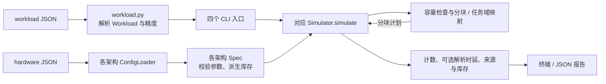
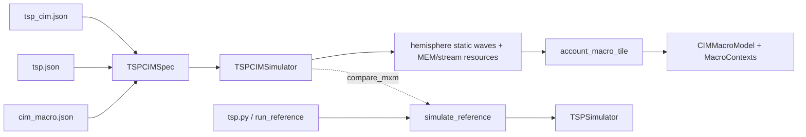
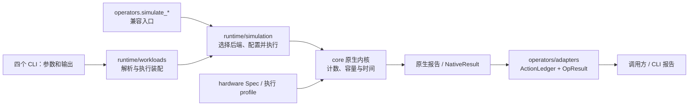

# 架构、参数与验收说明

整理日期：2026-11-18（America/Los_Angeles）。本文汇总当前本地实现；来源材料的原始版本日期和 Git blob 保持不变。

本文是四架构及共享 CIM Macro 的现行技术说明。安装与运行见 [README](README.md)，参数来源核验结果见[核验结论](#source-audit)及[逐项证据台账](calibration/parameter_source_audit.json)。参数的完整元数据以链接的 JSON 为准；本文中的未知项、假设和执行范围与代码对应。

- [四个仿真器的代码结构](#simulator-structure)
- [四套执行路径字符框图](#execution-diagrams)：[Ascend](#diagram-ascend)、[TPU](#diagram-tpu)、[原生 TSP](#diagram-tsp)、[CIM-TSP](#diagram-cim-tsp)、[粒度对照](#diagram-comparison)
- [共同约定与报告口径](#conventions)
- [算子契约与 GEMM 适配（Issue #3 第一批）](#operator-contract)
- [独立 Vector / Nonlinear（Issue #3 第二批）](#vector-operators)
- [RMSNorm / Softmax（Issue #3 第三批）](#normalization-operators)
- [Residual / SwiGLU / FFN（Issue #3 第四批）](#decode-blocks)
- [Decode Attention / GQA 与 KV Cache（Issue #3 第五批）](#decode-attention)
- [Ascend 910](#ascend)
- [TPU v4](#tpu)
- [原生 TSP](#tsp)与[完整参数来源表](#tsp-parameters)
- [共享 CIM Macro 模型](#cim-macro)
- [CIM-TSP Core / Cluster / Plane](#cim-tsp)
- [文件组织与迁移](#migration)
- [验证与 issue #2 状态](#validation)
- [待确认参数与后续工作](#remaining)

<a id="simulator-structure"></a>

## 四个仿真器的代码结构

当前有四个独立 Python 仿真器类，分别服务 Ascend、TPU v4、原生 TSP 和 CIM-TSP。它们共享 GEMM 任务定义，按各自硬件边界进行分块和统计；没有统一的 Simulator 基类或公共事件调度器。下图表示共同的职责分层，具体实现仍由各入口选择。



### 从入口到结果的调用链

以下调用链描述原生 GEMM：四个入口构造硬件规格和任务，再调用仿真器；分块函数由 `simulate` 内部调用。`src/hardware` 负责描述和检查规格，`src/core` 负责分块与执行统计，`src/utils` 负责配置、任务解析和报告展示。Issue #3 的执行编排和统一结果适配见下方[算子执行分层](#operator-layering)。

`src/core` 的四个架构包均含 `simulator.py`。Ascend、TPU、原生 TSP 使用各自的 `tiling.py`；CIM-TSP 在 `hemisphere.py` 中完成静态任务域映射，并复用原生 TSP 的驻留容量检查。`cim` 是 CIM-TSP 的支持包，保存 `macro_model.py` 和 Macro 聚合函数所在的 `simulator.py`，没有独立场景或 CLI。`tests` 对应四架构及 Macro 支持模型，跨架构检查归入 `tests/common`。硬件和工具层每种职责通常只有一个文件，继续采用架构前缀命名；详细位置与迁移关系见[目录迁移表](#directory-migration)。

| 仿真器 | 入口及规格装配 | 执行与分块 | 输出 |
|---|---|---|---|
| Ascend | [ascend.py](ascend.py) → [AscendConfigLoader](src/utils/ascend_config.py) → [AscendSpec](src/hardware/ascend.py) | [AscendSimulator.simulate](src/core/ascend/simulator.py) → [make_plan](src/core/ascend/tiling.py) → [Schedule](src/core/ascend/schedule.py) | [ascend_report](src/utils/ascend_report.py)，报告 schema 12 |
| TPU v4 | [tpu.py](tpu.py) → [TPUConfigLoader](src/utils/tpu_config.py) → [TPUSpec](src/hardware/tpu.py) | [TPUSimulator.simulate](src/core/tpu/simulator.py) → [make_plan](src/core/tpu/tiling.py) | [tpu_report](src/utils/tpu_report.py)，报告 schema 13 |
| 原生 TSP | [tsp.py](tsp.py) → [run_reference / simulate_reference](src/utils/tsp_reference.py)；runner 使用 [TSPConfigLoader](src/utils/tsp_config.py) 构造 [TSPSpec](src/hardware/tsp.py) | [TSPSimulator.simulate](src/core/tsp/simulator.py) → [TSPTilingEngine](src/core/tsp/tiling.py) | [tsp_report](src/utils/tsp_report.py)，报告 schema 10 |
| CIM-TSP | [tsp_cim.py](tsp_cim.py) → [TSPCIMConfigLoader](src/utils/tsp_cim_config.py) → [TSPCIMSpec](src/hardware/tsp_cim.py) | [TSPCIMSimulator.simulate](src/core/tsp_cim/simulator.py) → [半片调度](src/core/tsp_cim/hemisphere.py) → [account_macro_tile](src/core/cim/simulator.py) → [CIMMacroModel / MacroContexts](src/core/cim/macro_model.py) | CLI 直接输出 JSON，报告 schema 10 |

Ascend/TPU 的 `simulate` 直接接收 `Workload` 对象；TSP/CIM-TSP 内核接收 `M,K,N` 与策略参数，外层 runner/CLI 补回完整的 workload 元数据。四者返回普通字典，统一指标定义不意味着报告 schema 或 API 完全相同。

执行路径、复用状态和时间颗粒度统一在下方的[四套框图](#execution-diagrams)与[粒度对照](#diagram-comparison)中维护。代码调用链与硬件数据路径分开阅读；统一报告语义不意味着四者使用同构调度器。

### 配置依赖与公共实现

Ascend、TPU、TSP 各加载一份自身的参考配置。CIM-TSP 的规格由三份配置组合：`tsp_cim.json` 提供替换后的 Core/Cluster/Plane 与 NIM/LW 设计，`cim_macro.json` 提供 Macro，`tsp.json` 提供共享 MEM、lane、stream、VXM、clock 规格及原生对比基线。Loader 解析引用，`TSPCIMSpec` 检查跨配置几何和 stream 预算一致性。



- [workload.py](src/utils/workload.py) 统一 `A[M,K] × B[K,N]`、INT8/INT32 约定、精度覆盖与路径解析；[dataformat.py](src/hardware/dataformat.py) 提供格式定义。
- [parameters.py](src/hardware/parameters.py) 的严格字段校验被 TSP、Macro、CIM-TSP 共用；Ascend/TPU 各自保留参数类及校验规则。
- [macro_model.py](src/core/cim/macro_model.py) 是 CIM-TSP 唯一的 Macro 动作实现；[simulator.py](src/core/cim/simulator.py) 的 `account_macro_tile` 为半片内各计算域统一处理 context 复用和局部动作聚合；独立单域执行路径已删除。该文件并不是四架构的统一调度器。
- [tsp_reference.py](src/utils/tsp_reference.py) 确保独立 TSP 与 CIM 原生对比使用同一个 `TSPSimulator`。半片比较共享实际 MEM/stream 分配及 M 分组；报告解析周期比并列明策略差异，speedup/energy_ratio 为 null。
- [parameter_source_audit.json](calibration/parameter_source_audit.json) 与对应回归绑定配置版本、参数证据和核验判断；审计台账不参与运行期性能计算。

四个仿真器均不持有真实 A/B/C 数组，不执行数值 GEMM，也没有整片任务调度、逐周期资源争用或完整能耗/面积求解。推荐读代码时从各入口的 `main` 开始，依次看 Spec、`simulate`、tiling，最后看报告和测试；详细算法与限制见后续各架构章节。

<a id="operator-contract"></a>

## 算子契约与 GEMM 适配（Issue #3 第一批）

[src/operators](src/operators) 在现有执行内核上增加公共描述与结果视图。`types.py` 定义 `TensorSpec`、`OperatorSpec`、`OpResult`；`actions.py` 定义 Action ledger；`primitives.py` 提供 `Gemm` 与 `simulate_gemm`；`adapters.py` 显式映射四架构现有报告。四个 CLI 的 `--report-format operator` 输出精简 JSON 和终端摘要；默认 `legacy` 保持原行为。原生报告 schema 仍为 Ascend/TPU/TSP/CIM **12/13/10/10**；统一结果独立使用 schema **2**；详细诊断独立使用 `operator_details` schema **1**。

接口组织参考 [LLMCompass_mod 固定提交](https://github.com/pku-pacific-lab-team/LLMCompass_mod/commit/98e79ee5b34991f09c65efe395e1e84d58589fab) 的 Tensor、算子形状描述与 OpResult，不引入其运行依赖、硬件模板、公式或能耗系数。原生 Simulator 仍是映射、容量检查、动作计数和时间的唯一执行来源。第一批无需新增硬件参数、改变硬件 schema 或更新参数来源台账。

<a id="operator-layering"></a>

### 算子执行分层

GEMM、Vector 和归一化的公共 Python 入口均保留在 `src.operators.simulate_*`，签名不变；它们将执行委托给 [runtime/simulation.py](src/runtime/simulation.py)。后端注册表 [runtime/backends.py](src/runtime/backends.py) 统一检查架构与 Spec 的对应关系，并选择原生 GEMM Simulator、Vector 内核或归一化内存路径。



职责按以下边界分开：

- `utils/operator_workload.py` 只把 workload 字典解析为算子描述；`runtime/cli.py` 处理 CLI 选项兼容性、展示和输出路径；`runtime/workloads.py` 装配解析、profile 和硬件加载，不打印或写结果文件。
- Vector/归一化内核返回 [NativeResult](src/core/operator_result.py)，包含原生报告和动作元数据；[adapters.py](src/operators/adapters.py) 将其包装为统一结果，不重新计算周期或动作数量。原生 GEMM 仍返回原有字典。`core` 不导入 `operators` 或 `runtime`。
- [composite_memory.py](src/core/composite_memory.py) 显式定义 `MemoryPath`、`LocalMemoryPath` 和 `ResidentMemoryPath`。各架构工厂在构造时填写字段；存储校验通过 `MemoryKind` 和临时容量接口区分路径，不再依赖动态挂载属性或 `hasattr(local)`。
- [vector_resources.py](src/core/vector_resources.py) 集中计算 Vector 与归一化共用的 HBM/本地带宽以及 MEM/stream 分配。两类内核保留各自的搬运顺序、容量公式和调度。CIM 的 Vector/归一化继续复用原生 TSP 路径。

四个 CLI 的原生 GEMM 路径保持原有入口；选择 Vector/归一化后走 runtime 分支，Ascend 不再为取得 Spec 而构造 GEMM Simulator。分层重构保持硬件配置、计算公式和调用入口；后续报告精简将统一结果迁移至 schema 2，原生报告 schema 和默认输出路径不变。验收仍按 Issue #2 / #3 分开；[分层回归测试](tests/operators/test_layering.py) 对照报告精简前 64 组 API 的原生结果、算子描述和完整动作语义，并检查依赖方向与适配结果的隔离。

### 类型、执行和结果

- `TensorSpec(name, shape, dtype)` 描述逻辑存储字节；维度只接受正整数，空 shape 表示标量。支持 INT8/INT32/FP16/BF16/FP32 的存储描述，不分配数值数组，也不放宽旧 GEMM 精度检查。
- `Gemm(M, K, N)` 或 `Gemm.from_tensors(A, B)` 仅执行二维 INT8 输入、INT32 累加与输出。前者默认 A/B/C，后者检查 K 一致性并保留调用方 Tensor 名称；可用 output_name 显式命名输出。适配原生报告时验证维度一致，原生 GEMM 报告保持不变。尚未实现 INT8 输出转换或批量 GEMM；独立 Vector 见下一节。
- `simulate_gemm(task, architecture, spec, mode="count", **policy)` 接受 ascend/tpu/tsp/tsp_cim，检查 Spec 与架构匹配后调用原内核。分块/缓冲等 policy 原样传递，非法选项、容量不足和必需参数缺失不回退为默认维度或零时间。
- `adapt_gemm_report(architecture, report)` 可适配已运行的报告，验证原生模型、版本、范围、GEMM 逻辑工作量和完整动作集合。新增/删除动作或原生 schema 变化时需要重新审阅映射，不能静默漏计。
- `OpResult` 直接提供 `latency_s`、`cycle_count`、`timing_status`、算子描述、边界、工作量、资源需求和动作账本。`to_dict()` 导出 schema 2；`action_counts` 只出现一次，不内嵌原生报告、完整配置或来源台账。
- `resource_requirements` 每个资源只记录 `scope`、`required_bytes`、`capacity_bytes`、`requirement_basis` 及适用的 bypass 模式。分配/驻留/补齐/逻辑载荷的依据原样标明；各层容量不合池、不求和。没有容量信息时为 null。
- `latency_s=time_ns/1e9`，`cycle_count` 保持原生总周期。count 为 `not_evaluated`，缺时钟但能计算周期为 `cycles_only`，完整计时为 `analytical_estimate`。能耗保持 `not_evaluated`，不使用 LLMCompass 的能耗系数。
- `simulate_gemm/vector/composite(..., include_details=True)` 和 `adapt_gemm_report(..., include_details=True)` 才保留原生快照。此时 `native_report` 返回隔离副本，`to_detailed_dict()` 导出独立诊断，含原生报告、完整 io_contract 和动作来源；SHA-256 绑定规范化的精简结果。默认访问未保留的详细数据会明确报错。
- CLI 用 `--details-output PATH` 显式选择详细文件。精简结果和详细文件独立写入；终端仅打印任务、时间、资源和计数。批量脚本的 `-Details` 只对 Issue #3 生效；其 CSV 汇总按架构与算子分行，资源与动作保持分项，失败行不读取旧报告。

schema 1 → 2 的读取迁移：`latency.latency_s/cycle_count/status` 改为顶层 `latency_s/cycle_count/timing_status`；`action_ledger.entries/grouped_counts` 改为按动作 ID 索引的 `action_counts`；`resource_requirements.memory` 改为紧凑的资源表。`io_contract` 可通过 `src.operators.connections.io_contract(result)` 按需生成，连接检查直接使用精简结果，不要求详细快照。调度、执行策略、来源、比较/扫描结果在详细文件的 `native_report` 内。调用入口不变，旧 JSON 消费者需要按 schema 2 迁移。

### Action ledger 的计数口径

每条记录携带 architecture、component、name、category、count、unit、dtype、scope、basis、原生字段 JSON pointer 和原始依据。basis 使用 logical/padded/modeled_internal；原字段没有逐项 basis 的 TSP 使用明确的 K/N 和 stream 补齐规则。适配层逐条保留原动作的数值、单位和范围，不把逻辑载荷升级为物理 bank/DRAM 事务。

| 来源 | 映射原则 |
|---|---|
| Ascend `cube_mac`、原生 TSP `mxm_mac` | padded MAC；保留尾块发出工作 |
| TPU `matrix_mac` | logical MAC；补齐发出工作仍在 `work_counts.issued`，不凭空增加物理 MAC 动作 |
| CIM `issued_mac` / `useful_mac` | 前者为 padded action，后者为 logical reference，仅前者进入动作汇总 |
| CIM 四项 `logical_*` 别名 | summary 引用原动作并校验计数，汇总时排除，避免重复统计 |
| Ascend L1→L0A/B、L0C→UB | 保留 onchip_transfer 路径，未补造 SRAM 端点读写次数 |
| TSP/CIM stream | interconnect 指本侧片上 stream；不包含 C2C 或片外供给 |
| CIM 内部动作 | 保留 Macro 独立计数；局部加法树及移位累加的内部操作位宽未指定，dtype 标为 unspecified，不套用最终 INT32 输出位宽 |

`ActionLedger.grouped_counts()` 只合并架构、组件、动作名、类别、单位、精度、作用域、basis 和 attributes 全部一致的 action。适配记录以 `native_action` attribute 保留各阶段身份。重复 ID/来源和不一致的 summary 被拒绝；reference/summary 不进入汇总。未知计数必须是 `unavailable + null`，不能用零替代，且任何未知贡献使对应汇总保持未知。

ledger 与其 grouped_counts 也是同一工作量的两种视图。Macro 的复合动作与内部 primitive 虽然分别列出，但不是可以全部累加的能耗项；Issue #5 接入系数时仍需声明不重叠的计费边界。本批不加载系数，energy 保持未评估。缺少某类动作不表示该硬件活动为零；`coverage` 明确 TSP/CIM 片外供给在边界外，所有架构均未提供物理存储事务。

### 第一批验证范围

`tests/operators` 覆盖 Tensor 字节与精度、ledger 单位/来源/别名、四架构小 M 和尾块/跨 K GEMM 的 count/timing 原生对账、策略透传、超容量/缺参、缺时钟周期结果、CLI 默认兼容及失败时保护输出。算子独立验证使用 `python scripts/verify_issue3.py`，全仓库回归另行使用 `python -m unittest discover -s tests -t . -v`。

Issue #3 使用[独立覆盖清单、证据目录和判据](validation/issue3/README.md)，不读取或续用 Issue #2 的 A1/A5 审阅。Issue #2 不再发现算子测试，算子专属文件不进入其语义审阅快照；共享入口、原生代码和本文仍属于共同依赖，修改后可能使旧审阅过期。独立 Vector/Nonlinear 已在第二批接入，第三批加入 RMSNorm/Softmax；其余复合块与目标模型覆盖仍列为未完成，不因本轮验证通过而宣称整个 Issue #3 完成。

新增执行 profile 的来源及哈希独立维护在 [operator_execution_audit.json](calibration/operator_execution_audit.json)，原生硬件台账及参数总数不包含这些策略。

### 接口收尾：语义、身份和连接边界

统一结果 schema 1 增加 `operator.attributes` 和 `io_contract`，属于可选扩展信息的补齐；旧字段及原生报告版本不变。消费方应容忍新增字段，旧报告缺少 attributes/io_contract 时不能推断完整语义或边界。`OperatorSpec.attributes` 接受字典或键值对，验证键唯一、值为有限 JSON 标量，保存为排序后的不可变元组；导出复制为字典。RMSNorm/Softmax 把 -1 转为真实正轴，RMSNorm epsilon 规范化为 float，因此同义轴表示相等，不同 epsilon 可区分。描述可作为节点语义键，但仿真结果缓存还须包括架构、硬件/执行 profile、mode 与全部策略覆盖。

所有可执行 Python 算子支持 output_name，默认名称会避开输入，显式重名拒绝；GEMM from_tensors 保留输入名字。Vector/复合 workload 接受 output_name，既有 GEMM workload 继续使用原解析器。Tensor 名称只在单次调用内有效，图层需要节点限定名；连接按显式端口索引建立，不从同名、相同形状或相同架构推断物理别名。

`src/operators/connections.py` 按需生成的 io_contract 记录每个端口的 dtype、shape、逻辑 bytes、HBM/local_MEM 边界、作用域和已知 hemisphere。Ascend/TSP/CIM GEMM 保留 native_packed 标签，不把补齐或打包隐藏成逻辑稠密布局；TPU GEMM 与 Vector/复合块使用 logical_dense。物理设备 ID 未知，不承诺跨调用的 UB/VMEM/寄存器保留。

`plan_connection` 仅给一个拟连接边生成需求描述：形状不同拒绝；精度不同返回 required_unmodeled 转换；native_packed 或布局差异需要布局核对；架构、存储层或已知 hemisphere 不同需要传输模型；其他情况仍需确认设备和分配。INT32→FP32 及 FP32→INT8 不默认做 cast/dequant/requant，也不假设 scale/rounding。报告两端逻辑载荷大小供后续规划，不能直接加为动作或峰值容量；新增时间、动作、能耗均为 null。现有独立块已经记过边界访问，连接检查不扣除这些流量，不模拟图执行，也不把未建模工作当作零。

<a id="vector-operators"></a>

## 独立 Vector / Nonlinear（Issue #3 第二批）

支持 `int32_add`、`fp32_add`、`fp32_mul`、`fp32_exp`、`fp32_rsqrt` 五种操作。`Vector` 描述形状和输入数，`simulate_vector` 选择各架构独立路径。现有硬件 Spec 的 compute-only 服务不变：独立执行内核将搬运、局部存储访问和分块串接在服务外层。CIM 直接复用原生 TSP 路径，使用一个 VXM 任务预算，不乘半片数或 domain 数。没有实际浮点求值、数值域检查、广播、归约、量化转换和复合块融合。

### 配置与来源

新增 `src/hardware/vector.py` 解析独立 [Vector 执行 profile](configs/execution/vector.json)，当前 schema 2，兼容 schema 1 的独立 Vector。其 policies 分别定义 Ascend、TPU 和原生/CIM 共用的 TSP 策略，明确逐块逐阶段串行、1024 元素默认块、读写启动和计算启动各 0 cycle。零是显式省略固定延迟，不表示实测零延迟。schema 2 增加下节的 composite 策略，不改变已有 Vector 或 GEMM 的执行公式、硬件 schema 和参数值。

唯一新增带宽参数为 Ascend UB read/write，各 256 B/cycle，status=assumed。取每周期 64 个 32-bit 字（64×4=256）的服务代理，量级参考已有单核 Vector 预算；不声称是公开硬件端口规格。它是固定独立参数，不随 Vector compute budget 自动缩放，也不表示读写可以同时叠加。DMA 对 UB 和 HBM 同时预约，以较慢端为周期下限。来源、条件和配置哈希记录在 `calibration/operator_execution_audit.json.vector_execution_profiles`，与原有硬件参数数量分开。

其余参数复用所选 Spec：Ascend 单核 HBM 份额、TPU 单 TensorCore HBM 份额及 VMEM 服务、TSP MEM slice 读写及方向 stream。计算代价复用 INT32 ADD=1、FP32 ADD/MUL=1、EXP=15、RSQRT=12 的现行配置值；用户修改硬件配置后直接生效，未在 Vector 内硬编码这些值。完整使用的硬件 provenance、执行 profile、profile hash 与实际 tile 保留在报告。

### 计数、容量与时间公式

设元素数 E、输入数 a（一元为 1、二元为 2），每元素均为 4 byte。逻辑输入字节为 4aE，输出为 4E，逻辑算术动作数为 E。EXP 的 15 倍代价只用于计算占用，不产生 15E 次 EXP action。`work_counts.issued.operations=null` 明确尚无 SIMD 指令发出/尾部算术门控模型。

Ascend/TPU 检查完整输入输出 HBM 占用 `4(a+1)E`；局部块大小为请求上限、E、`floor(local_capacity/[4(a+1)])` 的最小值，零容量块报错。输入与输出分开分配，不假设 in-place 更新。Ascend 经过 HBM→UB（L2 bypass），TPU 经过 HBM→VMEM（CMEM bypass）；每个块依次执行：

1. 每个输入 DMA：`ceil(4n / min(hbm_bpc, local_write_bpc)) + transfer_startup`。
2. 局部操作数读取：`ceil(4an / local_read_bpc)`。
3. 计算：调用原 Spec 对 n 个操作的加权周期估算，再加 compute_startup。
4. 局部结果写入：`ceil(4n / local_write_bpc)`。
5. 导出 DMA：`ceil(4n / min(local_read_bpc, hbm_bpc)) + transfer_startup`。

TPU 的 local_read/write 使用同一 VMEM 服务上限，阶段串行不会重复分配带宽。HBM 与局部存储的 DMA 端点动作分别计数，但同一 DMA 时间只计一次。HBM 份额和时钟只影响本核服务，不把计算量乘硬件核数。

TSP/CIM 检查完整输入输出按选定 slice 均匀条带化后的驻留量：每个 tensor 每 slice 为 `ceil(4E/slices)`，reserved 同样向上取整。减小 Vector tile 不能解决完整驻留容量不足。MEM action 计逻辑载荷；每个块的 stream 字节为 `align_up(4n, stream_width_bytes)`，显式假设尾组用掩码/填充值承载，不额外读取或分配 MEM。每个输入搬运时间为 `max(ceil(4n/MEM_read_bpc), ceil(padded_bytes/stream_bpc)) + startup`，然后计算，最后使用 MEM_write 和输出 stream 的相同公式写回。读写及不同输入在本版串行；不跨方向加算带宽，不新增 VXM 寄存器容量或将 MEM 块重复分配为一份完整工作集。

所有块串行；完整块以次数聚合，尾块独立计算，不生成与元素数成正比的事件列表。`service_cycles` 和 `elapsed_cycles` 的分项在本串行策略下相同，均求和为 total_cycles；它们和 ledger/grouped_counts 是不同视图，不重复计费。所需带宽或当前操作服务缺失时 timing 拒绝，count 仍可统计字节与动作。未用的 Cube/MXU/MXM、其他 Vector 操作成本、L2/CMEM 服务不成为本算子的 timing 必需项。TSP 的 B/cycle 参数在缺时钟时仍允许 cycles_only；Ascend/TPU 换算 B/s 需要时钟。

### 接口与验证

`src/utils/operator_workload.py` 严格解析 schema 1 的 `{operation: "vector", op, inputs}`，每个 input 必须有 name/shape/dtype；未知字段、类型、重复名字、形状不一致和广播请求拒绝。新 CLI 参数为 `--vector-config`、`--vector-tile-elements`。Vector 固定采用 operator JSON，显式旧报告格式及 GEMM 专用选项拒绝；GEMM 默认行为不变。TSP 保留 mem-slices/streams/reserved-bytes，CIM 还保留 hemisphere 选择。默认 profile 相对于配置目录查找，缺文件不回退；API 可传入已验证的 VectorExecution。

`tests/operators/test_vector*.py` 覆盖五种操作×四架构、矩阵/宏执行隔离、1025 元素尾块、手算阶段周期、输入输出/stream 字节守恒、局部容量回退与完整驻留容量拒绝、共享预算、缺参/缺时钟、启动开销、profile 来源哈希、CLI 选项与失败输出保护。参考小例中，17 个 FP32 ADD 元素、tile=8、4 op/cycle、HBM=16 B/cycle、local=32 B/cycle，Ascend/TPU 为 28 cycle；TSP 使用单 slice 读写 16 B/cycle、单 stream，得到 20 cycle。这是合成测试参数，不能作为四架构速度对比。

<a id="normalization-operators"></a>

## RMSNorm / Softmax（Issue #3 第三批）

`src/operators/composite.py` 提供 `RMSNorm(x, weight, epsilon=1e-5, axis=-1)`、`Softmax(x, axis=-1)` 和 `simulate_composite`。只接受非标量 FP32，axis 为最后一个轴（可用 -1 或对应正索引）；设最后轴宽 D，前导维度乘积 R，总元素 E=RD。RMSNorm weight 必须为 `[D]`，且名字与 x 不同；输入输出不别名。算法不求实际张量值，不检查浮点数值域，不含 Softmax mask、转换、任意广播或布局指令。

### 算法、工作量与依赖

- RMSNorm：`y = x * rsqrt(sum(x*x)/D + epsilon) * weight`。每行先分块平方、SUM 归约及合并；随后均值缩放、epsilon 加法、RSQRT；最后重读 x 并应用行标量与 weight。
- Softmax：`y = exp(x-max(x)) / sum(exp(x-max(x)))`。第一遍求行 MAX；第二遍重读 x，减最大值、EXP，把指数值写入输出区，同时求行 SUM；求一次行 RCP 后，第三遍读取输出区并乘倒数。

| 算法 | 逻辑 FP32 算术计数 |
| --- | --- |
| RMSNorm | MUL=3E+R，ADD=E（归约 E-R 加 epsilon R），RSQRT=R，总计 4E+2R |
| Softmax | MAX=E-R，SUB=E，EXP=E，ADD=E-R，RCP=R，MUL=E，总计 5E-R |

D=1 时不产生 MAX/SUM 算术，但仍计算声明的归一化公式，不做常量折叠。`1/D` 和 epsilon 是隐式标量常数；均值仅计一次 MUL，无运行时 RCP。EXP/RSQRT/RCP 的等价工作量不能再当成额外 EXP 等动作重复入账。

归约每块采用平衡二叉树：每层对 q 个存活值做 `floor(q/2)` 次操作，下层剩 `ceil(q/2)` 个。奇数尾值保留原位置，采用存活索引描述，不假设免费复制成连续数组；所计读取仍是逻辑载荷，不能作为物理 bank transaction。每块最后的部分结果按 tile 顺序合并到行状态，第一块只初始化状态，后续各做一次二元合并。全行恰好 D-1 次归约操作。树层和合并串行等待前驱；每轮 compute 时间为 `max(ceil(pair_count*cost/shared_budget), reduction_round_cycles)`，再加显式 compute startup。局部读写另计，不能用整个归约操作数一次除吞吐替代依赖。

schema 2 的 `composite.parameters` 新增四个 assumed 参数：SUB=1、MAX=1、RCP=7 equivalent_op/op，归约依赖下限=1 cycle。RCP 的 7 是“一个种子等价操作 + 两次各 2 MUL/1 SUB 的 Newton 风格更新”工作代理，不实现种子或数值算法，不承诺精度及原生指令延迟。SUB/MAX 也未标定。新操作与已有 ADD/MUL/EXP/RSQRT 共用 Spec 的 Vector/VXM 预算，不增加 SFU 或按库存复制吞吐。参数来源与配置哈希另存于 `vector_execution_profiles.composite_parameters`；原硬件参数台账不变。未用成本可为 unknown/null，count 无需速率，timing 仅要求实际执行的服务。

### 存储与架构映射

`src/core/composite.py` 保存每行、每遍、每类块的高层执行图；`src/core/{ascend,tpu,tsp,tsp_cim}/composite.py` 分别选择本架构服务、容量和边界。RMSNorm 与 Softmax 不调用独立 Vector 的 HBM-to-HBM 仿真接口，也不调用 GEMM 或 Macro。所有行、块及阶段串行；相同块用重复次数表示，计算量不随 batch 展开成巨量事件。

Ascend/TPU 仍使用 HBM→UB/VMEM 路径并绕过 L2/CMEM。DMA 时间取两个端点较慢服务，端点动作分别计数。算法阶段计局部操作数读、共享计算、结果写；多个局部操作数读取按总字节共享端口。行标量每块读 4 B，随后广播，不物化为 D 元素张量；额外 shuffle 服务未建模。

| 项目 | RMSNorm | Softmax |
| --- | --- | --- |
| HBM 完整输入输出容量 | 8E+4D B | 8E B |
| HBM 读流量 | 12E B（x 两次、weight 每行一次） | 12E B（x 两次、指数值一次） |
| HBM 写流量 | 4E B | 8E B（指数值和最终输出各一次） |
| UB/VMEM 工作集，实际 tile=t | 8t+4 B：两块缓冲及一个行状态 | 4t+8 B：一个可复用块缓冲及两个行状态 |

RMSNorm 的第一遍两个块槽用于 x/平方与归约，第二遍复用为 x/输出和 weight；行和、均值、缩放量重用一个标量槽。Softmax 先导出指数值，再破坏性归约本地块，因此归一化时重载的指数值仍完整。MAX 和 SUM 在第二遍同时存活，RCP 后复用 SUM 槽。HBM 容量保存 weight 一份，但本版本不保留跨行局部 weight cache，因此按 R 次读流量计。请求块上限可被局部容量缩小，连一个元素及标量都放不下时拒绝。

TSP/CIM 原始 x、weight、输出直接驻留选定本侧 MEM，load/export 不增加伪 DMA；每个算术阶段的实际逻辑读写经 MEM/stream 计数。每个读或写操作数分别按 stream 宽度补齐，时间为 `max(ceil(logical_bytes/MEM_bpc), ceil(padded_bytes/stream_bpc)) + transfer_startup`；不同操作数及方向串行。中间平方、移位值和树部分和写入一个 4t B 可复用 MEM 临时块，行状态另占 4/8 B；Softmax 指数值直接使用输出分配。总驻留要求为完整输入输出 + 临时块 + 行状态 + reserved；每份分配分别按 slice 向上取整。空间不足先缩小临时块，完整驻留加一个元素临时块仍不足则报错，不虚构片外分页或 VXM 寄存器容量。CIM 仅复用同一个原生 VXM，报告不产生 Macro MAC/编程动作。

### 报告、迁移和验证

统一 OpResult schema 仍为 1。workload 保留 axis/rows/width/epsilon，schedule 的 groups_per_row 展示阶段顺序与块重复次数，memory.lifetimes 说明缓冲复用。算术和存储 action 都汇总为不重复的逻辑账本，计数与阶段视图不能相加；issued operations 保持 null，不声明指令或物理事务。硬件配置 schema 不变；旧 Vector profile schema 1 可继续运行独立 Vector，复合块明确拒绝，迁移须新增完整 composite 元数据并升至 2。

schema 2 的 composite 必须为完整字典，null 不再等同于 schema 1 的缺省。复合执行在生成结果前调用 `src/core/composite_storage.py` 验证符号生命周期：局部 DMA 必须先于读取；归约逐层保留奇数存活值；行状态只能在初始化后读取；指数值在本地被归约覆盖前必须完成 HBM 导出；完整一行指数值保存后才能归一化；临时活跃字节不能超过声明分配。重复块检查首轮和稳定轮并保持次数聚合，不展开每个元素。memory.lifetime_validation 保存检查结果与临时峰值，这仍不是物理地址或 bank 校验。

独立手算固定 D=7、tile=4（尾块 3）、共享预算 4 op/cycle、HBM=16 B/cycle、UB/VMEM=32 B/cycle、单 MEM slice=16 B/cycle、stream=320 B/cycle、启动 0。两块均有两层归约，第二块额外合并一次；EXP 两块分别占 15/12 cycle。

| 手算项目 | RMSNorm | Softmax |
| --- | --- | --- |
| Ascend/TPU 分阶段周期 | sum_squares 25 + normalizer 11 + apply 18 = 54 | max 19 + exp/sum 58 + rcp 4 + normalize 10 = 91 |
| TSP/CIM 分阶段周期（同原生服务配置） | sum_squares 24 + normalizer 11 + apply 16 = 51 | max 18 + exp/sum 57 + rcp 4 + normalize 8 = 87 |
| 算法局部存储/MEM 读、写 | 184 / 124 B | 208 / 144 B |
| HBM 读、写（Ascend/TPU） | 84 / 28 B | 84 / 56 B |
| stream 输入、输出（TSP/CIM） | 6400 / 4800 B | 8000 / 6080 B |

上述局部字节不含 DMA 端点，Ascend/TPU 还分别计输入 DMA 本地写与导出 DMA 本地读；TSP/CIM 没有这部分 HBM/DMA 动作。测试逐项对照固定手算账本并校验阶段汇总；另将 transfer startup=2、compute startup=3，RMSNorm 得到 Ascend/TPU 112、TSP 163 cycle，Softmax 为 162/226 cycle。测试通过故意交换归一化/指数阶段、删除初始化或 DMA、错写奇数存活数、延后指数导出及缩小声明临时区，验证生命周期错误会被拒绝。

`tests/operators/test_composite*.py` 覆盖四架构的两个块、手算单元素周期/访问、D-1 归约守恒、尾块及跨块依赖、batch/head 缩放、临时空间回退和全驻留容量边界、缺参/缺时钟、原生/CIM 一致性、严格 CLI 与 schema 迁移。第四批的 Residual、SwiGLU/FFN 见下节。Attention/GQA、KV Cache、MLA、MoE 和目标模型的块覆盖矩阵仍待完成；完整模型拼装与端到端评估属于 Issue #4。

<a id="decode-blocks"></a>

## Residual / SwiGLU / FFN（Issue #3 第四批）

`src/operators/blocks.py` 定义形状和存储类型；`src/runtime/blocks.py` 展开子块、分配符号存储并组合结果；`src/core/block_schedule.py` 检查拓扑与张量生命周期；`src/core/block_elementwise.py` 将点算阶段映射到既有 Vector/VXM 和显式 MemoryPath。core 不依赖公共 operators/runtime 层。组合调度保持串行，原生 GEMM 内部允许原有流水重叠，不改变既有 GEMM、Vector、RMSNorm/Softmax 的数值模型。

| 块 | 输入/输出存储 | FP32 算法工作 |
| --- | --- | --- |
| Residual | 两个同形状 INT8 或 FP32，输出同类型 | 每元素一次 ADD |
| SwiGLU | gate/up 同形状、同类型 INT8/INT32/FP32；输出 INT8 或 FP32 | `silu(gate)*up`：每元素 3 MUL（含负号）、1 EXP、1 ADD、1 RCP |
| SwiGLUFFN | INT8 X[M,H]、Wg/Wu[H,I]、Wd[I,H]；INT8 Y[M,H] | 三个 GEMM 的有效 MAC 总量 `3*M*H*I`；SwiGLU 处理 M*I 元素 |

FFN 的依赖为 `gate=X*Wg`、`up=X*Wu`（INT32），`activation=SwiGLU(gate,up)`（FP32 计算后存 INT8），`down=activation*Wd`（INT32），最后经过块内存储边界写 INT8 Y。FFN 不含 bias、外部 Residual、RMSNorm 或其他 Decoder 层。形状、输入/输出别名和 dtype 不匹配均拒绝；内部张量名称避开全部边界名称。

### 存储边界、访问与时间

`configs/execution/blocks.json` 单独声明 `serial_materialized_nodes`、`persistent_inputs_reused_intermediates`、`symbolic_padded_views`。非 FP32 输入各有独立 FP32 tile 副本；SwiGLU 有一个 FP32 激活工作区，INT8 输出还有 FP32 结果工作区（FFN 最终转换直接复用其 FP32 副本）。这些工作区不重叠；tile 完成后复用。标量 -1/+1 为隐式常量，不分配完整常量张量。

INT8/INT32→FP32 每元素暂按 1 个等价基本操作，FP32→INT8 按 3 个（scale/round/clamp 工作量代理），RCP 按 7 个。参数均为 `assumed`，使用一个共享 Vector/VXM 预算，未标定；它们不是独立量化、反量化或 ISA 指令模型，不计算数值、scale、零点或舍入误差。转换前后的存储读写单独计入。边界动作使用 `element` 单位并保留 `modeled_internal`，不混进 FP32 算法 op 或 GEMM MAC 计数。count 可以保留未知成本；timing 仅在实际用到未知成本时拒绝。来源和配置哈希记录在 `calibration/operator_execution_audit.json`。

Ascend/TPU 点算经过 HBM→UB/VMEM→HBM；DMA 同时预约两端并取最小服务率，读取、计算、写回分阶段串行。TSP/CIM 数据驻留本侧 MEM，每次访问同时约束 MEM 与方向 stream，后者按完整 stream 宽度补齐；CIM 不额外复制 VXM。既有 Vector profile 提供 tile 上限、固定启动项和 Ascend UB 代理。每个阶段分别向上取整后按 tile 次数累加，不能先合并全部元素再只取整一次。

子块输出全部物化，保留原生 GEMM 的冷缓存假设；相邻子块的写与读是两个不同动作。父块仅给子块 action ID 加节点前缀，保留原始单位、dtype、basis、role 和 summary 引用，不新增通用“边流量”。总周期为各子块 elapsed 周期之和；service 分解只有在所有子块均有该分解时提供，不能将 GEMM 内部重叠服务当作 elapsed 相加。详细文件保留每个子块的原生报告、配置及来源，精简 OpResult 仍为 schema 2。

### 容量与可验证边界

每个输入与权重在整块期间常驻；中间张量从产生时到最后一个消费者结束时存活，输出在生产阶段即占空间。每个张量只分配一次，大小取逻辑载荷与所有原生 GEMM 角色补齐要求的最大值：Ascend 为 M16/K32/N16，TPU 为逻辑尺寸，TSP 为 K/N supercell，CIM 的 N 进一步遵守 Macro 块尺寸。`symbolic_padded_views` 表示同一分配的符号视图，并不验证物理地址布局或免费实现真实转置；跨独立结果的连接规划仍要求布局核验。

TSP/CIM 每个张量和用户 reserved 分别按选中 slice 数向上条带化，点算 scratch 为一个有不相交子区间的条带化池。逐节点检查活跃张量+reserved+scratch，GEMM 收到的 reserved 还包括其他存活张量。Ascend/TPU 检查 HBM 活跃峰值，UB/VMEM 等本地资源在串行节点之间复用，取节点峰值最大值；不得把不同存储层容量相加。HBM/MEM 不足直接拒绝，没有分页或片外供给补救。`memory.lifetime_validation` 提供各张量存活区间与逐节点峰值；这是符号容量检查，不是 bank、寄存器或物理地址验证。

手算用例：TPU 的 M=2/H=17/I=7 FFN，常驻输入共 391 B，五阶段存储分别为 447、503、517、541、561 B，HBM 峰值 561 B；HBM 共读 687 B、写 296 B。Residual 的 7 个 INT8 元素在 UB=96 B、HBM=16 B/cycle、UB=32 B/cycle、共享预算=4 op/cycle、启动0时分 tile 6+1，周期 23+15=38，HBM 读14/写7 B，算法局部读98/写91 B，另计 DMA 端点。测试还检查原生 GEMM 对账、分支释放、全块容量失败、条带化、尾块、成本敏感性、未知参数、CIM/VXM 一致性及四入口错误路径。

执行保持单 AI Core、单 TensorCore 或单 hemisphere，`chip_execution_included=false`。将来整片调度须先定义 M/N 分片、共享/复制权重与输入、局部容量、跨核/半片归约和通信，再组合时间，不能直接以核数除单核时间。本批不实现整片调度。LLMCompass 指定提交仅作为 Operator/Tensor/OpResult 接口参考；本节算法及存储策略是本工程显式建模假设。

<a id="decode-attention"></a>

## Decode Attention / GQA 与 KV Cache（Issue #3 第五批）

`src/operators/attention.py` 定义 `KVCacheSpec`、`KVCacheAccess` 和 `DecodeAttention`；`src/runtime/attention.py` 绑定共享缓存、组合原生 GEMM/Softmax 和已有块级转换；`src/core/kv_cache.py` 只计缓存追加拷贝与流式读取；`src/runtime/composition.py` 汇总重复子块，同时保留 action role、来源和 summary 引用。新增配置 `configs/execution/attention.json` 明确预分配缓存、串行 Query head、无跨 head 读取复用和符号补齐视图，所有策略为 assumed。

算法语义核对 [Meta Llama 3 的 Attention 实现](https://github.com/meta-llama/llama3/blob/main/llama/model.py)及 [GQA 论文](https://arxiv.org/abs/2305.13245v3)：Query head 与 KV head 按组对应，缩放点积后做 Softmax 和加权 V。本工程只采用这些块级依赖；INT8 存储、资源映射、串行策略和时间服务均来自本项目显式假设，不复制参考代码的数值精度或硬件性能。DeepSeek-R1 基于 V3 架构（见其[官方说明](https://github.com/deepseek-ai/DeepSeek-R1)），MLA/MoE 单独登记为待补，不以普通 GQA 替代。

### 单 token 契约与工作量

记 B 为 batch、Hq/Hkv 为 Query/KV head 数、D 为 head dimension、S 为执行前有效长度、C 为预分配容量、a 为追加数（0 或 1），L=S+a。要求 Hq 可被 Hkv 整除，0≤S≤L≤C，Attention 中 L≥1。所有 batch 项使用相同长度，没有 Prefill、多 token、变长 padding mask、滑窗、缓存增长或淘汰。Q 与新 K/V 已完成投影和位置处理；输出仍按 head 分列，后续输出投影不在本块内。

每个 head 依次执行 INT8 `Q[1,D] * Kᵀ[D,L]`，将 INT32 scores 转为 FP32 并乘隐式常数 `1/sqrt(D)`，复用稳定 FP32 Softmax，将概率按块级代理存为 INT8，再执行 `P[1,L] * V[L,D]` 并将 INT32 context 经 FP32 边界存为 INT8。有效 MAC 总量为 `2*B*Hq*L*D`；矩阵基本 op 为其两倍。每个 head 的 Softmax 包含 MAX/ADD 各 L−1 次、SUB/EXP/MUL 各 L 次、RCP 一次，另有缩放 MUL L 次，所以非矩阵算法 op 为 `B*Hq*(6L−1)`。存储边界转换各有 `B*Hq*(L+D)` 个 to-FP32/to-INT8 元素，单列为 modeled_internal，不与算法 op 重复累加。

缓存有效载荷为 `2*B*Hkv*L*D` byte，逻辑预留容量为 `2*B*Hkv*C*D` byte，每轮追加写入为 `2*B*Hkv*D*a` byte，追加来源也读取同样字节数。独立缓存读取按每个 KV head 一次，Attention 默认按每个 Query head 冷启动，因此其有效 K/V 读取载荷为 `2*B*Hq*L*D` byte。实际原生 action 可能包含补齐、内部重读等开销；逻辑载荷是解释视图，不是可以再次加进账本的动作。

### 共享 backing 与容量

K/V 缓存按每个 batch/KV head 分开预留，大小覆盖容量 C 内最大的原生矩阵视图：K 供 QK 的 `[D,C]` 权重视图使用，V 供 PV 的 `[C,D]` 视图使用；各架构沿用原生 GEMM 补齐要求。TSP/CIM 每个 head 分配、Query、context、输入新 token 和 reserved 分别按选中 slice 条带化。实际读取只使用前 L 个位置，但未填充位置仍占预分配容量。

Query 与 context 为 B*Hq 个 head 的全局 backing；K/V 为 B*Hkv 个 head。`(b,h)` 映射到 `(b,floor(h/(Hq/Hkv)))` 的 K/V；视图本身不重复分配缓存。全局 Query、缓存和输出空间在块期间保留。追加时新 token 输入存活，追加结束后释放；随后只保留一个 head 的 scores、scaled scores、FP32/INT8 probabilities、INT32 context 临时区，并在各自最后一次消费后释放。重复整个 head 模板，不让不同 head 中间结果同时存活。TSP/CIM 将其他全局存储作为子块 reserved，Softmax 的行状态与 scratch 仍进入真实峰值检查。局部 UB/VMEM/CMEM 取串行子块峰值最大值。

K 的转置、head 切片和缓存追加偏移都是符号补齐视图，不证明真实地址布局、bank 行为或免费物理重排。状态输出为原 K/V 分配的新版本描述，`cache_state.output_aliases` 明确映射；`cache_after` 返回不可变长度元数据，不进行数值存储修改。缓存长度增长不会重写已有历史。`memory.lifetime_validation` 是验证证据，不是额外硬件资源；资源摘要已排除该元数据（同时修正第四批摘要中重复列出的这一项，计算、容量峰值和 action 不变）。

### 访问、时间及手算

独立 Cache 在 Ascend/TPU 使用一个可复用 UB/VMEM 传输块：追加为 HBM→本地→HBM，读取为 HBM→本地，无完整读出缓存副本。TSP/CIM 为 MEM→输入 stream 的读取，以及追加时 stream→MEM 的写入，瞬态转发寄存器未建模。各次传输按带宽和启动成本分别取整，再按 K/V head 次数累加。此过程没有 MAC、非线性或转换计算。Attention 内部只嵌入 append；后续 QK/PV 原生读写已包含缓存访问，不增加额外 cache-read 节点。

Attention 总时间为一次缓存追加，加上 B*Hq 次完整 head 模板的 elapsed 时间。原生 GEMM 内部保留既有流水；head 之间不重叠、也不保留冷启动缓存/权重上下文。重复模板报告给出节点的单次原生结果和 repetitions；所有父级 action 计数及角色引用同步乘重复次数。只有全部子块有 service 分解时才给父级 service 总和，elapsed 始终可按串行模板求和。能耗系数未接入。

独立手算样例 B=2、Hq=4、Hkv=2、D=7、S=5、C=9、a=1：L=6，有效 MAC=672，非矩阵 op=280；追加56 B，独立 cache-read336 B，Attention 有效 K/V 读取672 B。TPU 逻辑 HBM 总读写为2016/1152 B：每个 head 读 `5D+2LD+21L`、写 `5D+17L`，另加追加读写各56 B。全局 Query/K/V/context 共616 B，追加阶段峰值672 B；六阶段存储分别为640、664、664、646、650、644 B。

Cache 手算取 HBM或所选单 MEM slice=16 B/cycle、本地32 B/cycle、启动0：每个 K/V head 追加7 B读写各1 cycle，读取42 B用3 cycle，8个 K/V head 总40 cycle。测试进一步覆盖空缓存首次追加、满缓存拒绝、只读 MHA/GQA/MQA、batch/sequence/capacity 独立缩放、重复模板不展开、尾块、原生结果保真、slice 条带化、临时区容量、未知成本/时钟和四入口失败保护。

`validation/issue3/model_coverage.json` 是初始目标模型块清单，区分 implemented/partial/pending，给出代码、测试和缺口归属。它没有宣称模型整体完成：RoPE、投影和归一化的完整存储边界包装、embedding、MLA、MoE 等仍需补齐。完整模型拼装属于 Issue #4，整片调度另行推进。

<a id="execution-diagrams"></a>

## 四套执行路径字符框图

本节按当前参考配置的默认 `timing` 策略，统一展示**存储边界 → 数据搬运 → 计算与累加 → 写回 → 调度约束**。数值来自当前硬件 JSON，其中包含显式标记的模型假设；各项来源、单位和条件仍以 JSON 为准。箭头表示模型中的数据或依赖关系，不表示逐周期物理连线仿真。

`execution` 控制分块、缓冲槽、资源共享、预取和固定延迟；命令行覆盖与容量回退后，以报告中的 `execution_contract` 和 `memory` 为准。图中容量是当前配置的可用容量或分配份额，不等于每次任务的实际占用。`_documentation` 和 Ascend 的 `output_path` 是说明信息，不作为额外的执行阶段。

<a id="diagram-ascend"></a>

### Ascend：单 AI Core，HBM 到 HBM

```text
                     ┌────────────────────┐
                     │ HBM：初始 A、B     │
                     └─────────┬──────────┘
                               │ MTE2
                  ┌────────────▼─────────────┐
                  │ L2：本核分配份额 1 MiB   │
                  │ 冷启动，整 panel 的 LRU  │
                  └────────────┬─────────────┘
                               │ MTE2
       HBM：超大 panel 绕过 L2 ─┤
                               ▼
                     ┌────────────────────┐
                     │ L1：1 MiB          │
                     │ A/B 的 K panel     │
                     └─────────┬──────────┘
                               │ MTE1：A/B 搬运共用
                     ┌─────────┴─────────┐
                     ▼                   ▼
              ┌────────────┐      ┌────────────┐
              │ L0A 64 KiB │      │ L0B 64 KiB │
              └──────┬─────┘      └─────┬──────┘
                     └─────────┬────────┘
                               ▼
                     ┌────────────────────┐
                     │ Cube               │
                     │ M16 × K32 × N16    │
                     │ 8192 MAC/cycle     │
                     └─────────┬──────────┘
                               ▼
                     ┌────────────────────┐
                     │ L0C：256 KiB       │
                     │ 保留完整 K 累加    │
                     └─────────┬──────────┘
                               │ 独立导出服务
                               ▼
                     ┌────────────────────┐
                     │ UB：256 KiB        │
                     │ 分段暂存最终 C     │
                     └─────────┬──────────┘
                               │ MTE3
                               ▼
                     ┌────────────────────┐
                     │ HBM：最终 INT32 C  │
                     │ 输出绕过 L2        │
                     └────────────────────┘

  调度：tile / 搬运事件 → FIFO 队列 → 资源互斥与缓冲生命周期
  缓冲：默认请求 2 槽，按各级容量确定实际槽数
  共享：HBM 读写共用服务；L2 填充/读取共用服务
  旁路：独立 Vector 服务存在，但当前 GEMM 不调用
```

- L2 命中只读 L2；未命中依次执行 HBM 取数、L2 填充、L2 读取，三个服务分别计时。L2 以完整输入 panel 为单位复用和替换，可跨输出 tile 复用 A/B。
- 默认计算块为 `(M,K,N)=(64,128,64)`，L1 的 K panel 默认上限为 256。L1→L0A 与 L1→L0B 共用 MTE1 服务。
- 搬运、计算与导出在依赖和资源允许时重叠。L0C 中的结果完成全部 K 累加后才导出；L0C→UB→HBM 是明确的未标定 INT32 导出假设。
- 芯片有 32 核，但这里只调度一核；HBM 带宽、L2 容量和带宽按 32 核均分，不借用空闲核份额。

配置：[ascend910_reference.json](configs/hardware/ascend910_reference.json)。实现：[输入与计算路径](src/core/ascend/simulator.py)、[资源调度](src/core/ascend/schedule.py)、[L2 panel 缓存](src/core/ascend/cache.py)。参数、公式和边界见 [Ascend 详细说明](#ascend)。

<a id="diagram-tpu"></a>

### TPU：单 TensorCore，CMEM 外层预取与 VMEM 内层预取

```text
                    ┌────────────────────────┐
                    │ HBM：初始 A/B、最终 C  │
                    └───────────┬────────────┘
                                │ 输入 DMA
                                ▼
                 ┌─────────────────────────────┐
                 │ CMEM：本核份额 64 MiB       │
                 │ 完整 K 范围的 A/B panels    │
                 │ 最多 2 槽，冷启动           │
                 └──────────────┬──────────────┘
                                │ CMEM → VMEM
       CMEM bypass：HBM ────────┤
                                ▼
                 ┌─────────────────────────────┐
                 │ VMEM：16 MiB / TensorCore   │
                 │ A/B 输入槽 0、1             │
                 │ C/PSUM 驻留区               │
                 └──────────────┬──────────────┘
                                │ 输入读取
                                │ 后续 K 块还需读取旧 PSUM
                                ▼
                 ┌─────────────────────────────┐
                 │ 4 × MXU                     │
                 │ 每个阵列 128 × 128          │
                 │ 输出子块分 wave 并行执行    │
                 │ 计入阵列填充/排空时间       │
                 └──────────────┬──────────────┘
                                │ 每个 K 块结果
                                ▼
                 ┌─────────────────────────────┐
                 │ VMEM：更新 C/PSUM           │
                 │ 完成全部 K 后才导出         │
                 └──────────────┬──────────────┘
                                │ 绕过 CMEM
                                ▼
                          ┌───────────┐
                          │ HBM：C    │
                          └───────────┘

  外层：下一组 HBM→CMEM 填充，可与当前组内部执行重叠
  内层：下一 K 块 CMEM→VMEM，可与当前 MXU 计算重叠
  共享：HBM 填充/导出共用服务；VMEM 读写共用服务
  约束：内部输出块依次完成；CMEM 不同槽的读写可重叠
  旁路：独立 Vector/Nonlinear 服务不进入当前 GEMM
```

- 默认内部计算块为 `(256,128,256)`；CMEM 默认尝试容纳 `4×4` 个内部输出块对应的完整 K 输入 panels。
- 配置请求 2 槽不代表固定占用两个槽：容量不足或只有一个外层 panel 时会使用单槽；panel 放不下时缩小分组，仍放不下则 bypass。显式 `serial` 模式关闭流水重叠。
- CMEM 槽在最后一次输入读取结束后释放。DMA 按两端较慢的服务计一次时间，同时占用两端资源；未完整填充的 panel 不能提前消费。
- 同一 wave 内最多 4 个 MXU 并行；不足 4 个的尾 wave 仍计一次阵列计算和填充/排空。不同内部输出块依次完成全部 K 计算和最终导出。
- 芯片有两个 TensorCore，但这里只执行一个；HBM、CMEM 服务按两核均分。两个 VMEM 框表示同一存储的前后状态，不是两份 16 MiB 容量。

配置：[tpu_v4_reference.json](configs/hardware/tpu_v4_reference.json)。实现：[CMEM 容量规划](src/core/tpu/cmem.py)、[CMEM 外层调度](src/core/tpu/cmem_pipeline.py)、[VMEM 内层流水](src/core/tpu/pipeline.py)。参数、公式和串行对照见 [TPU 详细说明](#tpu)。

<a id="diagram-tsp"></a>

### 原生 TSP：单半芯片，驻留 MEM、权重预取与 MXM 行流水

```text
           ┌────────────────────────────────────────┐
           │ 本侧 MEM：完整 A / B / C_PSUM 已驻留   │
           │ 默认 44 slices，共 110 MiB             │
           │ C_PSUM 承载中间结果与最终输出          │
           └───────────────┬────────────────────────┘
                           │ 共享 MEM 读服务
              ┌────────────┼───────────────────────┐
              │ B 权重     │ A 激活                │ 旧 PSUM
              ▼            │                       │ 仅后续 K 块
    ┌────────────────────┐ │                       │
    │ LW：后台权重装载   │ │                       │
    │ 使用剩余读/流带宽  │ │                       │
    └─────────┬──────────┘ │                       │
              ▼            │                       │
    ┌────────────────────┐ │                       │
    │ 待安装权重缓冲     │ │                       │
    │ 1 槽，200 KiB      │ │                       │
    └─────────┬──────────┘ │                       │
              │ IW         │                       │
              │ 等前块排空 │                       │
              ▼            ▼                       │
           ┌──────────────────────────┐            │
           │ MXM：2 × 320×320 Plane   │            │
           │ 两个 Plane 沿 N 拼接     │            │
           │ 单块最大 K320、N640      │            │
           └────────────┬─────────────┘            │
                        │ 本 K 块结果              │
                        ▼                          ▼
                   ┌────────────────────────────────┐
                   │ 跨 K 块时：VXM INT32 加法      │
                   │ 第一 K 块：直接进入写回路径    │
                   └───────────────┬────────────────┘
                                   │ 输出流 + 独立 MEM 写服务
                                   ▼
                         ┌──────────────────┐
                         │ MEM：C_PSUM / C  │
                         └──────────────────┘

  调度：tile 顺序执行；tile 内为“首行延迟 + 后续行间隔”
  重叠：当前行流水 || 下一次需要的权重 LW
  约束：IW 等 LW 完成和前块排空；安装结束后释放待安装槽
```

- 默认块为 `(320,320,640)`，默认遍历顺序为 `KNM`，同一权重可被不同 M 块复用。K/N 按 16 补齐，M 保持实际行数。
- `buffer_slots=1` 指一套驻留 A/B/C 分配；另有独立的一个待安装权重槽，由 `weight_buffer_bytes=204800` 约束。待用权重可以跨多个复用当前 B 的 M 块逐步预取。
- LW 读取 MEM 并占用输入流；IW 仅使用内部安装服务，不重复读取 MEM。当前安装服务为 `10240 B/cycle`，另加 19 cycle 传播延迟。
- 当前行优先占用资源，LW 使用余量。默认 44 个 slice 的读、写服务各为 `44×320=14080 B/cycle`，每方向 stream 上限为 `32×320=10240 B/cycle`。读写可并发的前提是假设 bank 布局无冲突，实际各阶段仍受共同依赖与流资源限制。
- 整个任务的补齐 A/B/C 必须放入所选本侧 MEM，超容量直接拒绝；没有片外换入或借用远侧容量的模型。

配置：[tsp.json](configs/hardware/tsp.json)。实现：[驻留容量检查](src/core/tsp/tiling.py)、[动作与行间隔计算](src/core/tsp/simulator.py)、[LW/IW 预取调度](src/core/tsp/pipeline.py)。完整公式见 [TSP 详细说明](#tsp)。

<a id="diagram-cim-tsp"></a>

### CIM-TSP：单半芯片，8 个静态 domain 与 wave 行流水

```text
           ┌────────────────────────────────────────┐
           │ 本侧 MEM：完整 A / B / C_PSUM 已驻留   │
           │ 复用原生 TSP 的本侧容量和资源分配      │
           └──────────────────┬─────────────────────┘
                              │ 共享 MEM 读 / 输入流
                ┌─────────────┼────────────────────┐
                │ B 权重      │ A 激活             │ 旧 PSUM
                ▼             │                    │
       ┌───────────────────┐  │                    │
       │ LW：按字线与      │  │                    │
       │ Core-pair 扫描    │  │                    │
       │ 后台编程 context  │  │                    │
       └────────┬──────────┘  │                    │
                ▼             ▼                    │
       ┌────────────────────────────────────────┐  │
       │ 2 Planes × 4 domains = 8 domains       │  │
       │ Plane 0：D0  D1  D2  D3                │  │
       │ Plane 1：D4  D5  D6  D7                │  │
       │                                        │  │
       │ 每个 domain：K320 × N640               │  │
       │ 20 SuperLanes，100 Cores，400 Macros   │  │
       │ 每个 Macro：K16 × N32，4 contexts      │  │
       │ INT8 启动间隔：8 cycles                │  │
       └──────────────────┬─────────────────────┘  │
                          │                        │
                          ▼                        │
             ┌──────────────────────────────┐      │
             │ domain 内跨 SuperLane K 归约 │      │
             │ 动作统计 + 聚合流水时延      │      │
             └────────────┬─────────────────┘      │
                          ▼                        ▼
                  ┌────────────────────────────────┐
                  │ 跨 K 块：经 MEM/VXM 累加       │
                  │ 无直接跨 domain 归约网络调度   │
                  └───────────────┬────────────────┘
                                  ▼
                  ┌────────────────────────────────┐
                  │ 分布式 INT32 writer            │
                  │ 每 writer 256 B/cycle          │
                  │ 受共享输出流、MEM 写约束       │
                  └───────────────┬────────────────┘
                                  ▼
                        ┌──────────────────┐
                        │ MEM：C_PSUM / C  │
                        └──────────────────┘

  映射：K/N tile 固定轮转分配到 domain，不按 M 复制权重
  调度：每个 wave 最多 8 个任务；wave 之间排空
  重叠：后续 wave 的 LW 可利用当前行流水的剩余资源
  约束：覆盖旧 context 前必须等待其最后使用结束
```

层级关系如下；Cluster slice 是一条 SuperLane 上的局部组织，Cluster domain 才是跨 SuperLane 的任务域：

```text
Macro              K16 × N32
  └─ 4 Macro → Core
                    K16 × N128，沿 N 扩展
      └─ 5 Core → Cluster slice（单 SuperLane）
                    K16 × N640，沿 N 扩展
          └─ 跨 20 SuperLanes → Cluster domain
                    K320 × N640，沿 K 归约
              └─ 4 domains → Plane
                  └─ 2 Planes → 本次模拟的半芯片
```

- 四个 Macro 和五个 Core 的结果沿 N 并列，跨 SuperLane 才形成 K 维归约；这些层级不能都解释为串行累加。
- 8 个 domain 共享 MEM、输入流、输出流和 VXM 服务。默认 M 行组上限为 320，K/N 任务块固定为最大 `320×640`；短 wave 不会自动获得 8 倍加速。默认 workload 只有一个 K/N 分片，因此只使用一个 domain。
- 默认后台 LW 可以使用前一 wave 的剩余资源，`--load-overlap serialized` 为显式串行对照。context 是否复用和何时可覆盖由权重 tag 及最后使用的 wave 决定。
- writer 分布于各 Plane 的转置 SuperLane，每个 writer 的 256 B/cycle 是局部服务假设，不是整个 Plane 只有一条 256 B/cycle 写通路；所有写出仍受共享 MEM/stream 限制。
- Macro 内部动作统计较细，但时间仍是压缩的 wave/行流水；没有逐 Core 滚动 IW、collector 容量或 NIM 转换调度。`bit_serial_cycles` 是各 Macro 的局部动作总和，不能与任务总周期直接比较。

配置：[tsp_cim.json](configs/hardware/tsp_cim.json) 引用 [tsp.json](configs/hardware/tsp.json) 与 [cim_macro.json](configs/hardware/cim_macro.json)。实现：[静态映射与 wave 时间](src/core/tsp_cim/hemisphere.py)、[共享资源预约](src/core/tsp_cim/resources.py)、[拓扑派生](src/hardware/tsp_cim.py)。参数和公式见 [CIM-TSP 详细说明](#cim-tsp)。

<a id="diagram-comparison"></a>

### 四套模型的边界与粒度对照

| 项目 | Ascend | TPU | 原生 TSP | CIM-TSP |
|---|---|---|---|---|
| 执行范围 | 单 AI Core | 单 TensorCore | 单半芯片 | 单半芯片 |
| 计时起止 | HBM→HBM | HBM→HBM | 本侧 MEM→MEM | 本侧 MEM→MEM |
| 调度粒度 | tile 搬运/计算事件 | 外层 panel、内层 K 块及 MXU wave | tile 与压缩行窗口 | 静态 domain wave 与压缩行窗口 |
| 复用状态 | L2 panel LRU、L0C 跨 K 累加 | CMEM panel 与 VMEM 中的 C/PSUM | Plane 权重 tag 与待安装权重槽 | 各域 Macro context tag 与释放 wave |
| 主要重叠 | 搬运、计算、导出 | CMEM 预取、VMEM 预取与计算 | LW 与当前行流水 | context LW 与当前 wave |
| 服务周期分解 | 已提供 | 已提供 | 未单独分解 | 未单独分解 |
| 总时间分解 | 有总时间，未分摊阶段 | 默认流水未分摊；串行模式可分解 | 装载等待 + IW + 行流水 | 装载等待 + wave 行流水 |

服务周期是可重叠的阶段工作量；总时间分解是不重复计时的区间分类。TSP/CIM 的后台 LW 已在调度中处理，不能把完整 LW 时间再加到总周期。字段状态和精确定义见[服务周期与总时间分解](#timing-breakdowns)。

四者统一了阅读方式和报告语义，但没有统一成相同的系统边界。TSP 两套模型不计将 A/B 从片外搬入本侧 MEM 的时间；四者也都不计主机传输或真实矩阵数值计算，不能直接按总周期给出整片性能排名。

维护时修改执行路径、资源共享、默认分块或装载策略，应同时核对本节对应框图、下方详细公式、硬件 JSON 的 `execution` 与报告。图中一处硬件在多个阶段出现时代表状态变化或回写，不应据此重复统计容量和库存。

<a id="conventions"></a>

<a id="execution-contract"></a>

## 执行配置与颗粒度（2026-11-17 统一整改）

四份硬件 JSON 的 `execution` 区域声明相同类别的信息：执行范围、数据驻留边界、调度策略、默认 M/K/N 分块、缓冲槽数、权重装载重叠方式、固定延迟（cycle）及架构专属规则。整个区域标为 `assumed` 并保留来源、版本和适用条件；它描述软件建模策略，不属于物理硬件数量。各规格加载器严格校验支持的规则，旧版本或未知策略明确报错。命令行未指定的参数从配置读取；显式覆盖和容量回退后的结果可从 `execution_contract`、分块和 memory 报告核对。

| 配置 | 硬件 schema | 报告 schema | 默认策略 |
|---|---:|---:|---|
| Ascend | 9 | 12 | 单核 FIFO 资源流水；tile 64/128/64；容量允许时双缓冲；冷 L2 块级 LRU |
| TPU | 12 | 13 | 单 TensorCore；tile 256/128/256；完整块使用 4 MXU；VMEM K 预取与 CMEM 完整 K 面板预取 |
| TSP | 9 | 10 | 单半片；tile 320/320/640；有限缓冲后台权重预取与行流水；共享 VXM 操作代价 |
| CIM-TSP | 7 | 10 | 单半片 8 域；默认 M 行组 320；静态 K/N wave；默认后台 LW，serialized 为显式对照；共用原生 VXM 服务 |

Ascend/TPU 的边界为 HBM→HBM，TSP/CIM 为本侧 MEM→MEM。这些架构边界不能通过重命名字段假装相同；整片调度和端到端供给仍未实现。TSP/CIM 的容量、MEM/stream 分配和 M 行组可匹配；原生固定采用后台预取，CIM 默认采用后台 LW，默认 `comparison.load_policy_matched=true`。该标记仅表示装载重叠策略类别一致，各自的权重缓冲、安装和切换机制仍不同。`tsp_cim.py --compare-load-policies` 保持任务及分配不变，分别报告原生预取、CIM 串行、CIM 后台装载的周期与计数一致性（原生字段为 native_prefetch_cycles）；串行对照用 `--load-overlap serialized` 显式选择。解析周期比不代表硬件实测加速比。

CIM 的 `int32_writer_bpc` 表示每个转置 writer SuperLane/Plane 的 INT32 旁路服务假设，标为 `assumed`；`nim_conversion_lanes` 已移入规格归档，当前 GEMM 不执行 FP 转换。CIM 局部流水 3 cycle、上下文切换 1 cycle 已迁入 `execution.fixed_latency_cycles` 并被执行公式读取。

报告统一提供 `work_counts` 三层视图：`logical` 是有效运算和输出字节；`issued` 是补齐后的发出运算，统一按 2 op/MAC；`internal` 引用已建模的内部动作，CIM 为部分 Macro 动作，其余为 `not_modeled`。这些字段是现有计数的视图，不可再次叠加计费。TPU 现在按每个逻辑块的 MXU M/N 几何补齐计算 issued ops；输入、输出及 VMEM/HBM payload 仍按有效尺寸，不能据此推断总线事务或内部翻转能耗。未知阵列尺寸时，count 允许 issued ops 不可得，timing 仍拒绝缺失必要参数。

当前统一到“显式资源约束的解析模型”，不是同构调度器：Ascend 保留逐任务 FIFO，TPU 保留输出块串行边界，TSP/CIM 使用压缩行流水，CIM 还有 wave 屏障。默认 TPU 通过分块提高 MXU 利用率；CIM 仍只映射 K/N，窄 K/N 任务可能仅活跃一个域，不隐含沿 M 复制权重。配置、报告必须保留这些限制，不能按总资源数量直接缩放时间。

## 1. 共同约定与报告口径

本阶段对应 [issue #2](https://github.com/pku-pacific-lab-team/huawei_dfp/issues/2) 的硬件规格、参数追溯、派生约束、动作与库存输入，以及四架构独立 INT8 GEMM 入口。CIM 采用现行项目评审材料中的 Core/Cluster/Plane 方案。

### 任务、范围和单位

任务是 `A[M,K] × B[K,N] → C[M,N]`。四个入口共用 [workload 解析](src/utils/workload.py)，当前参考执行支持 INT8 输入、INT32 累加/输出。唯一自带负载为 `tiny_gemm.json`（M512/K256/N512、INT8），四入口默认加载；可用 `--workload` 指定其他 GEMM 配置，显式精度覆盖仍记录在报告中。模型统计运算、搬运和逻辑动作，不计算真实矩阵数值或验证溢出语义。

| 入口 | 默认执行范围 | 输入/输出边界 | timing 能力 |
| --- | --- | --- | --- |
| `ascend.py` | 单 AI Core 的 Cube GEMM 路径 | 预排布 A/B 在 HBM → 补齐 INT32 C 在 HBM | 资源/依赖流水调度；所有服务从配置读取，缺速率时拒绝 |
| `tpu.py` | 单 TensorCore 逻辑 GEMM | 逻辑 A/B 在 HBM → 逻辑 INT32 C 在 HBM | K 预取资源流水，块内 MXU 分批并行，串行策略可显式选择 |
| `tsp.py` | 单 hemisphere | 已排布 A/B 在本侧 MEM → INT32 C/PSUM 在本侧 MEM | 支持压缩行服务公式；按任务使用配置值或显式代理 |
| `tsp_cim.py` | 单 hemisphere | 本侧 MEM 的 INT8 A/B → MEM 的 INT32 C | 8 域静态 wave、受约束行流水与可选后台 LW；假设随报告披露 |

CIM-TSP 物理 Core 为 4 Macro，具体层级由 `tsp_cim.json` 定义。issue #2 的四架构指 Ascend、TPU、原生 TSP、CIM-TSP。

一次 MAC 按 2 op；有效运算为 `2MKN`。尾块补齐、物理活动和有效运算分别报告。容量采用 byte/KiB/MiB/GiB；GB/s 为十进制，Gbit/s 与 byte/s 转换须乘 8。规格峰值用实际声明的作用域和时钟推导；不把单核/单侧周期除以芯片资源数量。不同输入输出边界、执行范围和动作层级的结果不能直接排名性能或能效。

<a id="timing-breakdowns"></a>

### 服务周期与总时间分解

四架构统一由 [metrics.py](src/core/metrics.py) 输出以下两个对象。`timing.total_cycles` 仍是任务总耗时，`time_ns` 仍按架构时钟换算；新增视图不改变调度、动作计数或资源预约。

| 字段 | 含义 | 求和规则 |
|---|---|---|
| `timing.service_cycles.by_stage` | 各阶段的服务工作量，可相互重叠 | 和为 `service_cycles.total_cycles`；不代表任务总耗时，也不是各资源 busy 周期相加 |
| `timing.elapsed_cycles.by_stage` | 互斥的时间区间分类，每个耗时周期只计一次 | 和必须等于 `elapsed_cycles.total_cycles = timing.total_cycles` |

两个对象都带 `status`、`by_stage`、`total_cycles`、`semantics`。状态只取：`available`（已有分解）、`not_decomposed`（已计算任务时间，但尚无这类分解，另附 `reason`）、`not_evaluated`（count 模式未计算时间）。不可提供的 `by_stage` 为 null；未知的服务总量为 null。已算出总耗时的流水即使没有互斥分解，也保留 `elapsed_cycles.total_cycles`。这些 null 由明确状态解释，不能视为零周期。

| 模型 / 模式 | 服务周期 | 总时间分解 |
|---|---|---|
| Ascend timing | `available`：计算及各搬运阶段 | `not_decomposed`：保留流水总耗时 |
| TPU 流水 timing，含 CMEM / bypass | `available`：输入、部分和、矩阵计算、填充/排空、输出等 | `not_decomposed`：保留流水总耗时 |
| TPU serial timing，含 CMEM / bypass | `available` | `available`：串行阶段与服务周期相同 |
| TSP timing | `not_decomposed` | `available`：`weight_load_stall + install + row_service` |
| CIM-TSP timing，含 background / serialized | `not_decomposed` | `available`：`load_wait + row_pipeline` |
| 四架构 count | `not_evaluated`，总量 null | `not_evaluated`，总量 null |

Ascend/TPU 流水尚未按临界路径或互斥区间归因，不能直接把服务之和填入总时间分解。TSP/CIM 的压缩行窗口已经融合了多个重叠服务，LW 区间还可能包含等待，因此不能反向当作独立组件服务。其原有 `weight_load_cycles` / `load_elapsed_cycles_sum` 保留为诊断量，已隐藏的后台加载不再次加入总耗时。

例：默认 tiny 下，Ascend 服务总量 73472、任务 43588 cycle；TPU 服务总量 9500、任务 9244 cycle。TSP 为 `13 + 32 + 556 = 601`，CIM 为 `160 + 4147 = 4307` cycle，后二者只声明时间分解。Ascend/TPU 的 `overlapped_service_cycles` 继续表示服务总量减任务总耗时，不解释为某个互斥阶段。

引入统一时间视图时，报告版本为 Ascend/TPU 11、TSP/CIM 9；后续归档后的当前版本见[归档清单](configs/archive/README.md)。旧 `stages_cycles` 必须按模型迁移：Ascend/TPU 移到 `service_cycles.by_stage`；TSP/CIM 移到 `elapsed_cycles.by_stage`。旧 `service_cycles_sum` 移到 `service_cycles.total_cycles`；旧 `stages_cycles_basis`、`stage_semantics` 由两个视图各自的状态及语义说明替代。报告不保留歧义字段别名。

<a id="explicit-model-parameters"></a>

### 显式模型参数与 JSON 读取约定

当前四份运行配置共 **90 项**数值参数：Ascend 29、TPU 21、TSP 30、CIM-TSP 10；另含共享 Macro profile 的 9 项时，来源台账活动总数为 **99 项（51 documented、48 assumed）**。本轮将 11 项标称规格/库存输入移入 [configs/archive](configs/archive/README.md)，完整保留原值、元数据与审阅依据；运行时不读取归档。对应硬件/报告 schema 为 **9/12、12/13、9/10、7/10**。剩余库存为部分库存，不能解释为物理资源为零或完整面积模型；结构图仍可引用归档的物理事实。

四份硬件 JSON 在根层使用可选 `_documentation` 对象作为维护注释，正文统一按配置控制、硬件参数、执行策略、说明依据排列。注释中的 `hardware_parameters`、`execution_policy`、`descriptive_metadata` 标明三类信息；`configuration_control` 另外标明参与版本/身份/格式校验或实际依赖加载的字段。`parameter_fields` 解释数值对象内部的取值、单位、作用域及依据，`execution_fields` 逐项区分策略与其来源文字，`maintenance_rules` 说明维护要求。

标准 JSON 不支持 `//` 注释。[without_documentation](src/hardware/documentation.py) 只接收并剔除根层 `_documentation` 对象；四个 Spec 随后继续严格校验所有真实字段，CIM 还剔除其已解析原生 TSP 配置的同名注释。其他未知字段、嵌入参数或 execution 内的注释键仍拒绝。注释不改变输入数值、策略、完整报告或运行时 reference_id；全文来源审计哈希仍包含它。新增注释本身为可选扩展；本轮规格/库存归档的 schema 迁移见上文。

`output_path` 的 status/source/description 用于 Ascend 路径依据校验及报告，文字不会驱动调度；`execution.rules.route_resources` 与模拟器实现决定实际资源占用。CIM 的 `native_reference` / `macro_reference` 是实际配置依赖，会影响加载和执行，不能归为仅供阅读的文献引用。参数中的 unit/scope/status 同样有合法性校验，来源说明不应被理解为任何文字都可任意修改。

已有服务代理直接填写 value，并标 status=assumed；conditions 写明公式、参考条件、固定值是否需随硬件依据手工更新。null 只表示尚无该字段的可用数值，不再触发隐藏的服务默认值。剩余 null 的 conditions 明确说明当前仅作规格/库存或为后续算子预留。Macro 局部 timing 参数已退役，不再要求补齐。

TSP 自 schema 3 起，时间参数的 value 均为固定能力或固定延迟，已移除 derivation、reference_value 和 configured_derivation；当前 schema 9 采用独立 MEM 读写预算，将 LW 预取与内部 IW 服务分开，并将 VXM 加法速率归约为共享预算/操作代价。安装端口上限 10240 B/cycle 与 VXM 加法能力 320 op/cycle 不随分配改变；安装传播延迟为 19 cycle，额外 VXM 流水延迟为 0。实际带宽、载荷服务和逐块行计算时间由执行公式计算，放在 timing.derived_services；timing.parameters 始终保留配置原值。

固定服务直接修改 value，保持其真实来源状态。Ascend 的 Cube/三条核内路径与 TPU VMEM 带宽是固定配置；Ascend 硬件 schema 5 的 HBM 路径从芯片 byte/s、核数、时钟派生，三者改变时自动联动。固定参数迁移保留计数和原串行服务公式；后续 Ascend 报告 schema 6 的流水调度改变总耗时，见 Ascend 章节。配置身份、缺参列表和派生规格随新参数更新；assumed 输入产生的规格峰值仍为模型假设。

### 参数和缺项

四架构参考规格及共享 Macro 参数都记录数值、单位、作用域、来源、版本、条件和状态。Ascend/TPU 使用 `version`，TSP/Macro/CIM-TSP 使用 `source_version`，后者还包含 `verification`。已移除的通用 32 Macro 场景不属于现行硬件规格。

| 状态 | 含义 |
| --- | --- |
| `documented` | 有文档或项目要求支持；来源类型及核验状态决定证据强度 |
| `measured` | 来源明确的测量值 |
| `assumed` | 为场景或模型明确采用的假设 |
| `unknown` | 未确定；数值为 `null`，不会静默补值 |

未知值不会静默按零处理。已有代理现在以 assumed 数值直接写入硬件 JSON；硬件参数保持固定，任务派生服务单独报告。必需容量或服务为 null 时拒绝相应请求，不再因 null 自动启用代理。派生规格保留假设身份，documented 和测试通过均不代表芯片实测。

### 报告字段

各入口保持独立 schema；共享的是指标定义。消费报告时先检查 `model`、`schema_version`、`boundary` 和 `mode`。

四个 CLI 默认使用 `timing`，报告同时包含计数与解析时延；`--mode count` 仅统计工作量，核心模拟器与原生比较 API 的默认 count 不变。

四个 CLI 成功运行后默认写入工程根目录的 `results/<架构>.json`，文件名分别为 `ascend.json`、`tpu.json`、`tsp.json`、`tsp_cim.json`；输出父目录自动创建，终端同时显示报告路径。同一架构再次成功运行会覆盖对应文件，任务检查或仿真失败时不写入报告。`--output` 可覆盖默认位置，显式相对路径仍相对于启动时的工作目录；默认位置不随工作目录变化。JSON 字段、计数和模型边界保持原义。

| 内容 | 当前 JSON 位置及差异 |
| --- | --- |
| 任务与范围 | `workload`、`boundary`；分块策略在 Ascend 的 `strategy`、TPU 的 `counting_policy`、TSP/CIM 的 `policy` |
| 有效运算 | Ascend/TPU/TSP：`counts.useful_ops`；CIM-TSP：`2 × counts.useful_mac` |
| 补齐工作量 | Ascend/TSP：`counts.executed_padded_ops`；CIM：`2 × counts.issued_mac`；TPU 按 MXU 几何计算补齐发出运算，物理访存仍未评估 |
| 动作输入 | `action_counts`；核侧请求、逻辑 payload、Macro 捕获和逻辑归约各有边界，不等于统一的物理事务 |
| 派生量与来源 | `hardware_derived`、`parameter_provenance` |
| 硬件层级 | TPU：`hardware_hierarchy` 的 MXU/TensorCore/Chip；CIM-TSP：`topology`；结构层级不表示已执行整片任务 |
| 面积库存 | Ascend：`hardware_derived.area_inventory`；TSP：`hardware_inventory`；TPU/CIM-TSP 整片库存：`hardware_inventory.chip`；TPU 每核库存：`hardware_inventory.per_tensorcore` |
| 缺参 | Ascend/TSP 的 timing 缺项在 `timing.missing_parameters`；TPU/CIM-TSP 另有顶层 `missing_parameters`，CIM 不把共享 Nonlinear 预留项列为 GEMM 缺参；完整状态以 provenance 为准 |
| 时间、能耗、面积 | count 下时间为 null，能耗未评估；Ascend 面积 null 位于库存，其他入口另有 `area.total_mm2`；不同 schema 的状态字符串有差异 |

动作摘要与端点动作可能描述同一工作，不能重复计费。面积库存是单元数量和存储容量，不是 mm²；成本缺失时不输出能效/面积效率。规格峰值、Macro 忙碌周期总和与模拟得到的墙钟时间是不同指标。

<a id="ascend"></a>

## 2. Ascend 910

配置：[ascend910_reference.json](configs/hardware/ascend910_reference.json)。实现：[AscendSpec](src/hardware/ascend.py)、[分块与流水](src/core/ascend/simulator.py)、[块级缓存](src/core/ascend/cache.py)、[入口](ascend.py)。硬件 schema **9**，报告 schema **12**。

### 执行边界与存储层级

执行范围是单 AI Core 的 INT8×INT8、INT32 累加/输出 GEMM。芯片规格有 32 核，但不会将单核时间直接除以核数。GM 是逻辑全局地址空间，本配置由 HBM 承载。L2 位于计算芯片内部、AI Core 外部；当前模型为单核划分固定容量/带宽份额，不模拟其他核心。

完整执行路径见前部的 [Ascend 字符框图](#diagram-ascend)。下文集中说明各级容量、L2 策略和具体计时公式。

不计主机传输、启动、ND 布局转换和输出去 padding，也不计算真实矩阵值。L0C→UB→HBM 的原始 910 INT32 导出路径仍是未标定假设。所有存储动作统计补齐后的载荷字节，不等同于真实缓存行或 HBM 总线事务。

### 参数依据与容量

每个数值参数保存 `value/unit/scope/status/source/version/conditions`。当前 29 项数值参数均有值；L2 接入沿用原有容量/带宽，Vector 服务另新增 5 项显式假设。L2 执行选择单列在 assumed 的 `execution.l2` 中。

| 参数 | 参考值与作用域 | 依据与限制 |
|---|---|---|
| INT8 Cube 分形 | 16×32×16，core | [CANN Mmad](https://www.hiascend.com/doc_center/source/zh/CANNCommunityEdition/800alpha003/apiref/ascendcopapi/atlasascendc_api_07_0249.html)；形状不保证一周期完成 |
| 架构核数、参考时钟 | 32 核、1 GHz | Huawei 2022 表 5、§4.1.1；不代表任意 SKU 或实测 DVFS |
| Cube / Vector（数量已归档） | 每核各 1 | 数量仅保存在 [Ascend 规格归档](configs/archive/ascend910_reference.json)，当前报告不输出单元库存；Vector 提供独立计算服务，GEMM 不调用，不假设独立 SFU |
| L1、L0A/B、L0C/UB | 1 MiB、各 64 KiB、各 256 KiB / core | KB/MB 的二进制换算及 usable=physical 仍为 assumed |
| L2 容量 | 32 MiB / chip | Huawei 2020 第 19 页标注 On-chip Buffer 32 MB；L2 映射与 MiB 换算为 assumed |
| L2 服务率 | 3000 B/cycle / chip | 用户选择 3 TB/s，在 1 GHz 下归一化，assumed |
| HBM 容量 | physical=usable=32,000,000,000 B / chip | 标称 32 GB 的十进制解释及全容量可用为 assumed；补齐 A/B/C 必须同时驻留 |
| HBM 带宽 | 1.2e12 B/s / chip | documented 名义值；核间均分属于执行假设 |
| Cube 服务 | 8192 MAC/cycle / core | assumed，MAC 包含累加 |
| L1→L0A/B、L0C→UB | 512、512、1024 B/cycle / core | assumed 核内服务，非实测端口带宽 |

Huawei 2022 指 [Communications of HUAWEI RESEARCH，June 2022](https://www-file.huawei.com/admin/asset/v1/pro/view/6ca306adab0a4852bacffce25f5573ec.pdf)：图 9 在 PDF 第 108 页，表 5 与 §4.1.1–4.1.3 在第 113–114 页。Huawei 2020 指 [DaVinci 演示](https://www.cmc.ca/wp-content/uploads/2020/03/Zhan-Xu-Huawei.pdf)。逐项证据见[来源台账](calibration/parameter_source_audit.json)。

核内/HBM 要求 usable ≤ physical。核内块及缓冲槽不能超过 usable，HBM 全任务补齐占用只计一次。L2 的单核容量为 `floor(chip.l2_bytes / architectural_cores)`，必须为正；全芯片 L2 库存仍只计一次。面积库存不是 mm²。规格算力为 `MAC/cycle × 2 × GHz`，芯片规格再乘核数；不代表模拟芯片性能。

<a id="ascend-l2-bandwidth"></a>

### L2 策略、带宽与流量（2026-11-18）

`chip.l2_bytes_per_cycle = 3000` 表示十进制 **3 TB/s = 3e12 B/s** 除以参考 **1 GHz 核心/模型时钟**，不是每核速率，也不是按 2 GHz NoC 时钟归一化。固定配置不随时钟自动重算；改变参考时钟但保持 3 TB/s 时，须显式重设此值。

[华为 Hot Chips 2019 演示稿](https://www.old.hotchips.org/hc31/HC31_1.11_Huawei.Davinci.HengLiao_v4.0.pdf) 第 10 页写 `910: 3 TB/s ÷ 32`，第 38 页列每核 NoC 读/写各 128 GB/s，第 39 页写 L2 访问带宽 4 TB/s。两数口径及读写关系没有解释；本模型的 3 TB/s 选择不证明实测持续带宽、75% 实测效率或硬件读写拆分。

| execution.l2 策略 | 已实现行为 |
|---|---|
| `mode=panel_lru`、`initial_state=cold` | 每次 simulate 从空缓存开始；缓存完整、补齐后的 L1 A/B 输入 panel |
| `capacity_policy=equal_partition_all_capacity` | 假设全部 L2 容量可用，按架构核数均分；当前单核 1 MiB |
| `bandwidth_policy=equal_partition_no_borrow` | L2 总速率按核数均分，当前 93.75 B/cycle；填充与读取共用同一服务，不借用闲核份额 |
| `request_order=program_order` | 输入请求按 MNK 程序顺序完成；A/B 独立标识，坐标和补齐形状作为块键 |
| `miss_pipeline=fetch_fill_read_serial` | 缺失先按 HBM 读入，再按 L2 速率填充，最后按 L2 速率搬入 L1；明确采用整块存储转发近似 |
| `output_policy=bypass` | C 从 UB 直接写 HBM，不占 L2，不产生脏缓存行 |
| `oversized_read_policy=bypass_no_allocate` | 单块大于单核 L2 容量时直接 HBM→L1，不淘汰现有缓存；其余未命中按字节容量逐个淘汰最久未用块 |

输入矩阵只读、当前划分形成不重叠的输入 panel；淘汰无需写回。每个输入请求依赖前一个请求完成，确保预先计算的 LRU 状态与时间执行一致；输出和计算仍可重叠。这里没有固定命中率参数，命中率由实际块序列、容量和 LRU 得出。报告 `cache` 包含请求/命中/缺失数量及字节、绕过、淘汰、驻留峰值、请求命中率和字节命中率。

流量守恒：`requested_bytes = hit_bytes + miss_bytes = read_bytes + bypass_bytes`；`miss_bytes = fill_bytes + bypass_bytes`。`hbm_read_bytes` 仅计缺失及绕过；`l2_fill_bytes` 计可缓存缺失的填充，`l2_read_bytes` 计全部缓存读取（包括首次填充后的读取）。`hbm_write_bytes` 只计最终 C。核侧请求量是统计视图，不能再作为额外物理动作重复计费。

[官方 Matmul L2 切分案例](https://www.hiascend.com/doc_center/source/zh/CANNCommunityEdition/83RC1alpha002/opdevg/ascendcbestP/atlas_ascendc_best_practices_10_10012.html)支持容量约束和访问顺序影响性能的建模方向；案例中的 192 MB 与性能收益没有移植到原始 910。[LLMCompass](https://augustning.com/assets/papers/llmcompass-isca-2024.pdf)提供分块级复用方法参考，本模型的 LRU、均分、绕过和整块串行缺失路径都是执行假设。

### 分块与流水时间

输出驻留 L0C，遍历顺序 MNK。默认 tile M/K/N=64/128/64、L1 K panel=256；M/N 向 16、K 向 32 补齐；每个输出块完成全部 K 归约后分段经 UB 导出。A/B 输入请求经 L2 策略处理，核内 L1→L0A/B 搬运量不因 L2 命中改变。只保留流水模型，无串行执行模式。

每次传输服务为 `ceil(payload_bytes / route_Bpc) + transfer_startup`；Cube 为 `ceil(M*K*N / macs_per_cycle) + compute_startup`。固定延迟 0 表示未加入该未标定项，不表示真实硬件延迟为零。缺失路径的三次传输分别计服务。HBM 单核 Bpc = `chip_Bps / cores / (GHz*1e9)`；L2 单核 Bpc = `chip_l2_Bpc / cores`。

| 阶段 | 默认资源 | 依赖 |
|---|---|---|
| `hbm_to_l2` / `hbm_to_l1` | `mte2`、`hbm` | 上一输入请求完成、L1 槽旧读者完成 |
| `l2_fill` | `mte2`、`l2` | 对应 HBM 缺失读取完成 |
| `l2_to_l1` | `mte2`、`l2` | 命中或对应填充完成，以及输入请求顺序 |
| `l1_l0a` / `l1_l0b` | `mte1` | L1 输入就绪、L0 槽旧 Cube 读取完成 |
| `compute` | `cube` | A/B 就绪、同块 K 累加有序、L0C 槽旧导出完成 |
| `l0c_ub` | `l0c_export` | 全部 K 完成、UB 槽旧写回完成 |
| `ub_to_hbm` | `mte3`、`hbm` | UB 导出完成 |

HBM 读写共用一个服务；L2 填充/读取共用另一个服务。不同资源可重叠。L1 槽到最后一次 L0 读取才释放，L0A/B 到 Cube 结束释放，L0C 保留整个 K 归约直到导出，UB 到 HBM 写回结束释放。`--buffers 1|2` 控制最大槽数，容量不足时逐缓冲回退单槽；不缩减 tile。各队列 FIFO、按最早可执行时间贪心仲裁，任务 ID 打破平局；增加槽数可能改变竞争顺序，不保证总耗时单调下降。

报告 `timing.model=single_core_l2_pipeline_v1`。`timing.parameters` 保存实际使用的配置来源；`derived_services.hbm/l2` 给出均分服务，`proxy_parameters` 包括六项 assumed：Cube、三条本地服务、L2 容量和带宽。`service_cycles.by_stage` 是各服务工作量，不能相加当作总时间；`service_cycles.total_cycles` 是工作量总和，`overlapped_service_cycles` 是其与调度完成时间的差。资源 busy 周期不可跨资源直接相加。

`--trace` 输出 `timing.schedule.events` 和 `timing.schedule.buffer_lifetimes`，采用半开区间；输入事件包含 cache_key/cache_status，可检查缺失读取→填充→L1 的先后顺序。count 不产生时间或轨迹。`memory.l2` 报告容量份额和驻留峰值；其他本地 memory 的 allocated/peak_bytes 是固定槽容量，peak_payload_bytes 是单次载荷峰值。

| 回归场景 | 模型结果 |
|---|---|
| M16/K32/N16，参考参数，冷缓存 | 83 cycle / 83 ns；服务总量 84，HBM busy 56，L2 busy 24；2 次缺失 |
| M512/K256/N512，默认双缓冲 | 43,588 cycle / 43.588 μs；服务总量 73,472；HBM busy 34,960；L2 busy 25,200 |
| 同一默认任务，单缓冲 | 42,601 cycle；固定贪心仲裁的结果，不说明真实硬件单缓冲更快 |
| 同一默认任务，流量与复用 | 输入请求 2 MiB，HBM 输入及 L2 填充各 256 KiB，L2 读取 2 MiB，C 写回 1 MiB；112 hit、16 miss，字节命中率 87.5% |
| 人工参数：所有搬运服务 512 B/cycle、Cube 8192 MAC/cycle | M16/K32/N16：12 cycle、服务总量 13；两个 M16 输出块共用 B：单/双缓冲 17/16 cycle |

逻辑运算和核内搬运计数保持原定义；默认任务为 8,192 个分形、134,217,728 有效运算。相对旧的无缓存 84,064 cycle，新的时间变化包含减少 HBM 重复读取及新增 L2 服务，不能作为实测加速比。

容量未知时 count/timing 均拒绝；L2/HBM 速率或时钟未知时仅 count 可运行。支持的执行策略必须完整配置，不默默采用 fallback。新模型仍不模拟缓存行、组相联、bank 冲突、NoC/DRAM 控制器细节、跨核共享/竞争、真实缓存保留空间或完整指令流水；不能视为校准后的上下界。

<a id="ascend-vector-service"></a>

### 共享 Vector / Nonlinear 计算服务

硬件 schema 8 在 `vector` 下增加 5 项数值参数，报告 schema 10 在 `hardware_derived.vector_service` 展示共享服务。接口 `AscendSpec.vector_service_cycles(operation_counts)` 参考 TSP 的共享 VXM 方法，只计算单核算术资源占用；当前 GEMM 的 K 累加已计入 Cube MAC，不额外调用 Vector。

| 新参数（均为 core 范围、assumed） | 值 | 含义 |
|---|---:|---|
| `vector.base_ops_per_cycle` | 64 | 单核共享的等价基础操作/cycle |
| `vector.int32_add_cost` | 1 | 每个标量元素的 INT32 ADD 工作量 |
| `vector.fp32_basic_op_cost` | 1 | 每个标量元素的 FP32 ADD 或 MUL 工作量 |
| `vector.fp32_exp_cost` | 15 | 每个 FP32 EXP 的算法工作量代理 |
| `vector.fp32_rsqrt_cost` | 12 | 每个 FP32 RSQRT 的算法工作量代理 |

[Huawei 2022 表 5](https://www-file.huawei.com/admin/asset/v1/pro/view/6ca306adab0a4852bacffce25f5573ec.pdf#page=113)给出 Ascend-Max 向量宽度 256 bytes。按 32 位元素，每组可容纳 64 个元素；**再假设每周期处理一组**，得到 64 op/cycle。宽度本身不能证明吞吐，故该值明确为 assumed，不是实测性能。它与 TSP 的 320 op/cycle 分别配置，不移植 TSP 的硬件预算；也不随 Vector 单元数或芯片核数自动放大。

FP32 Exp/Rsqrt 复用 TSP 的算法工作量口径。Exp 为范围缩减 4 + 五阶 Horner 多项式 10 + 指数缩放 1，共 15；参考输入范围为有限的 [-80,0]。Rsqrt 为 bit seed 2 + 两轮 Newton 迭代各 5，共 12，参考输入为正的有限 normal 数。代价不含 FMA 折扣，详细拆分保存在 JSON conditions。这里只计工作量，不执行近似算法，也不宣称 FP32 正确舍入或对异常值的精度保证。这些数字不是 Ascend 原生 Exp/Rsqrt 指令时延，也没有新增独立 SFU。

```text
cycles = ceil(sum(各操作的标量元素数 × 对应 cost) / base_ops_per_cycle)
```

使用有理数汇总并只在末尾取整；不同操作竞争同一个预算，不能把各自吞吐相加。64 个 ADD 为 1 cycle、64 个 EXP 为 15 cycle、64 个 RSQRT 为 12 cycle；64 ADD + 64 EXP 共 16 cycle。该混合工作量近似不调度各条向量指令，也不逐条加入尾向量浪费。

```python
from src.utils.ascend_config import AscendConfigLoader

spec = AscendConfigLoader().load_hardware()
cycles = spec.vector_service_cycles({"fp32_add": 64, "fp32_exp": 64})
assert cycles == 16
print(spec.vector_service())
```

操作名仅支持 `int32_add/fp32_add/fp32_mul/fp32_exp/fp32_rsqrt`；计数须为非负整数。空或全零工作量返回 0；未知操作即使计数为零也拒绝。自定义配置可将未标定服务显式标 unknown/null，只在调用相应操作时要求其预算和代价；不会用单元库存或向量宽度静默补值。参考配置新增项均非 null。未使用的 Vector 参数不进入 GEMM 的 missing/timing.parameters，但仍在服务摘要和硬件来源中可见。

这是与 TSP 非线性服务相同层次的独立计算接口，本身不包含 UB/HBM 搬运、归约、类型转换、算子依赖和 Cube/Vector 混合调度，不能把该返回值直接当成完整 Softmax、RMSNorm 或端到端算子延迟。CLI 另通过独立 Vector 和复合块执行层接入前述行为。增加库存不会自动改变预算；修改预算和代价可改变此 API 的结果，而纯 GEMM 计数和时间保持不变。

<a id="tpu"></a>

## 3. TPU v4

配置：[tpu_v4_reference.json](configs/hardware/tpu_v4_reference.json)。实现：[TPUSpec](src/hardware/tpu.py)、[Tiling/Simulator](src/core/tpu/)、[入口](tpu.py)。目标为 TPU v4，未采用 TPUv4i 配置替代。

整片建模采用与其他参考仿真器一致的“局部执行 + 整片规格/库存”边界：`TPUSpec` 显式给出 MXU → TensorCore → Chip 的结构、三级规格峰值以及每核/整片资源数量，执行端仍统计一个 TensorCore 的逻辑 GEMM。该扩展对应 issue #2 的硬件层级、派生算力和面积库存输入。

单 TensorCore count 使用逻辑 INT8/INT32 约定，不宣称已核验 TPU 原生整数数值语义、溢出规则或编译器实现。count 不做逐 MXU 事件分配，但计算补齐发出运算；可选 timing 在同一逻辑程序内增加 MXU 分批和阵列填充/排空近似。默认启用 CMEM 完整 K 输入面板；不模拟多核调度；输入双缓冲受 VMEM 容量约束。`--tile M K N` 是逻辑块上界，默认 256/128/256，未引入 ISA 对齐限制。

### 整片结构与局部执行边界

单 TensorCore 的运行路径见前部的 [TPU 字符框图](#diagram-tpu)。下面只展示当前配置的芯片级组织与资源归属：

```text
TPU v4 chip
  +-- TensorCore 0
  |     +-- 4 x MXU，每个 128 x 128
  |     +-- 私有 VMEM：16 MiB
  |     +-- 独立 Vector/Nonlinear 服务（不进入 GEMM）
  +-- TensorCore 1：同样的私有资源组织
  +-- 共享 CMEM：128 MiB，模型每核分配 64 MiB
  +-- HBM：32 GiB，完整任务检查一次容量

模拟范围：一个 TensorCore；不跨核分配 GEMM 或合并私有 VMEM
```

ICI、寄存器容量及 VPU 数量等参考规格已移入 [TPU 规格归档](configs/archive/tpu_v4_reference.json)，不由活动配置或当前库存 API 输出。

框图展示结构归属，未定义内部连接协议。`hierarchy()`、`tensorcore_inventory()`、`inventory()` 全部从同一份已校验配置派生，不另设副本配置或逐 PE 对象。芯片共有 8 个 MXU；count 不指定活跃数量，timing 只允许一个 TensorCore 内最多 4 个 MXU 分批并行，不跨核分配任务。

私有库存按 TensorCore 数聚合，CMEM、HBM 只按芯片配置计一次。每核 VMEM 仍是独立的 16 MiB；整片 32 MiB 是库存总量，不是单核可用池。内层分块使用 `vmem_usable_bytes`，CMEM 外层分组受芯片可用容量的单核份额限制；完整任务仍检查一次芯片 `hbm_usable_bytes`。SparseCore/SPMEM 已退出当前模型，原始硬件规格保留在退役记录中。

<a id="tpu-parameters"></a>

### 参数来源与场景假设

完整参数名、数值、单位、作用域及 `status/source/version/conditions` 位于 [参考配置](configs/hardware/tpu_v4_reference.json)。硬件配置现为 `schema_version=12`，保留原标识 `model=tpu_v4_count`；报告为 schema 13，count 的 model 不变，timing 的 model 为 `tpu_v4_analytical`。新增共享 Vector 服务和 CMEM 容量假设，寄存器等规格已移入独立归档文件；已移除字段的配置和证据保存在来源台账 `retired_parameters`。额外的 GEMM 时间模型假设仍在 `timing.parameters` 披露。

参考资料：

- **P**：[TPU v4 论文](https://arxiv.org/pdf/2304.01433)，ISCA 2023，DOI [10.1145/3579371.3589350](https://doi.org/10.1145/3579371.3589350)，PDF 第 2 页第 2 节开头、PDF 第 7 页表 4，以及第 10 页 §7.5；来源复核日期 2026-11-14（America/Los_Angeles，即 UTC 2026-11-15）。原先“§2.2”的定位已修正。
- **G**：[Google TPU v4 文档](https://docs.cloud.google.com/tpu/docs/v4)，System architecture、Memory system、TensorCores、Inter-chip interconnect；原核验记录日期 2026-11-15。
- **A**：本文声明的逻辑计数假设，版本为 TPU count model v1。

| 参数 | 数值及作用域 | 来源/状态 |
|---|---|---|
| TensorCore / MXU | 2 TC/chip，4 MXU/TC，128×128/MXU | G、P；documented |
| 时钟 / 标称 INT8 峰值（峰值已归档） | 1.05 GHz、275 TOPS/chip | P、G；documented；时钟保留为活动参数，标称峰值仅保存在归档 JSON |
| 每 cell 每周期 MAC | 1 | A；assumed，几何峰值与公开峰值相符；timing 显式沿用为理想计算服务，未校准有效速率 |
| VPU / ALU 库存（已归档） | 1 VPU/TC，128 lane/VPU，16 ALU/lane | G、P；documented；仅保存在归档 JSON，不再由库存 API 输出 |
| Scalar 库存 | 已移出活动配置与报告 | 原 1/TC 的 documented 事实归档至 retired_parameters |
| VMEM / CMEM | 16 MiB/TC、128 MiB/chip 共享 | P；documented |
| SparseCore / SPMEM | 已移出当前模型 | 原始 documented 规格及来源归档到 retired_parameters；不再输出库存 |
| HBM | 32 GiB/chip，1200 GB/s/chip | G；documented，二进制容量/十进制带宽 |
| ICI（归档） | 6 links/chip，报告值 50 GB/s/link | G、P；documented；仅保存在归档 JSON，方向口径未核实 |
| 工艺 / 面积信息（归档） | 7 nm、die <600 mm² | P；documented；仅保存在归档 JSON，面积为严格上界 |
| VMEM/HBM 可用容量 | 本逻辑场景设为各自物理容量 | A；assumed，运行时保留空间未计入 |
| Vector 共享基准吞吐 | 2048 等价 op/cycle/TC | assumed；固定配置，假设每个参考 ALU 每周期供应一次基础操作；ALU 库存不能证明有效吞吐 |
| INT32 ADD / FP32 ADD、MUL 等价代价 | 各 1 equivalent_op/op | assumed；共用同一服务，FMA/DIV/归约代价未定义 |
| FP32 EXP / RSQRT 等价代价 | 15 / 12 equivalent_op/op | assumed；复用 TSP 的算法工作量约定，共用 Vector 预算，不是原生指令吞吐 |
| VMEM 带宽 | 1075200000000 B/s | assumed；4×(128+128) B/cycle×1.05 GHz，显式固定配置 |
| CMEM 可用容量 | 134217728 B/chip | assumed；全物理容量按核数均分，用于冷 CMEM 输入面板 |
| CMEM 读 / 写带宽 | 2150704873472 / 1075352436736 byte/s/chip | assumed；v4 libtpu 单值映射为读服务，写按 v4i 的 2:1 比例归约；方向独立且按核数均分 |
| 寄存器容量（归档） | 262144 B/chip | P；documented；仅保存在归档 JSON，不推断每 TC 归属/分配 |
| SMEM 容量 | 已移出当前模型 | 无 Scalar 执行/分配模型；不表示硬件不存在 SMEM |
| Scalar 吞吐、独立 SFU 数量/吞吐、ICI 单向有效载荷带宽 | 已移除 | 用户弃用执行参数；EXP/RSQRT 归入共享 Vector 服务；Scalar 规格保留于历史台账，ICI 规格移入独立归档文件 |

`documented/measured/assumed/unknown` 含义与现有参考模型一致。unknown 必须为 null；每个字段必须存在，禁止 loader 静默补值。本文未确认的字段没有被宣称为实测或硬件不存在。

VMEM/HBM 全容量可用是显式计数场景，不是实际程序可分配容量保证。可在配置中减少 `usable_bytes`，其值不得超过已知物理容量。执行所需的可用容量缺失会拒绝计数；无关的未知带宽等不会阻止运算量统计。

<a id="tpu-parameter-usage"></a>

### 独立规格归档与参数用途

[configs/archive/tpu_v4_reference.json](configs/archive/tpu_v4_reference.json) 单独保存 `register_file_chip_bytes`、`ici_links_per_chip`、`ici_link_reported_bytes_per_second`、`process_node_nm`、`die_area_upper_bound_mm2` 五项规格及原顶层 `interconnect` 元数据。原值、单位、作用域、documented 状态、来源、版本和适用条件完整保留，另记录归档日期、原 schema 和逐项原因。它是参考资料，不是可执行配置；运行时不加载、不合并，也不把它作为缺参回退来源。

硬件 schema 10→11：从活动配置删除上述五项及顶层 `interconnect`。报告 schema 11→12：删除库存中的 `register_file_bytes`、`ici_links`、`die_area_upper_bound_mm2`、`die_area_bound_operator`，不再输出 `interconnect_specification` 或 ICI 带宽派生值。源文件与历史审阅见 `calibration/parameter_source_audit.json` 的 `archives` 和 `retired_parameters`；归档文件不计入活动参数数量。此前已删除的 Scalar 保持在历史台账中。

| 归档字段 | 原用途与归档原因 |
|---|---|
| `register_file_chip_bytes` | 仅芯片寄存器库存，没有分配、溢出或时序模型 |
| `ici_links_per_chip`、`ici_link_reported_bytes_per_second`、`interconnect` | 仅通信规格展示，没有通信、路由或 collective 执行 |
| `process_node_nm` | 没有工艺缩放计算，仅保留来源事实 |
| `die_area_upper_bound_mm2` | 没有面积计算或实际运行约束，仅为公布的面积上界 |

当前 21 项数值参数的用途索引见来源台账 `parameter_usage_review`：13 项进入 GEMM 分块/容量/传输/计时，3 项物理容量约束可用容量，5 项用于独立 Vector/Nonlinear 服务。标称 TOPS 与三项 VPU 几何参数（共四项）已追加到同一归档，硬件 11→12、报告 12→13；报告不再输出相应标称值及 VPU/ALU 库存。物理/可用容量分别承担上限校验和分配，Vector 服务仍使用独立预算，不从归档读取几何默认值。

六组 tiled/bypass GEMM 在归档前后的计数、动作、内存、计时和 Vector 服务一致。旧版本和重新加入归档字段的配置均明确拒绝；新活动配置不需要归档文件存在即可运行。

<a id="tpu-vector-service"></a>

### 共享 Vector 服务与存储归约

2026-11-17 对照 [LLMCompass 作者实现](https://github.com/PrincetonUniversity/LLMCompass/tree/2e015fd2ee750e6cad8d7152df52551e5b41ef20)：`VectorUnit` 聚合吞吐，Softmax 以等价操作代价计入特殊函数，寄存器组织进入面积模型。这里只借用抽象方法，没有复制其 TPU v3 的速率、exp=15、启动开销或存储带宽。尤其 TPU v3 配置中的 16 GiB global buffer 对应 HBM 抽象，不能替换 TPU v4 的 128 MiB CMEM。

配置的 `vector_base_ops_per_cycle=2048` 是固定的假设值，取法为参考库存 1×128×16 ALU，并额外假设每 ALU 每周期一份基础操作。`vector_int32_add_cost=1`，`vector_fp32_basic_op_cost=1` 分别表示一个元素的 INT32 加法和 FP32 加法/乘法所需等价操作。修改几何不会暗中改写服务值，服务为 null 也不回退到几何推导。

`hardware_derived.vector_service` 报告作用域、共享资源策略、配置代价、派生操作速率、assumed/unknown 依赖，并明确 `included_in_gemm=false`。同一 TensorCore 的 INT32 与 FP32 工作量共享预算：

```text
rate[op] = vector_base_ops_per_cycle / cost[op]
cycles = ceil(sum(count[op] * cost[op]) / vector_base_ops_per_cycle)
```

`TPUSpec.vector_service_cycles({"int32_add": 2048, "fp32_add": 2048})` 返回 2 个理想服务占用周期；不能将两种模式当作两个并行执行单元。所有操作工作量先累加、再对服务总量取整，采用有理数避免额外浮点舍入周期。空工作量返回 0，只检查实际使用操作的配置；负数、非整数、布尔计数及未知操作均拒绝。支持 `int32_add`、`fp32_add`、`fp32_mul`、`fp32_exp`、`fp32_rsqrt`。该 Spec API 仍拒绝 FMA、DIV、归约和完整复合算子；第三批在外层定义 RMSNorm/Softmax 工作图与归约依赖，新增代价显式配置，不能静默取 1。

2026-11-18 参考项目 [TSP 共享 VXM 服务](#tsp-vxm-service)，加入两个独立可配置的总等价工作量参数，均为 `assumed`，不引入单独 SFU：

| 操作 | 参数 | 默认等价代价及取法 |
|---|---|---|
| FP32 EXP | `vector_fp32_exp_cost=15` | 范围归约 `k=round(x*log2(e)), r=x-k*ln(2)` 共 4；五次多项式 Horner 求值 5 MUL + 5 ADD；指数缩放 1，总计 15 |
| FP32 RSQRT | `vector_fp32_rsqrt_cost=12` | 正规正数的位模式初值 `bits(y)=0x5f3759df-(bits(x)>>1)` 计 2；两次 `y=(0.5*y)*(3-x*y*y)`，每次 4 MUL + 1 SUB，总计 12 |

这是算法工作量代理：EXP 参考域为有限 `x∈[-80,0]`，RSQRT 参考域为正的正规 FP32 数。round、缩放、移位和 SUB 按所列等价工作计数，位重解释计 0，不使用 FMA 折扣。API 不执行数值计算，也不承诺正确舍入、异常值处理或近似误差界；这些不是 TPU 原生指令时延。代价是固定的总等价操作数，独立于 `vector_fp32_basic_op_cost`；修改基础代价不会隐式重算 EXP/RSQRT。

沿用 TPU 的 `2048 op/cycle/TensorCore`，不复制 TSP 的 320 op/cycle 任务分配。默认 `vector_service_cycles({"fp32_exp": 2048})=15`、`{"fp32_rsqrt": 2048}=12`；混合 `{"int32_add":512,"fp32_exp":64,"fp32_rsqrt":48}` 恰为 2048 等价操作，合计 1 cycle。各操作独占时的速率只是同一资源的不同用法，不能同时相加。只校验非零工作量的依赖；未使用的特殊函数配置为 unknown/null 不阻止 GEMM。

报告 `hardware_derived.vector_service` 使用 `status=analytical_compute_service`，新增两种操作的代价/速率，标明 `special_function_model=algorithmic_work_proxy_not_native_instruction_timing`、`gemm_operations=[]`、`included_in_gemm=false`、`nonlinear_included_in_gemm=false`。TSP 的跨 K 加法确实消耗 VXM；TPU 的跨 K 累加仍计在 MXU 内，不能照搬 TSP 再加一份 Vector 费用。

迁移：schema 8 配置先显式添加 `vector_fp32_exp_cost`、`vector_fp32_rsqrt_cost` 的完整元数据完成历史 schema 9，再删除 `scalar_units_per_tensorcore` 完成 schema 10，再将五项规格和 `interconnect` 移入独立归档完成 schema 11，最后按[参数归档说明](#tpu-parameter-usage)移出标称 TOPS 与三项 VPU 几何参数，升级到当前硬件 schema 12；报告为 schema 13。当前参考配置为 21 项、9 documented、12 assumed、0 unknown。可选择参考算法假设，或为尚未支持的自定义成本填写 unknown/null；loader 不补默认值。Vector 接入和 Scalar 库存退出均不改变 GEMM 计数及计时。

这个 API 只估算计算服务占用，不含访存、布局补齐、指令依赖、流水和调度开销；它不是完整 Vector 算子模拟器。现有 GEMM 不调用该 API，跨 K 累加仍由 MXU 计算服务承担。

CMEM 可用容量以 α=1 取 128 MiB/chip，属于 assumed；读写带宽采用下述 libtpu v4 基准与 TPUv4i 比例组成的代理，仍为 assumed。默认 tiled 使用独立的 CMEM 容量和输入驻留策略，不将 CMEM 加进 VMEM 容量。bypass 保留原 HBM/VMEM 路径。SMEM 从当前 schema/库存退出；寄存器芯片总量已移入归档，不做每核均分或溢出预测。

<a id="tpu-cmem-proxy"></a>

### CMEM 代理配置与执行边界

当前硬件 schema 12、报告 schema 13；21 项硬件参数，9 documented、12 assumed、0 unknown。执行策略保留 `cmem_buffer_slots=2`。CMEM 带宽更新只修改已有两个方向的参考值和来源，当时未增加参数或 null；当前 21 项已包含后续 Vector 扩展的两项代价。

[TPUv4i 原始论文](https://markgottscho.com/cv/papers/2021_NJouppi_ISCA.pdf#page=10) 第 10 页给出 CMEM 读 2000 GB/s、写 1000 GB/s、同时读写及 XLA 从 HBM 预取；第 7 页介绍异步 DMA、显式同步与部分完成进度。当前仅沿用其 2:1 读写比例与独立方向假设，绝对基准改用下述 v4 软件配置值；仍未做 v4 方向带宽标定。[2025 年 TPU/CIM 建模论文](https://arxiv.org/pdf/2503.00461#page=4) §III-C 将 CMEM/VMEM 两级分块及各层双缓冲作为调度选项。这些依据支持代理模型允许重叠，不能确定真实 v4 的最优仲裁、端口冲突和持续带宽。

2026-11-18 从 [Google libtpu 0.0.40](https://pypi.org/project/libtpu/0.0.40/) 的 cp314 Linux x86_64 wheel 直接读取 Pufferfish standard（v4，2 TensorCore）与 lite（v4i，1 TensorCore）的共享 CMEM 配置：两者 `bytes_per_second` 均为 **2150704873472 B/s = 2003 GiB/s**，容量均为 128 MiB。已核对官方 wheel SHA-256、两个配置块的内嵌 MD5、长度以及字段 9 的名称和类型。复核方法参考[公开解析研究](https://gh.evko.io/crucible-notes/libtpu/targets/chip-parts-binarypb.html)；版本、偏移、校验和及解码值保存在 [来源台账](calibration/parameter_source_audit.json) 的 `sources.tpu_v4_libtpu_0040`，不依赖临时下载文件。

该字段没有区分读写，因此模型显式选择 `read = B`、`write = B × 1000/2000`，其中 `B = 2150704873472 B/s`。所得整芯片读/写服务为 **2150704873472 / 1075352436736 B/s**。单值分配给读方向和 2:1 比例都是假设，两个参数仍为 `assumed`；保留整数是为了可复现，不能理解为实测精度或官方给出的方向峰值。自定义配置无须迁移；两个值独立读取，不在运行时强制维持比例。

[XProf 源码](https://github.com/openxla/xprof/blob/c2c408f1ea86581cc31ac0b11afe9dc677944f9a/xprof/convert/xplane_to_op_stats.cc#L199) 支持分别读取设备 profile 的 CMEM 峰值读/写带宽；界面采用每 TensorCore、GiB/s 口径。本轮未获得实际 v4 profile 数值；后续可在核对 Megacore 模式和单位后校准这两个服务，当前不将接口存在当作数值验证。

`execution.cmem_mode` 支持 `tiled`（默认）和 `bypass`；`cmem_groups_mn=[4,4]` 是每个 CMEM 外层块覆盖的 VMEM 输出块数量上限；`cmem_buffer_slots=2` 请求两个 CMEM 面板槽。CLI 分别为 `--cmem-mode`、`--cmem-groups M N`、`--cmem-buffers 1|2`，API 为 `cmem_mode`、`cmem_groups_mn`、`cmem_buffers`。原 `--buffers` / API `buffers` 只控制 VMEM 输入槽。

```text
                     +-------------------------+
HBM -- panel fill -->| CMEM slot 0 / slot 1     |-- input read --> VMEM --> MXU
 ^                   | independent read/write  |                   ^       |
 |                   +-------------------------+                   +-- C --+
 +---------------------- final INT32 C -----------------------------+
   ^ fills and exports share ONE HBM service

time -->  cold fill 0 | body 0 ... export 0 | body 1 ... export 1 | ...
CMEM:                | fill 1 overlaps body 0 |
slot reuse: last CMEM read --> free; no need to wait for final compute/export
bypass: HBM -----------------------------------------------> VMEM
```

容量规划见 [cmem.py](src/core/tpu/cmem.py)，调度见 [cmem_pipeline.py](src/core/tpu/cmem_pipeline.py)。VMEM 先确定内层 m/k/n；外层组合 M/N，K 完整驻留。单面板占 `K*(outer_m+outer_n)` byte，仅含 INT8 A/B。超容量时缩减跨度较大的分组，最小一份也放不下则报告 bypass；未知容量报错。面板确定后，实际槽数为 `min(requested_slots, floor(CMEM_share/panel_bytes), outer_tiles)`。保留已选分组，不为双缓冲缩小面板；尾部也按最大面板大小预留槽。默认每核 CMEM 可用 64 MiB，C 始终占 VMEM，不借用另一核空间。串行对照可预留两个槽，但不利用重叠。

每个外层面板完全装入后才允许读取。内层输出块依次执行，各自保留 C 跨全部 K；已有 VMEM 双缓冲允许下一段 K 的输入搬运与当前 MXU 计算重叠。新增外层调度允许另一 CMEM 槽的装入同时执行；当前槽在最后一个内层输出块的最后一次 CMEM→VMEM 读取完成后释放，单槽也可能利用剩余计算时间预取。每次任务冷启动，不跨外层块保留相同输入、不跨任务复用。

HBM 以不可抢占的整次传输建模：第一次装入后立即尝试预取第二槽，若尚未结束，结果导出必须等待。后续槽释放时，若整次预取可在当前输出就绪前完成，则提前发起；否则先导出当前结果，再预取。该明确的启发式既保留 HBM 冲突，也避免迟来的整面板传输延误已就绪输出；不宣称是最优调度。CMEM 读写可同时服务不同有效槽，不能覆盖仍在读取的槽。VMEM 内部搬运、部分和读写和输出导出仍争用一份 VMEM 服务。

```text
HBM input reads = ceil(N/outer_n)*M*K + ceil(M/outer_m)*K*N
CMEM writes    = HBM input reads
CMEM reads     = VMEM input writes = ceil(N/n)*M*K + ceil(M/m)*K*N
CMEM allocated = actual_slots*K*(outer_m+outer_n) <= floor(chip_usable/TC_count)

HBM service        = chip_HBM_byte/s / TC_count / clock
CMEM read/write    = chip_direction_byte/s / TC_count / clock
HBM -> CMEM        = ceil(panel_bytes/min(HBM, CMEM_write)) + startup
CMEM -> VMEM       = ceil(inner_input_bytes/min(CMEM_read, VMEM)) + startup
VMEM -> HBM output = ceil(C_bytes/min(VMEM, HBM)) + startup
```

每次 DMA 同时占两个端点，按较慢端计一次时间。一个 A+B 面板对按一次逻辑搬运计启动开销；`transfer_startup=0` 是显式忽略固定开销。CMEM 两方向不相加、不乘核数；参考每核读 1075352436736 B/s、写 537676218368 B/s，约为 1.075 / 0.538 TB/s。实际 OCI、bank、突发事务和物理布局不在模型中。

报告 `memory.cmem` 包含请求/实际槽数、单槽字节数、总分配、分组及回退原因。`counts.input_*_transfer_bytes` 是 VMEM 输入，`hbm_input_*_read_bytes` 是 HBM 逻辑读取，`cmem_fill_bytes` / `cmem_to_vmem_bytes` 分别描述填充和读出；端点动作与传输摘要不能重复计费。bypass 不要求 CMEM 参数；tiled count 要求容量，timing 再要求两个方向速率。执行契约记录请求/有效模式与槽数。

`service_cycles.by_stage` / `service_cycles.total_cycles` 是服务工作量，不能相加当作重叠后的耗时。`serialized_cmem_outer_cycles` 保留相同内层 K 流水、禁用外层重叠的比较值；`cmem_outer_overlap_saved_cycles` 是其与新总周期之差。`--cmem-buffers 1` 仍允许最后读取后的提前复用，不能当作旧版外层全串行；`--schedule serial` 则连内层 K 重叠也关闭。计时采用少量输出形状及重复状态聚合；行列尾块、冷启动和末尾导出保留显式处理，默认不生成逐事件报告。

手算：每核 HBM/VMEM/CMEM-read/CMEM-write 为 8/8/8/1 B/cycle、MXU 2×2，任务 8×3×4、内层 2/2/2、外层 2×2。两个面板各装入 24 cycle，8 个输出块各 18 cycle。旧外层串行为 `48+8*18=192`。双缓冲中第二次装入为 24..48，第一输出内部执行 24..40，但导出须等到 48..50；最终为 176 cycle，节省 16，并未忽略共享 HBM。若 CMEM-write 改为 4 B/cycle，单槽最后读取在 63 完成，下一装入 63..69 与当前剩余计算重叠，两个外层块共 150 cycle。

参考配置的模型比较（M×K×N，均使用当前 libtpu 基准代理；只比较外层调度，相同内层/外层分块、流量不变）：

| 任务 | 原串行外层 + 内层流水 | 新外层重叠 + 内层流水 | 节省 |
|---|---:|---:|---:|
| 512×256×512（tiny） | 9244 | 9244 | 0 |
| 1025×257×1027 | 59371 | 58337 | 1034 |
| 2048×4096×2048 | 2044600 | 1995454 | 49146 |

tiny 只有一个外层面板，首次装入 512 cycle 无法被本轮外层预取隐藏；HBM 输入为 256 KiB，对照 bypass 为 512 KiB/8936 cycle。节省流量不保证冷任务更快；所有周期为未标定代理结果。

进一步检查的重叠位置：

| 位置 | 当前处理 | 继续实现的条件 |
|---|---|---|
| 下一 CMEM 面板装入与当前内层执行 | 本轮接入 | 不同槽、共享 HBM 仲裁、独立 CMEM 读写 |
| 最后一次 CMEM 读取之后的尾部计算与装入 | 本轮接入，单槽也可能受益 | 槽只在最后读取完成后释放 |
| 下一 K 输入预取与当前 MXU 计算 | 已有 | 两个 VMEM 输入槽；所有 VMEM 访问共享服务 |
| 下一输出块输入预取与当前块尾部计算/导出 | 尚未接入，优先后续候选 | 延长 VMEM 输入槽生命周期到跨输出块，保护尚未消费的数据 |
| 前一 C 导出与下一输出块计算 | 尚未接入 | 当前只有一个 C 槽；需验证 MXU/VMEM 结果保留和覆盖时机，必要时增加并计入 C 缓冲容量 |
| 同一 CMEM 面板边填充边消费 | 尚未接入，冷启动仍完整付费 | 细化到可用区域/子块，证明对应 DMA 进度；v4i 的部分完成同步能力不等于 v4 编译器已经采用 |
| MXU wave 的装入、计算、排空之间 | 当前每个 wave/阶段保守串行 | 权重/输入驻留、指令流水与端口并发资料；不能只把服务求和改为 max |

同一 HBM 服务上的装入/导出不能各取全带宽并行；VMEM 部分和读、写及其他搬运也不能重复占用完整服务。跨 K 的当前部分和依赖上一 K 结果，不能以双缓冲为由取消。Vector/SparseCore/多 TensorCore 并行仍不属于当前密集单核 GEMM 执行范围。

迁移：schema 7 配置增加 `execution.cmem_buffer_slots=1` 或 `2`，完成历史 schema 8，再添加上节两个 Vector 非线性代价完成 schema 9，删除 Scalar 数量完成 schema 10，再移出五项归档规格和 interconnect 完成 schema 11，最后按[参数归档说明](#tpu-parameter-usage)移出标称 TOPS 与三项 VPU 几何参数，升级到当前硬件 schema 12；当前报告为 13。schema 6 还需补 `cmem_groups_mn` 和模式，更早版本需完成 CMEM 方向拆分及 SparseCore/SPMEM 退役。CMEM 容量、带宽与调度仍保留 assumed，历史策略和来源归档。

<a id="tpu-sparsecore-retirement"></a>

### SparseCore/SPMEM 退出模型

2026-11-18 将仅用于库存的 `sparsecores_per_chip`、`spmem_physical_bytes` 移出活动参数，硬件 schema 5 → 6、报告 schema 6 → 7。当前范围是密集 GEMM，没有 embedding、gather/scatter 或稀疏计算任务；移除不改变分块、HBM/VMEM 容量、动作计数和时间。SPMEM 不转入 VMEM 或 CMEM。

自定义 schema 5 配置先删除上述两项完成 schema 6 迁移，再按上节添加 CMEM 分组和缓冲槽策略及 Vector 两个非线性代价，再删除 scalar_units_per_tensorcore 完成 schema 10，再按归档说明移出五项规格及 interconnect 完成 schema 11，最后移出标称 TOPS 与三项 VPU 几何参数，升级到当前 schema 12；旧版本及退役字段均明确拒绝。报告的 `hardware_inventory.chip` 不再输出 `sparsecores`、`sparse_spmem_bytes`，来源和派生缺参列表也不再包含这两个参数。原有 4 核及合计 10 MiB 的 documented 配置、来源、核验记录保存在台账 `retired_parameters`，不表示真实 TPU v4 没有这些硬件。未来加入 embedding 应另行定义任务输入、执行路径及有效服务参数。

### 规格派生和面积库存

```text
MAC = 2 op
MXU MAC/cycle = 128 × 128 × 1 = 16384
MXU peak = 16384 × 2 × 1.05e9 / 1e12 = 34.4064 TOPS
core MAC/cycle = 4 × MXU MAC/cycle = 65536
core peak = 65536 × 2 × 1.05e9 / 1e12 = 137.6256 TOPS
chip MAC/cycle = core MAC/cycle × 2 = 131072
chip peak = core peak × 2 = 275.2512 TOPS
bandwidth Gbit/s = bandwidth byte/s × 8 / 1e9
```

当前报告只输出几何推导峰值；标称 275 TOPS 单独保存在规格归档。上述结果不是周期预测；依赖假设参数的派生量保留假设性质，不因公式计算升级为硬件事实。INT8 不额外乘位宽加速倍数。

`hardware_hierarchy.mxu/tensorcore/chip` 中的 `int8_macs_per_cycle` 和 `int8_peak_tops` 分别对应 MAC/cycle 和 TOPS；几何与层级倍数分别位于 `rows/columns/cells`、`mxus_per_tensorcore`、`tensorcores_per_chip/mxus_per_chip`。来源沿用 `parameter_provenance`，参与峰值的假设参数列于 `hardware_hierarchy.peak_assumed_inputs`。依赖项未知时只传播到相关派生量：时钟未知不影响 MAC/cycle 或库存，芯片核数未知不影响单 MXU/单 TensorCore 规格；count 入口仍要求核数与 VMEM/HBM 可用容量明确。

当前整片库存输出 2 TensorCore、8 MXU；2 VPU、4096 VPU ALU 的结构依据已移入规格归档，当前库存 API 不再输出。Scalar 数量已退出活动配置和两级库存。私有 VMEM 合计 32 MiB、共享 CMEM 128 MiB、寄存器、ICI 与面积规格移入独立归档。每核库存不再输出 `private_register_file_bytes` 或 `private_smem_bytes`，SMEM 退出当前模型。SparseCore/SPMEM 已退出库存；不把当前存储求和冒充完整物理 SRAM。外部 HBM 与片上存储分列。面积上界在归档文件中保留；当前仍不评估面积，`total_area_mm2=null`。

### 早期报告迁移与当前接口

2026-11-17 硬件 schema 2 → 3、报告 schema 3 → 4：删除 `vector_int32_adds_per_cycle`、`vector_fp32_ops_per_cycle`、`smem_physical_bytes`、`register_file_physical_bytes`。新增 `vector_base_ops_per_cycle`、`vector_int32_add_cost`、`vector_fp32_basic_op_cost` 和 `register_file_chip_bytes`，单位/作用域见参考 JSON；寄存器新字段只能为 chip。参考 CMEM 可用容量采用完整物理容量假设，带宽保持 unknown。自定义配置需显式填写服务及代价，不能只改版本号；若旧配置已有两项已知速率，可选共同基准 R 并设 cost=R/旧速率，但这也明确采用共享预算，不能继续当作两套并行资源。

schema 1 用户还需删除之前已退役的 `scalar_ops_per_cycle`、`sfu_units_per_tensorcore`、`sfu_fp32_ops_per_cycle`、`ici_link_one_way_bytes_per_second`。所有旧硬件版本和退役字段均拒绝。每核/整片库存移除 `private_smem_bytes`、`private_register_file_bytes`，曾新增芯片 `register_file_bytes`，现已退出活动报告；Vector 摘要位于 `hardware_derived.vector_service`。Scalar 单元数量保留在历史台账；ICI 链路数量和公开带宽移入独立归档。历史配置与证据保留在台账；下表记录最初的层级迁移，当前还需添加统一 execution 区域、CMEM 读写代理和外层分组策略，并完成 SparseCore/SPMEM 退役；添加两个 Vector 非线性代价、移除 Scalar 数量，再归档五项规格及 interconnect 完成硬件 schema 11，最后归档标称 TOPS 和三项 VPU 几何参数，使用当前硬件 schema 12、报告 schema 13。

| 字段/API | 含义与迁移 |
|---|---|
| `hardware_hierarchy` | 新增 MXU、TensorCore、Chip 结构及三级规格峰值，不分配执行任务 |
| `hardware_inventory.per_tensorcore` | 单个 TensorCore 的私有物理库存；当前输出 4 MXU 和 16 MiB VMEM，早期的 VPU/ALU 库存已归档 |
| `hardware_inventory.chip` | schema 1 的平铺 `hardware_inventory` 移到此处，原库存字段名及含义保持；例如旧 `hardware_inventory.mxus` 改读 `.chip.mxus` |
| `boundary.hardware_scope` | `chip`，硬件规格范围 |
| `boundary.counting_scope` / `boundary.scope` | 均为 `single_tensorcore`；保留原 `scope` 便于统一读取执行范围 |
| `boundary.simulated_tensorcores` / `chip_execution_included` | 分别为 `1` / `false`，未包含整片执行 |
| `hardware_derived` | 原字段保留，增加 `mxu_int8_macs_per_cycle`、`mxu_int8_peak_tops`、`chip_int8_macs_per_cycle` |
| `TPUSpec.inventory()` | 仍返回平铺整片库存；每核库存与层级分别调用新增 `tensorcore_inventory()`、`hierarchy()` |

`counts`、`action_counts`、`memory` 和分块策略保持原义；硬件核数或 MXU 数变化不自动乘算单核动作，也不输出整片吞吐/时间。timing 中，核数影响假设分得的 HBM/CMEM 带宽和 CMEM 容量，MXU 数影响每批并行量。CLI 默认 `timing`，可显式选择 `--mode count`；核心 Python API 默认仍为 `count`；终端保留结构/库存摘要，timing 时另打印阶段时间与假设。

### 逻辑分块与动作公式

内层固定 MNK，VMEM 请求一或两个输入缓冲；同一个 C 块遍历全部 K，完成后写回 HBM。VMEM 不跨输出块保留输入；tiled 通过 CMEM 外层面板跨输出块复用输入，bypass 不复用。同一输入面板在一个逻辑计算块内由聚合矩阵服务读取一次，不推测内部广播、权重装载或 PE 活动。

先把请求的块上界限制到实际尺寸。如果工作集超容量，依次减半当前最长维度，直到满足容量约束；该规则只用于获得合法逻辑块，没有搜索目标。VMEM/HBM 载荷和分配按尾块真实尺寸计数；`executed_padded_ops` 另按 MXU 的 M/N 几何补齐，不能将两种口径混用。

```text
VMEM logical block = m*k + k*n + 4*m*n bytes
HBM logical allocation = M*K + K*N + 4*M*N bytes
```

要求 A/B/C 同时容纳于声明的 HBM 可用空间，不能用一个小块能放下替代整任务驻留检查。VMEM 只检查 A/B/C 逻辑存储，未纳入实际布局、编译器临时空间和寄存器溢出。

令 `I=ceil(M/m)`、`J=ceil(N/n)`、`R=ceil(K/k)`，对包含尾块的 MNK 循环求和：

```text
useful_MACs = M*K*N
useful_ops = 2*M*K*N
compute_blocks = I*J*R
output_blocks = I*J
A input transfers = J*M*K bytes
B input transfers = I*K*N bytes
final output = 4*M*N bytes
old PSUM reads = 4*(R-1)*M*N bytes
intermediate PSUM writes = 4*(R-1)*M*N bytes
```

实现使用上述闭式求和，结果与逐逻辑块计数一致，不保存事件列表。

C 是唯一的逻辑部分和区域。第一 K 块不读旧 C；各 K 块写出更新后的 C；最后一次写归为 final write，其余归为 intermediate PSUM write。最终另计一次 VMEM export read 和 HBM write。MAC 已包含逻辑累加，不再添加固定 VPU add 或独立归约成本。

Action 输出：`matrix_mac`，HBM read/write，CMEM read/write，VMEM input read/write，VMEM PSUM read/write，VMEM final write/export read。作用域均为 `single_tensorcore`，basis 为 `logical_arithmetic` 或 `logical_payload`。这是部分动作输入，不是完整物理能耗清单；未覆盖的内部活动没有按零能耗处理。搬运摘要与端点动作描述同一数据传输，不能同时乘能耗系数后重复相加。

已知 MXU 几何时，`executed_padded_ops` 给出按阵列几何补齐的发出运算估计；几何未知才为 null。count 的时间及两种模式的能耗、面积总量仍为 null，状态 `not_evaluated`。阵列占用近似不把逻辑载荷补成物理事务。

### 手算样例

16×32×16 INT8/INT32：8192 MAC、16384 op、输入搬运 1024 byte、输出 1024 byte，单块工作集 2048 byte，无跨块部分和访问。

3×5×7、逻辑块上界 2/3/4：8 个计算块、4 个输出块、105 MAC；A/B 搬运为 30/70 byte，最终输出 84 byte，部分和中间写和旧值读各 84 byte，VMEM 峰值 50 byte，HBM 驻留 134 byte。这些数值仅验证 VMEM 侧逻辑计数；默认 CMEM 可驻留整个输入，HBM 读取为 50 byte，bypass 则为 100 byte。

<a id="tpu-timing"></a>

### 单 TensorCore 资源流水与串行对照

默认由 `execution.schedule=resource_pipeline` 选择 [K 流水实现](src/core/tpu/pipeline.py)，也可使用 `--schedule serial` 做相同分块的串行对照。输出块保持串行；每个块内最多四个 MXU 并行，每批阵列计算服务为 `ceil(k / cell_rate) + rows + columns - 2`。后半项是配置明确选择的阵列填充/排空规则，并非 TPU 实测指令延迟。

HBM 分配为芯片带宽除以 TensorCore 数再除以时钟，参考值约 571.43 B/cycle；VMEM 为 JSON 的 byte/s 除以时钟，参考值 1024 B/cycle。bypass 输入及最终输出的 DMA 同时占 HBM 和 VMEM，按两端最慢服务计一次；tiled 输入经上述 CMEM 两段路径。所有 VMEM 输入、部分和、结果搬运共享一个服务，不能同时各用满带宽。每次搬运另加 `execution.fixed_latency_cycles.transfer_startup`，默认 0，明确表示省略固定开销。

一个逻辑块需要输入槽 `mk+kn` byte 和一个 C 槽 `4mn` byte。默认请求两个输入槽；容量不够时保留当前分块并退回一个槽。报告 `memory.vmem.allocated_bytes` 和 `input_buffer_slots`，均不超 usable 容量。当前 A/B 被阵列读取后，第二槽允许下一段 K 从 CMEM（或 bypass 的 HBM）预取与当前计算重叠；部分和读写依赖仍串行保留。C 在整个 K 归约期间留在 VMEM，最终只导出一次 HBM。

默认 tile 256/128/256 的完整输出块可使用 4 MXU。尾块不足四个阵列时，空闲单元不从其他输出块借任务。旧默认 tile 128/128/128 可通过 `--tile 128 128 128` 重现。已知阵列几何时，count/timing 都报告补齐发出运算；它不把逻辑 payload 擅自补成物理总线流量。

旁路手算测试（`--cmem-mode bypass`）：128/256/128、tile 128/128/128 的串行及单输入槽耗时均为 1251 cycle；双输入槽可隐藏下一段 58 cycle 的 DMA，耗时 1193 cycle。1/1/1 为 259 cycle，issued 为 32768 op，而有效工作仅 2 op。旁路 tiny 为 8936 cycle，最多使用 4 MXU；同一默认分块的串行服务工作量为 9396 cycle。它与旧默认 20016 cycle 的差异同时包含分块和流水变化，不能全部当作流水收益。

`timing.service_cycles.by_stage` 记录服务工作量：旁路七类；tiled 将输入拆为 HBM-to-CMEM 和 CMEM-to-VMEM；流水时不能求和作为耗时。`service_cycles.total_cycles`、`overlapped_service_cycles`、`resource_busy_cycles` 和 `resource_utilization` 分别记录服务总量、重叠量及共享资源占用。旁路串行模型为 `single_tensorcore_serial_v1`，旁路流水为 `single_tensorcore_buffered_pipeline_v1`；tiled 模型为 `single_tensorcore_cmem_serial_v1` / `single_tensorcore_cmem_resource_pipeline_v2`。完整块/尾块的重复输出形状只计算一次，重复 K 状态通过周期跳转加速；不展开巨量事件表。

当前仍假设块内输入理想共享，不建模 bank 冲突、XLA 指令、寄存器溢出、SparseCore/Vector 执行或跨输出块流水；CMEM 仅实现上文完整 K 面板策略。未验证硬件时序，结果不是实测性能或可靠上下界。

<a id="tsp"></a>

## 4. 原生 TSP

配置：[tsp.json](configs/hardware/tsp.json)。实现：[TSPSpec](src/hardware/tsp.py)、[分块](src/core/tsp/tiling.py)、[模拟器](src/core/tsp/simulator.py)、[公共原生 runner](src/utils/tsp_reference.py)、[入口](tsp.py)。

### 规格与执行范围

完整执行路径见前部的 [原生 TSP 字符框图](#diagram-tsp)，其中区分后台 LW、待安装权重槽、IW 和 MXM/VXM 行流水。下文集中说明几何、驻留容量和公式。

参考可用 MEM 为 220 MiB/chip、110 MiB/hemisphere。memory tile 的 128 KiB 定义包含两个 bank，20 tiles/slice×44 slices/hemisphere×2 hemispheres 得到 220 MiB，不能再乘 bank_count。当前模型不保留额外局部 SRAM、备用 SuperLane 或物理总 SRAM 汇总字段；已知 MEM 容量不表示全部物理 SRAM，历史缺口记录保存在来源台账。

库存为 320 lane、4 MXM plane/chip、5120 VXM ALU；单侧执行使用 2 plane，不复制中心 VXM。INT32 add 使用明确的单任务吞吐参数，不自动把 5120 ALU 当作每种操作的吞吐。参考验证仅接受不超过每 ALU 每周期一次 INT32 add 的预算上限；该上限是本模型的保守约束。

几何峰值为 737.28 TOPS；标称 750 TOPS 保存在 [TSP 规格归档](configs/archive/tsp.json)，不再是活动输入或报告字段。32×320=10240 byte/cycle 是单方向网络上限，不能当作单个 MEM slice 的供给。45 个 SR 坐标是结构字段，代码检查其索引范围，不据此推导所有路径均为 45 hops。

参数表见 [完整参数来源表](#tsp-parameters)，完整元数据位于 [参考配置](configs/hardware/tsp.json)。来源区分项目设计规格、公开原始论文、模型假设和 unknown。issue 指定的架构文件已恢复并核对精确 Git blob，配置已改用包含该 blob 的固定 commit 链接。documented 项目规格不等于芯片实测。

### 驻留、分块与流量

起点为已排布 A/B 位于本侧 MEM，终点为 INT32 C 位于本侧 MEM。主机传输、布局准备、外部供给、远侧 MEM 和输出裁剪不计入。超容量任务拒绝，不能以 tile 放得下代替完整驻留检查。

默认 tile 上限 M/K/N=320/320/640，是软件策略。K/N 向 16 对齐，M 保持实际行数；支持 KNM、KMN、MKN、NKM。修改 --tile 会影响重复加载和填充，不等同于硬件结构变化。

A/B/C 采用互不重叠的均匀条带逻辑地址，默认使用本侧全部 44 个 slice；可用 --mem-slices 选择明确子集。C 区域兼作 PSUM，所有活跃输出均有容量，不另配一份完整 C。--reserved-bytes 默认 0 是显式软件场景假设，不表示真实硬件没有保留空间。

MEM action 是已填充的有效负载 byte，尚不是 bank 事务计数；stream action 按 320-byte 组补齐。零填充/掩码和均匀条带是逻辑布局假设，未验证为具体 ISA ABI。逻辑 useful_ops=2MKN；executed_padded_ops 来自分块后的 MAC 计数，不预测 inactive supercell 的实际翻转/门控能量。

### 可选时间公式

<a id="tsp-weight-prefetch"></a>

#### 权重预取与安装

原生 TSP 仅保留受约束的后台预取：`weight_load_overlap="background"`、`inter_tile_overlap="weight_prefetch"`。旧串行策略和旧 schema 拒绝加载，不保留运行分支。

公开依据：[Answer Fast III-C，第 5 页](https://arxiv.org/pdf/2206.11062#page=5)明确描述在同一 MXM plane 执行 pass i−1 时加载 pass i 权重，在该 BERT 调度中隐藏安装延迟；[Hot Chips 34，第 25 页](https://hc34.hotchips.org/assets/program/conference/day2/Machine%20Learning/HotChips34%20-%20Groq%20-%20Abts%20-%20final.pdf#page=25)区分 LW（stream→权重缓冲）和 IW（缓冲/stream→阵列）。这些资料支持重叠机制；以下容量与具体时序是本工程的显式假设。

按 plane 保存 `(K 起点、N 起点、填充 K、列数)` 权重标签，只为变化的 plane 装载。不同 M 块继续复用驻留权重。`weight_buffer_bytes=204800` 假设容纳本侧两个 320×320 INT8 plane 的一个待用块（200 KiB），并非公开硬件容量；它与 MEM 中的一份 A/B/C 分配分开，不能加到已核验物理 SRAM 库存。缓冲不足时 count/timing 都明确拒绝，可显式缩小 tile。缓冲再大也只预取一个后续权重块。

```text
MEM --LW(共享读/stream预算)--> 待用权重缓冲 --IW(内部端口)--> MXM 当前权重
           可与当前行流水并发                  等上一块行流水排空

LW_idle = ceil(max(weight_payload / MEM_read_Bpc,
                   padded_weight_stream_bytes / stream_to_MXM_Bpc))
IW = install_propagation_cycles + ceil(weight_payload / install_bpc)

row_resource_rate[r] = row_payload[r] / II_row
LW_fraction_per_cycle = min(
    (MEM_read_Bpc - row_resource_rate[mem_read]) / weight_payload,
    (stream_to_MXM_Bpc - row_resource_rate[stream_to_mxm]) / padded_weight_stream_bytes)
```

LW 使用当前行窗口剩余的读与同方向 stream 带宽；读服务已满或 stream 已满时暂停，写预算独立。用精确有理数推进 payload 与补齐 stream 的相同完成比例，最后不足一拍向上取整。预取可跨越多个复用当前 B 的 M 块。LW capture 未另加端口瓶颈，是显式假设；全片 stream 上限仍约束本侧分配。

当前 IW 采用保守排空策略：等待上一 tile 的行窗口结束、目标 LW 完成后，消耗内部 `install_bpc=10240 B/cycle` 与固定传播 19 cycle。IW 不再次读取 MEM/stream。待用槽在 IW 结束后释放，才能预取再下一块；不会覆盖当前阵列仍在使用的权重。论文中的滚动安装/无空转并未逐指令复现，不能把这项保守时序称为硬件必需间隙。

`schedule.tiles` 给出各 tile 的 LW、IW、行窗口及保留速率；`schedule.weight_load_segments` 给出实际搬运段、字节和带宽。行需求/II 在整个首行填充、稳态和排空窗口上保留，可能压低可用预取带宽。这是压缩流体服务模型，不是逐 bank/stream slot 模拟。

#### 行服务

每行按实际填充 K/N 计算 activation、MXM result、可选 old PSUM 和写回需求。固定的 row_io_latency_cycles 包含该 profile 路径的 SRAM/SR 固定延迟，排除显式 payload 服务及 MXM/VXM 内部时间。

```text
II_MEM = max(read_bytes / read_supply,
             write_bytes / write_supply), each rounded up

II_stream = max(outward_bytes / allocated_stream_supply,
                inward_bytes / allocated_stream_supply), rounded up

II_MXM = max(mxm_row_ii, ceil(padded_K * padded_N / allocated_peak_MAC_per_cycle))
VXM_row_add_cycles = ceil(actual_tile_padded_N * vxm_int32_add_cost / vxm_base_ops_per_cycle)  # only later K
VXM_row_first = vxm_add_latency_cycles + VXM_row_add_cycles
II_row = max(II_MEM, II_stream, II_MXM, VXM_row_add_cycles)

L_row = row_io_latency_cycles + first_activation_transfer
        + mxm_first_cycles + first_result_transfer
        + optional_PSUM_read + optional_VXM_row_first + first_write

T_rows = L_row + (m_actual - 1) * II_row
T_total = weight_load_stall_cycles + install_cycles + row_service_cycles
```

首行的传输和加法按完整依赖链串行服务；后续行允许不同资源流水。VXM 按固定纯计算速率计算行服务，不再用 stream 带宽压低其算力后额外收费；stream 的供给约束已经体现在显式传输与 II_stream 中。额外 VXM 固定流水延迟只加入首行，不当作稳态 II。每个 N 尾块使用自己的补齐列数，不沿用最大行的加法时间。

同一聚合资源的多项需求先求和，再与其他资源取 max。方向预算保守地把 activation/write 计入同一 outward 预算，result/PSUM read 计入同一 inward 预算；不实现空间局部复用。MEM read/write 使用独立预算，假设异 bank 无冲突；所有读需求共用 read 预算，所有写需求共用 write 预算。不再施加读写合计上限。

mxm_first_cycles 包含首结果的内部归约与错拍，结果服务不再重复加这部分。纯 GEMM 的第一个 K tile 不调用额外 VXM 激活函数；后续 K tile 读取旧 PSUM 并逐元素做 INT32 add。R 个 K tile 有 (R-1)MN 个逻辑 add、4(R-1)MN byte 逻辑 PSUM 读和中间写，以及 4MN byte 最终输出；填充动作另计。

压缩行流水没有证明逐指令静态排程；只输出 tile 窗口与 LW 搬运段。计算块间保留排空边界，后续权重预取可以与当前行窗口重叠。first_row_write_cycle 可以是中间 PSUM 的首次写入，不保证是最终 C 的首次完成。

手算回归使用人工时序参数：1×16 乘 16×16 为 14 cycles，三行复用同一权重为 18 cycles；K=32 分两块为 31 cycles（单 stream 已满，无法隐藏 LW）。这些样例验证公式，不是 TSP 实测延迟。

### 缺参和参考身份

count 不产生周期或能效。timing 只要求本次任务使用的服务；一个 K tile 不需要 VXM 跨 K 加法参数。必需服务为空时报错。JSON 的 value 全部直接采用，不根据任务改写。额外本地/物理 SRAM 字段已退役，报告不捏造库存。

energy/area 为 not_evaluated，总量和效率为 null；action_counts 与 hardware_inventory 作为后续成本模型输入。clock/control/SXM 物理数量没有可靠定义时，不从逻辑端点数捏造库存。

reference_id 是 profile_id 加完整配置内容哈希，防止仅文件名相同却使用不同参数。报告保存参数来源、派生公式及依赖状态、内存范围、分块、作用域和未建模限制。

### 原生 TSP 显式配置的模型服务（2026-11-16）

保留行流水、MEM 驻留、stream 预算、权重 tag 和跨 K 动作计数。配置与派生量分开：timing.parameters 记录固定输入；timing.derived_services 记录当前 MEM/stream 带宽、LW 空闲峰值、独立 IW 带宽、权重缓冲容量以及实际使用的 VXM 行计算/首行时间最小最大值。无跨 K 加法时，VXM 时间范围为 null，表示本任务未使用该服务。

| 配置字段 | 固定值 | 作用 |
|---|---|---|
| `weight_buffer_bytes` | 204800 byte | 假设一个待用权重块；独立于 MEM 驻留容量 |
| `install_bpc` | 10240 B/cycle | 缓冲到阵列的内部 IW 端口；不再与 MEM/stream 取 min |
| `install_propagation_cycles` | 19 cycle | 安装时仅支付一次固定传播；载荷时间另算，包含首组 |
| `mxm_row_ii` | 1 cycle | 理想驻留计算行 II；任务 II 仍由各资源瓶颈决定 |
| `mxm_first_cycles` | 20 cycle | 完整 MXM 首结果参考延迟，不另计同一归约错拍 |
| `row_io_latency_cycles` | 0 cycle | 显式省略额外固定 MEM/SR 路由开销；载荷仍计费 |
| `vxm_base_ops_per_cycle` | 320 op/cycle | 单 hemisphere 任务的共享 VXM 等价操作预算；不随 stream 数变化 |
| `vxm_int32_add_cost` | 1 equivalent_op/op | 每元素 INT32 加法占用；默认仍为 320 add/cycle |
| `vxm_add_latency_cycles` | 0 cycle | 纯行计算服务之外的额外固定流水延迟；不包含传输或整行算术工作 |


只有跨 K 分段才解析最后三项 VXM 参数。默认 1/320/640 的冷 LW 为 20 cycle，内部 IW 为 20 拍载荷加 19 拍传播，首行另需 23 拍，总计 **82 cycle**。这些固定服务是明确假设，不能用整段权重装载参考时间同时充当 LW 和 IW 的实测依据。

当前报告 schema 10，`timing.model=single_hem_weight_prefetch_v1`。`elapsed_cycles.by_stage` 是不重叠的墙钟分解：等待 LW + IW + 行窗口。`weight_load_cycles` 为所有实际 LW 段长度之和，其中 `weight_load_overlap_cycles` 已包含在行窗口，不能重复加到总周期。当前 16/32/16 为 **59 cycle**、1/321/16 为 **89 cycle**、tiny 为 **601 cycle**；M3/K321/N640、单 stream/单 slice 为 **865 cycle**，默认分配 M2/K321/N641 为 **221 cycle**。首次 LW 和内部 IW 现在分开计时，单块任务可能比旧合并公式更长；不把这次语义修正包装成必然加速。

模型包含有限权重预取和共享带宽争用，尚无逐 stream 排程或实测拟合。不构成真实硬件上下界或跨架构速度排名。

迁移 schema 7 → 8：新增 `weight_buffer_bytes` 的完整元数据；执行策略改为 `background` 和 `weight_prefetch`。`buffer_slots=1` 仍表示一份 MEM A/B/C 分配，待用权重缓冲另行限制。原 `install_bpc`、`install_propagation_cycles` 需重新确认仅描述内部 IW；报告删除旧安装组派生字段，新增 LW 等待/重叠统计和窗口计划。

<a id="tsp-mem-concurrency"></a>

### 简化 MEM 读写并发模型（2026-11-18）

原生 TSP 当前硬件 schema 9、报告 schema 10（独立 MEM 读写规则自 schema 7 引入），CIM 硬件 schema 7、报告 schema 10。每 slice 保留 `mem_read_bpc=320`、`mem_write_bpc=320`，删除 `mem_shared_bpc`。两份配置都要求 `execution.rules.mem_read_write="independent_assumed_conflict_free"`：明确假设布局已把并发读写分配到不同 bank，不模拟 bank 分配、逐 bank 容量或冲突。同一读预算仍由 activation、旧 PSUM 和权重 LW 共享，所有写动作共用独立写预算；不能把 320+320 当作 640 B/cycle 的单向能力。

公开依据：[Answer Fast 第 2 页](https://arxiv.org/pdf/2206.11062#page=2)明确支持异 bank 同时读写各一个 320 B 向量；[HotChips34 第 30 页](https://hc34.hotchips.org/assets/program/conference/day2/Machine%20Learning/HotChips34%20-%20Groq%20-%20Abts%20-%20final.pdf#page=30)及 [ALCF Groq 2024 培训第 28 页](https://www.alcf.anl.gov/sites/default/files/2024-11/ALCFGroqDay1.pdf#page=28)给出相同能力。硬件能力有公开依据，任意任务均具备无冲突布局则是本模型的 assumed 策略。

```text
read_supply  = allocated_slices * mem_read_bpc
write_supply = allocated_slices * mem_write_bpc
II_MEM = max(ceil(total_row_reads / read_supply),
             ceil(total_row_writes / write_supply))
```

原生首行仍遵守读取→计算→结果传输→可选 PSUM 读取/加法→写回的依赖；仅稳态资源服务允许重叠。CIM 的日历分别预约 mem_read、mem_write，后台 LW 只占 mem_read 和 stream_in；输出写回不消耗读预算，其他读操作仍限制 LW。保持现有 stream 方向约束、块/wave 边界和保守填充/排空预约；这不是逐指令或逐 bank 精确调度。

单 slice、32 streams、M4/K320/N640：原生稳态 II 从 ceil((320+2560)/320)=9 降为 max(1,8)=8；K640 的后续行 activation+PSUM 共读 2880 B，II=9。CIM 的 K640/N640 两任务 wave 每行读 3200 B、写 5120 B，II 从 26 降为 16；其余首行依赖和动作计数不变。

迁移需同时删除原生旧参数、给原生及 CIM 增加上述执行规则并升级各自 schema，不能只改版本。历史参数配置和核验保存在 `retired_parameters`，原生当前有 30 项参数（18 documented、12 assumed），全部非空；schema 8 新增有限权重缓冲容量，schema 9 将标称 TOPS 移入规格归档。报告不再输出 mem_shared 服务/资源/需求。LW 消耗读服务，IW 消耗内部端口；所有计数和总 MEM 容量不变，周期改善取决于瓶颈。

<a id="tsp-vxm-service"></a>

### 共享 VXM 服务与非线性操作代价

当前硬件 schema 9 沿用 schema 6 引入的 `vxm_base_ops_per_cycle=320` 的单任务共享预算，INT32 add 和 FP32 add/mul 的等价代价均为 1，FP32 exp 为 15，FP32 rsqrt 为 12，全部是 assumed。`hemisphere` 表示当前任务分配范围，不代表两个半球复制两套中心 VXM。原生和 CIM 的跨 K INT32 累加都调用同一个 `TSPSpec.vxm_service_cycles()`；更改基础预算或加法代价会改变两者的加法占用，更改 FP32 代价不改变 GEMM。

```python
from src.utils.tsp_config import TSPConfigLoader

loader = TSPConfigLoader()
spec = loader.create_tsp_spec(loader.load_hardware_config())
spec.vxm_service_cycles({"fp32_exp": 320})    # 15 个计算占用周期
spec.vxm_service_cycles({"fp32_rsqrt": 320})  # 12 个计算占用周期
spec.vxm_service_cycles({"int32_add": 160, "fp32_exp": 8,
                         "fp32_rsqrt": 3, "fp32_mul": 4})  # 共 320 等价操作，1 周期
```

服务按 `ceil(sum(count[op] * cost[op]) / base_ops_per_cycle)` 计算，用有理数汇总后仅取整一次。所有操作共享预算，速率不能相加。API 仅接受非负整数元素操作数量；空工作返回 0，未支持的操作（含 FMA、DIV、完整 Softmax、归约）拒绝。自定义配置仍允许明确的 unknown，但只在实际使用到该服务时拒绝，不从 ALU 库存回退。参考配置的 30 个参数均非空；这不改变报告中未评估能耗、面积等 null 的含义。

非线性数值来自用户接受的**算法工作量代理**，不是 TSP 原生指令时序或数值仿真：

- exp：`k=round(x*log2(e)); r=x-k*ln(2)` 为 4 次操作，五阶 Taylor 多项式 Horner 求值为 5 MUL + 5 ADD，指数缩放为 1，总计 15。round 和指数缩放各按一次等价操作，不使用 FMA 折扣；参考输入域为有限 `x∈[-80,0]`。
- rsqrt：正的正常 FP32 输入，`bits(y)=0x5f3759df-(bits(x)>>1)` 初值计 2 次，位重解释计 0；两次 `y=(0.5*y)*(3-x*y*y)`，每次 4 MUL + 1 SUB，总计 12。不声明正确舍入、异常值处理或通用数值精度保证。

[HotChips 2022，第 25 页](https://hc34.hotchips.org/assets/program/conference/day2/Machine%20Learning/HotChips34%20-%20Groq%20-%20Abts%20-%20final.pdf) 支持 VXM 具有 Exp/RSqrt 功能；[Answer Fast](https://arxiv.org/pdf/2206.11062) 描述 VXM 算术链。两者不能证明上述等价代价是原生硬件吞吐。[LLMCompass](https://github.com/PrincetonUniversity/LLMCompass/blob/2e015fd2ee750e6cad8d7152df52551e5b41ef20/hardware_model/compute_module.py) 提供共享预算与 exp 等价代价的抽象参考，其 TPU v3 的 15 不作为 TSP 测量证据。

原生和 CIM 报告的 `hardware_derived.vxm_service` 包含操作代价、派生速率、依赖假设、缺参和使用边界，完整配置来源仍在 provenance。独立 API 只估算计算占用，不包含 MEM/stream、依赖与归约、特殊函数启动延迟；`vxm_add_latency_cycles` 只适用于当前 INT32 GEMM 加法。RMSNorm/Softmax 已由第三批复合层组合调度；第四批的 SwiGLU/FFN 继续复用同一预算，见 Decode 块章节。

历史 schema 5 → 6：删除 `vxm_add_ops_per_cycle` 和 `nonlinear_ops_per_cycle`；将旧 add 速率作为 `vxm_base_ops_per_cycle`，令 `vxm_int32_add_cost=1`，显式填写其余三项 FP32 代价及来源。保留 `vxm_add_latency_cycles`。旧版本和退役字段均拒绝；完整旧配置与审阅记录归档到 `retired_parameters`。默认 GEMM 计数和周期保持一致。原生报告升至 6，CIM 报告升至 7；当时 CIM 自身硬件配置仍为 5，共享来源跟随原生 schema 6；当前硬件版本见上方 MEM 并发迁移，报告字段见统一时间口径。

### 与 CIM-TSP 共用参考

CIM 配置通过 `native_reference=tsp.json` 引用 lane、MEM、stream、VXM 和 clock 参数及来源，并检查共享几何一致性。`--compare-mxm` 和 sweep 调用同一个原生 runner；相同 workload/策略使用相同原生结果，不再维护硬编码 MXM baseline。默认 CIM 与原生均为单 hemisphere，按同一模式/资源分配运行；`analytical_cycle_ratio_native_over_cim` 为解析周期比。原生单待用块预取、CIM 多 context LW 与各自切换屏障的差异仍披露，`speedup`、`energy_ratio` 保持 null。

<a id="tsp-parameters"></a>

### 完整参数来源表

本表与 [tsp.json](configs/hardware/tsp.json) 对应，逐项原文位置和适用限制见[核验台账](calibration/parameter_source_audit.json)。指定原文已核对，旧 `primary_document_pending` 状态已移除。来源缩写：

- **T：TSP 架构修订稿 2026-08-05**：[固定版本](https://github.com/pku-pacific-lab-team/LPU-HUAWEI-2012/blob/700b6e6509b1742878091382df0d0df3e92732e1/docs/public/tsp_architecture_doc_20260805.md)；Git blob `a1c88357c7a14ea54da7d107cd22b6b89ad0cd8e`。
- **S：SOW Summary 2026-11-05**：[固定版本](https://github.com/pku-pacific-lab-team/LPU-HUAWEI-2012/blob/071573763db09594a85f2371e7abfc7615cfe509/docs/reference/SOW-Summary.md)；Git blob `b77cbdf8eb55ba46c990dd89060c193445cb81b2`。
- **I：ISCA 2020 Think Fast**：[固定版本](https://github.com/pku-pacific-lab-team/LPU-HUAWEI-2012/blob/1db5a44ec36b6d3c7359f283fdd7d06908b212f4/docs/reference/papers/Think_Fast_A_Tensor_Streaming_Processor_TSP_for_Accelerating_Deep_Learning_Workloads.pdf)；Git blob `de8ebc2b25c212b9c409cc88adc629b17b2af2c5`。
- **A：ASAP 2022 Answer Fast**：[固定版本](https://github.com/pku-pacific-lab-team/LPU-HUAWEI-2012/blob/1db5a44ec36b6d3c7359f283fdd7d06908b212f4/docs/reference/papers/Answer_Fast_Accelerating_BERT_on_the_Tensor_Streaming_Processor.pdf)；Git blob `31dbb2fc9531d0578d9f72fc8e0b31e8d59d72a3`。
- **H：HotChips 2022 scale-out TSP**：[固定版本](https://github.com/pku-pacific-lab-team/LPU-HUAWEI-2012/blob/1db5a44ec36b6d3c7359f283fdd7d06908b212f4/docs/reference/papers/The_Groq_Software-defined_Scale-out_Tensor_Streaming_Multiprocessor__From_chips-to-systems_architectural_overview.pdf)；Git blob `eb4fafc781b412505509f7c335b2564900049175`。

`verified_project_spec` 仅表示与项目指定原文一致；`verified_primary` 表示与原始论文一致；derived 表示公式来自已核对结构。它们都不表示完成硅后标定。当前参考配置没有 unknown 项；自定义配置的 unknown 也不代表有任意可填的默认值。

| 参数 | 值 | 单位 | 作用域 | 状态 | 原文证据 / 核验结果 |
|---|---:|---|---|---|---|
| `superlanes` | 20 | count | chip | documented | tsp_design / verified_project_spec |
| `lanes_per_superlane` | 16 | count | superlane | documented | tsp_design / verified_project_spec |
| `hemispheres` | 2 | count | chip | documented | tsp_design / verified_project_spec |
| `planes_per_hemisphere` | 2 | count | hemisphere | documented | tsp_design / verified_project_spec |
| `plane_dim` | 320 | count | plane | documented | tsp_design / verified_project_spec |
| `supercell_dim` | 16 | count | supercell | documented | tsp_design / verified_project_spec |
| `vxm_alus_per_lane` | 16 | count | lane | documented | tsp_design / verified_project_spec |
| `mem_slices_per_hemisphere` | 44 | count | hemisphere | documented | tsp_design / verified_project_spec |
| `mem_tiles_per_slice` | 20 | count | slice | documented | tsp_design / verified_project_spec |
| `memory_tile_bytes` | 131072 | byte | memory_tile | documented | tsp_design / verified_project_spec |
| `banks_per_memory_tile` | 2 | count | memory_tile | documented | tsp_design / verified_project_spec |
| `usable_mem_bytes` | 230686720 | byte | chip | documented | tsp_design / verified_project_spec |
| `sr_coordinates` | 45 | count | superlane | documented | tsp_design / verified_project_spec |
| `streams_per_direction` | 32 | count | chip_stream_direction | documented | tsp_design / verified_project_spec |
| `stream_width_bytes` | 320 | byte | chip_stream_cross_section | documented | tsp_design, asap2022, isca2020 / derived_from_verified_geometry |
| `clock_ghz` | 0.9 | GHz | chip | documented | sow, isca2020 / verified_project_spec |
| `mem_read_bpc` | 320 | byte/cycle | slice | documented | isca2020, asap2022 / verified_primary |
| `mem_write_bpc` | 320 | byte/cycle | slice | documented | isca2020, asap2022 / verified_primary |
| `weight_buffer_bytes` | 204800 | byte | hemisphere | assumed | asap2022 + hotchips2022 + tsp_weight_prefetch_policy / explicit_model_assumption |
| `install_bpc` | 10240 | byte/cycle | hemisphere | assumed | tsp_design + tsp_weight_prefetch_policy / explicit_model_assumption |
| `install_propagation_cycles` | 19 | cycle | hemisphere | assumed | tsp_design + model_policy / explicit_model_assumption |
| `mxm_first_cycles` | 20 | cycle | hemisphere | assumed | tsp_design + model_policy / explicit_model_assumption |
| `mxm_row_ii` | 1 | cycle | hemisphere | assumed | tsp_design, cim_design + model_policy / explicit_model_assumption |
| `row_io_latency_cycles` | 0 | cycle | hemisphere | assumed | tsp_design + model_policy / explicit_model_assumption |
| `vxm_base_ops_per_cycle` | 320 | op/cycle | hemisphere | assumed | tsp_design + model_policy / explicit_model_assumption |
| `vxm_int32_add_cost` | 1 | equivalent_op/op | hemisphere | assumed | model_policy / explicit_model_assumption |
| `vxm_fp32_basic_op_cost` | 1 | equivalent_op/op | hemisphere | assumed | model_policy / explicit_model_assumption |
| `vxm_fp32_exp_cost` | 15 | equivalent_op/op | hemisphere | assumed | model_policy / explicit_model_assumption |
| `vxm_fp32_rsqrt_cost` | 12 | equivalent_op/op | hemisphere | assumed | model_policy / explicit_model_assumption |
| `vxm_add_latency_cycles` | 0 | cycle | hemisphere | assumed | tsp_design + model_policy / explicit_model_assumption |

当前硬件 schema 9、原生报告 schema 10，共 30 项参数：18 documented、12 assumed、0 unknown。2026-11-17 移除 `spare_superlanes`、`physical_sram_bytes`、`local_sram_bytes`、`offchip_capacity_bytes`、`offchip_bandwidth_bpc`、`interchip_bandwidth_bpc`；2026-11-18 进一步以共享 VXM 服务替换旧 add/nonlinear 速率。来源台账的 `retired_parameters` 保留各项完整旧配置、审阅依据和移除原因。

原 `nonlinear_ops_per_cycle` 已退役；[共享 VXM 服务](#tsp-vxm-service) 提供 FP32 基础操作与 exp/rsqrt 的明确代价假设。[Issue #3](https://github.com/pku-pacific-lab-team/huawei_dfp/issues/3) 仍需完整算子、归约和依赖时间建模。[Issue #6](https://github.com/pku-pacific-lab-team/huawei_dfp/issues/6) 的片外供给及片间链路由独立系统配置定义。

自定义 schema 3 配置迁移：删除上述 6 项，保留其余参数原值，设置 `schema_version=4`；旧 schema 及退役字段均拒绝。schema 2 还需先按固定服务重构迁移首行延迟字段。原生报告移除 `hardware_inventory` 中的 `spare_superlanes`、`physical_sram_mib`、`local_sram_mib`，对应 Spec 属性同步移除；MEM 可用容量及所有计数/时间公式不变。CIM `shared_system` 不再包含三项外部系统参数；引用内容变化会更新原生及 CIM 的 reference_id。CIM 自身配置和报告的后续精简见下文，当前 CIM 硬件 schema 7、报告 schema 10；原生还需完成 schema 5 的 execution 迁移、schema 6 的共享 VXM 迁移、schema 7 的独立 MEM 读写迁移及 schema 8 的有限权重缓冲预取迁移，最后将 `nominal_int8_tops` 移入[规格归档](configs/archive/tsp.json)，升级到当前 schema 9。

32 是每方向共享的一组 stream ID；每条 SuperLane 在每个 SR 坐标提供 16 B 分量，跨 20 条 SuperLane 的完整 stream 横截面才是 320 B。45 个 SR 坐标属于每条完整 SuperLane，不是芯片总寄存器数、路由跳数或需按 hemisphere 再乘的数量。配置及 loader 已分别使用 `chip_stream_direction`、`chip_stream_cross_section`、`superlane` 作用域；旧自定义配置需同步修正这些标签。

ISCA 2020 和 ASAP 2022 支持每 MEM slice 读/写各 320 B/cycle，异 bank 可并发。旧 mem_shared_bpc=320 保守合并上限已退役；当前独立读写服务显式假设 bank 布局无冲突。native matrix baseline II=1 在本模型中显式作为 assumed 的 mxm_row_ii=1；该映射未硬件标定。

900 MHz 与 750 TOPS 可追溯到 SOW；按四个 320×320 plane、每 MAC 2 op 推导得到 737.28 TOPS。差额为 12.72 TOPS，原文未解释原因，不将其断言为已证实的四舍五入。

<a id="cim-macro"></a>

## 5. 共享 CIM Macro 模型

共享实现：[CIMMacroModel](src/core/cim/macro_model.py)、[MacroContexts](src/core/cim/macro_model.py)、[CIMMacroSpec](src/hardware/macro.py)。通过 CIM-TSP 调用，或直接使用下文的 Macro Python API。

### 规格与参数来源

CIM-TSP 与 Macro Python API 统一引用 schema 2 的 [cim_macro.json](configs/hardware/cim_macro.json)，不得内嵌旧 macro 配置。每项参数记录 value、unit、scope、status、source、source_version、conditions、verification；缺失、不一致或旧 schema 均报错。结果携带完整参数与内容哈希，便于复现。

| 项目 | 当前值 | 依据与状态 |
| --- | --- | --- |
| 每 context 结构 | 16 bank × 16 subarray × 16 column | 项目文档的结构选择 |
| 权重上下文 | 4 套 | 固定当前 profile；原方案允许未来按面积调整 |
| W / A / 输出 | INT8 / INT8 / INT32 | 项目 INT8 模式 |
| K / N | 16 / 32 | N = 16 bank × (16 column / 8 bit) |
| 每 context / 总驻留 | 512 B / 2048 B | 由物理组织推导；四套不会增加瞬时吞吐 |
| 每行 MAC / II / 峰值 | 512 / 8 cycle / 64 MAC/cycle | 完整 MAC 计数；按 2 ops/MAC 为 128 ops/cycle |
| 每行输入 / 局部输出 | 16 B / 128 B | 16 个 INT8 activation；32 个 INT32 局部和 |
| 写入 wordline | 32 B，16 条/context | 详稿 §3.3.4 明确的写组织设计，不是已验证写带宽 |

设计来源与冻结版本见 [CIM 来源表](#cim-sources)。Macro 几何依据方案详稿 §3.1、§3.5，32 B 写组织依据最终 LW 设计 §3.3.4；已逐项核对原文。

`documented` 表示有项目文档依据，不表示经过流片测量或 ASIC 时序验证。这里不沿用材料中的跨精度能耗假设，也不把材料的整机结果移植为本模型预测。

<a id="cim-parameter-policy"></a>
参数政策：没有校准来源的成本不产生数值。32 B 写字组织已从 assumed 更新为 documented 项目设计；未被 Cluster 时间模型使用的首结果/写入/切换时序参数已退役。后续新增成本服务必须同时定义消费路径、来源、版本、条件和验证说明。

### 计数与 context

唯一 Macro 计算实现位于 [macro_model.py](src/core/cim/macro_model.py)。输入 rows 表示共享同一权重分片的 activation 行数；k≤16、n≤32。完整 INT8 操作数通过 8 个逐位输入阶段计算，输出是局部 INT32 部分和。

对 r 行：

- useful MAC = r × k × n；issued MAC = r × 16 × 32。
- bit-serial Macro cycles = r × 8；它是忙碌动作总数，不是端到端延迟。
- activation capture = r × 16 B；result = r × 128 B。
- W8×A1 word-bit product = r × 16 × 32 × 8；该项不是单 bitcell 翻转数。
- 局部 K 加法树 = r × 32 × 15 × 8 次 add；移位累加 = r × 32 × 8 次 update。
- 每次整 context 装载为 512 B / 16 条 wordline。尾块先补零，仍按整 context 装载。

尾块不假定免费门控或跳过 bit-serial 阶段。上述逻辑电路动作只作为后续成本模型的输入；bit 宽度、符号位处理电路、真实翻转率、能耗均未校准。不仿真数值结果或 INT32 溢出。

Macro API 只返回动作计数，不接受 `mode` 参数；返回值中的 `cycles`、`energy_pj`、`area_mm2` 保持 null。II=8 表示输入占用，不等于已标定的首结果延迟。任务时间统一由下文半片模型计算；不再保留独立的 Macro 首结果、首字写入、连续写间隔或切换时间公式。

`MacroContexts` 只记录权重 tag、active 指针及轮转替换位置：未装载 context 不可激活，active context 不可覆盖。调用发生在上一个任务已排空的边界；它不跟踪逐拍 busy、Cluster readiness 或运行中 IW，也不声称后台装载重叠。tag 必须唯一标识权重内容；聚合入口使用本次 GEMM 的 K/N 分片坐标，每次 simulate 从空状态开始。

### CIM-TSP 的 Macro 聚合

半片调度通过 `account_macro_tile` 调用 Macro 计算与 tag 复用逻辑。该函数只累加当前任务的动作并返回 context 变化，由半片模型统一生成执行报告。完整 K/N tile 的物理 slot 固定，尾块不重编号。四套 context 内驻留分片不重复装载，超过容量时轮转替换非 active 项。

聚合函数支持 M/K/N 六种循环排列。计数止于 Macro 局部部分和；跨 Macro / 跨 tile K 加法记录逻辑义务。Macro cycles 之和不是墙钟时间，局部输出 bytes 也不是最终 C 写回流量。可选 `on_tile` 观察器向 CIM-TSP 时间模型传递本次实际编程/切换次数，避免重复实现 context 状态机；不传观察器时仍只计数。上层时间模型使用单独披露的粗粒度假设；Macro 只提供几何、II、context 状态与动作次数。

### Python API

```python
import json
from pathlib import Path
from src.hardware.macro import CIMMacroSpec
from src.core.cim.macro_model import CIMMacroModel

# 在工程根目录运行，直接读取单个 Macro 的规格。
profile = json.loads(Path("configs/hardware/cim_macro.json").read_text(encoding="utf-8"))
spec = CIMMacroSpec.from_dict(profile)
macro = CIMMacroModel(spec)
result = macro.compute(rows=3, k=16, n=32)  # 1536 MAC, 384 B output
program = macro.program_context()           # 512 B, 16 wordlines
# 不再接受 mode 参数；任务时间通过 TSPCIMSimulator.simulate(mode="timing") 获取。
```

<a id="cim-tsp"></a>

## 6. CIM-TSP Core / Cluster / Plane

配置：[tsp_cim.json](configs/hardware/tsp_cim.json)。实现：[TSPCIMSpec](src/hardware/tsp_cim.py)、[半片执行](src/core/tsp_cim/hemisphere.py)、[模拟器](src/core/tsp_cim/simulator.py)、[入口](tsp_cim.py)。固定执行一个 hemisphere，包含 8 个独立 Cluster domain；整片规格和峰值独立报告。

<a id="cim-sources"></a>

### 设计来源与版本

本轮已逐项复核下面的冻结原文；文件内容与记录的 Git blob 完全一致，链接已固定到实际 commit：

| 来源 | 冻结的 Git blob | 用途 |
| --- | --- | --- |
| [评审材料](https://github.com/pku-pacific-lab-team/LPU-HUAWEI-2012/blob/7383ae43cefcddc04d01c189794356ca62eb7101/docs/public/cim-mxm-patent-idea-review-slides-20261110.md) | aa8f3377d1203ec070a46fe3038627af730ce78b | 技术方案页 1–5：层级、独立任务域、NIM 与时序设计边界 |
| [方案详稿](https://github.com/pku-pacific-lab-team/LPU-HUAWEI-2012/blob/7383ae43cefcddc04d01c189794356ca62eb7101/docs/legacy/patent-idea-review.md) | acf4798e3d0a5ed57bec576849d6c3ffb4679ab7 | §3.2–3.5：结构数量、K/N 组织、stream/LW、context 和 NIM 规格 |
| [原生 TSP 参数表](#tsp-parameters)及 [tsp.json](configs/hardware/tsp.json) | 随报告携带 native_reference_id | MEM、lane、stream、VXM、clock 等公共系统口径；保留原来源状态 |
| [Macro profile](configs/hardware/cim_macro.json) | 随报告携带 macro_reference_id | INT8 K16×N32、四套 context、64 MAC/cycle；详见 [Macro 说明](#cim-macro) |

固定链接、Git blob 与报告内容哈希共同用于复现。项目设计规格不等于 ASIC 实测；原生 profile 中的假设和未知项经 CIM 继承后保持原状态。详稿早期 §3.1 的“400 Macro/hemisphere”与最终拓扑冲突，当前采用后续 §3.2、§5.1 及评审材料一致的 6400 Macro/chip；该选择已入逐项台账。

2026-11-16 再次核对远端 `main`（commit `c641844c1d213d02a7d961d889838cae9b9dc8aa`）：上面两份文档的 blob 未变化。详稿 §5.1–5.2 及配套 [latency_model.py](https://github.com/pku-pacific-lab-team/LPU-HUAWEI-2012/blob/c641844c1d213d02a7d961d889838cae9b9dc8aa/tools/qwen3_ffn_cim_eval/latency_model.py) 已有 Qwen3 FFN 全芯片分析式评估，四格式、四个 M 的 16 组延迟对比已复现。本工程采纳 INT8 占用、LW 规格及其排空公式，此前在单 Cluster GEMM 入口中做串行估算；现已扩展到下述半片静态 wave。仍不移植专用 FFN 负载、多精度或全芯片调度器。

### 层级、任务域与放置

完整执行路径与层级展开见前部的 [CIM-TSP 字符框图](#diagram-cim-tsp)。本节给出对应的拓扑数量、放置地址和归约关系。

| 层级 | 组成 | INT8 K×N | Macro 数 | 稳态规格 MAC/cycle |
| --- | --- | --- | ---: | ---: |
| Macro | 共享 Macro profile | 16×32 | 1 | 64 |
| Core | 4 Macro，N 方向分片 | 16×128 | 4 | 256 |
| Cluster slice | 一条 SuperLane 上的 5 Core | 16×640 | 20 | 1,280 |
| Cluster domain | 同一 Cluster 编号跨 20 条 SuperLane | 320×640 | 400 | 25,600 |
| Plane | 4 个独立 Cluster domain | 每域 320×640 | 1,600 | 102,400 |
| hemisphere | 2 Plane | 8 个独立域 | 3,200 | 204,800 |
| chip | 2 hemisphere、4 Plane | 16 个独立域 | 6,400 | 409,600 |

文档中的“Cluster = 5 Core”是单 SuperLane 局部组织；“Cluster 任务 K=320”跨 20 条 SuperLane。代码显式使用 cluster_slice / cluster_domain 区分，两者不能互换。每 Plane 有 80 个局部 slice、400 Core，但只有 4 个独立任务域；全芯片共有 1,600 Core。

Core 内四个 Macro 保存不同 N 分片，结果并列，不互相相加。同一任务域跨 SuperLane 的对应 N 分片沿 K 累加；不同 Cluster 域之间不归并 PSUM。Plane 的四域 N 宽度总和不表示一个任务自动获得 N2560。

放置地址为 `(hemisphere, plane, cluster, superlane, core, macro)`，索引范围为 `2×2×4×20×5×4`。域内 slot 为 `superlane×20 + core×4 + macro`；K/N 区间分别为 `[superlane×16, (superlane+1)×16)` 和 `[(core×4+macro)×32, (core×4+macro+1)×32)`。尾块始终沿用完整域的 slot 跨度。

### 参数、派生带宽与 SRAM 库存

[tsp_cim.json](configs/hardware/tsp_cim.json) 使用 schema 7，每项参数都有 value、unit、scope、status、source、source_version、conditions、verification。表中详稿章节均指上面的固定 blob；评审材料用于交叉核对。当前是冻结的 INT8 profile，几何不一致、单位/作用域错误、布尔或非整数计数、遗漏字段及旧 overlay 字段均拒绝。

| 参数 | 值 | 作用域 / 来源 | 解释 |
| --- | --- | --- | --- |
| macros_per_core | 4 | core / §3.2 | N 分片 |
| cores_per_cluster | 5 | cluster_slice / §3.2 | 单 SuperLane 局部组 |
| clusters_per_superlane | 4 | superlane_in_plane / §3.2.6 | 四个独立广播域 |
| superlanes_per_plane | 20 | plane / §3.2 | K 方向 |
| planes_per_hemisphere、hemispheres | 2、2 | hemisphere、chip / §3.2、§5.1 | 与引用的原生 TSP 检查一致性 |
| nim_units_per_plane（已归档） | 1 | plane / §3.2.6 | 参考库存：一个共享物理 NIM，不再是活动输入 |
| nim_tiles_per_plane（已归档） | 20 | plane / §3.4 | 参考库存：沿 SuperLane 分布 |
| nim_channels_per_tile（已归档） | 4 | nim_tile / §3.4 | 参考库存：四域独立上下文 |
| nim_conversion_lanes（已归档） | 64 | plane / §3.4.5 | 参考库存：当前 GEMM 不执行浮点转换 |
| int32_writer_bpc | 256 byte/cycle | writer_superlane_plane / §3.4.5–3.4.6 | 每个转置 writer SuperLane 的目标；INT32 旁路及聚合带宽约束见下文 |
| streams_per_plane | 16 | superlane_plane_direction / §3.3 | 每 Plane 在每 SuperLane 的 LW stream 分配 |
| lw_cores_per_cycle | 2 core/cycle | superlane_plane / §3.3.4 | 设计的 LW 捕获宽度，不生成编程完成时间 |
| core_stagger_cycles | 1 cycle | cluster_slice / §3.2.5–3.2.6 | 计入 wave 内 Core 启动偏移 |

MEM 容量/切片/tile/bank、lane、stream 方向宽度、SR 坐标、VXM ALU、Vector/Nonlinear 有效速率与 clock 从同一个原生 profile 引用，完整保留来源。禁止在 CIM 配置中用旧 mem/streams/sram 字段覆盖它们。原生 schema 6 的 VXM 预算和操作代价由 CIM 共用；原生/CIM 的跨 K 累加都调用共享服务 API。FP32 代价在来源和 `hardware_derived.vxm_service` 中披露，不参与当前 GEMM，也不列入 CIM 的 `missing_parameters`；其他共享字段的 unknown 继续披露，时钟未知时仍保留周期但不计算 ns/GOPS。片外供给与互联留给 Issue #6 的独立系统层。

#### 派生规格与带宽边界

整片 INT8 峰值为 `6400×64=409600 MAC/cycle`，按 `2 ops/MAC`、原生参考时钟 `0.9 GHz` 得 `737.28 TOPS`；单域对应 `46.08 TOPS`。这些都是规格算术，不是本模拟器得到的吞吐。时钟未知时 TOPS 为 null，MAC/cycle 保留。材料中的 800 MHz 能耗评估工作点没有替换原生系统参考时钟，也不作为 Fmax。

- 单方向 stream 结构宽度：`32×320 = 10240 byte/cycle`。
- 每 SuperLane、每 Plane 的 LW 捕获目标：`2 Core×4 Macro×32 B = 256 byte/cycle`，占 `16 stream×16 lane`。
- 一个 Plane 的分布式 LW 捕获宽度：`20×256 = 5120 byte/cycle`；同半区两个 Plane 合计占满一个方向的 10240 byte/cycle，不能再把全部 stream 带宽重复分给 activation。
- 整片四个 Plane 的分布式 LW 捕获宽度：`4×5120 = 20480 byte/cycle`；各处并行捕获的宽度之和，不是单 Cluster 可独占的带宽。
- NIM 的 256 B/cycle 局部 writer 目标与分布式 LW 捕获宽度分别报告；结合 §3.4.6 按 writer SuperLane 作用域建模，并受共享系统服务约束。

当前半片路径检查 MEM 分配，并在共享服务预算上预约 LW 和行流水。预约为解析带宽，不是逐 bank/stream slot 调度，也不是经过标定的写入时序。结构宽度不能直接当作有效带宽。

详稿 §3.3.4 明确了 wordline 为外层、Core 为内层的 LW 轮转。沿用现有配置可得：每条 SuperLane、每个 Plane 共 `4×5=20` 个 Core，每拍服务 2 个 Core，所以扫描一轮为 10 拍；每 Macro 的一套 context 有 `512/32=16` 条 wordline，完整扫描预算为 `10×16=160` 拍。这个 160 拍覆盖整行四个 Cluster，不表示选中一个 Cluster、任意尾块或一次实际编程必定耗时 160 拍。

对应报告字段位于 `hardware_derived`：`lw_capture_bpc_per_chip`、`lw_scan_cycles_per_wordline`、`lw_full_context_scan_cycles`。每项保留 value、unit、scope、formula、source 和 source_version，它们是结构派生量，不代表 Macro 物理写入时间经过标定。

写回口径按详稿 §3.4.6 修正：不同 Core 的结果转置到不同 writer SuperLane，不能把整个 Plane 输出累计到一个 writer。`int32_writer_bpc=256` 的作用域改为 `writer_superlane_plane`；两个 Plane 各有 20 个 writer 位置，结构目标合计 10240 B/cycle。INT32 旁路采用该目标是明确模型假设，实际服务同时受方向 stream 与 MEM 读写预算限制；不据此把 64 个 FP 转换 lane 复制 20 份，也不执行 FP 转换。原作用域及审阅记录保存在来源台账。

#### SRAM 与面积库存

全芯片活动 context 的权重容量为 `6400×512 B = 3.125 MiB`，四套驻留总量为 `6400×2048 B = 12.5 MiB`。两者是包含关系，不相加。单域四套驻留为 800 KiB。

220 MiB MEM 加 12.5 MiB Macro 权重 SRAM 得到 232.5 MiB 已知小计，不能解释为全芯片物理 SRAM 总量。物理总量、额外局部 SRAM 汇总和 collector 容量占位已删除；当前仍未验证 collector 分配容量。Issue #4 的容量调度与 Issue #5 的成本模型需要按实际组件、复制数量及访问路径定义存储，不能用这些粗略汇总替代。没有面积密度/系数时不输出 mm² 或 TOPS/mm²。

当前库存还报告 5120 VXM ALU、88 MEM slice 和 1760 memory tile。4 个 NIM、80 个 NIM tile、256 条转换 lane 的结构依据已移入 [CIM-TSP 规格归档](configs/archive/tsp_cim.json)，当前库存 API 不再输出这些数量。memory tile 容量已经包括双 bank，容量不再乘以 2。不再输出始终为 null 且没有消费路径的 SXM 实体数、stream 物理端点数和 clock/control domain 数量占位；删除不表示这些物理资源不存在。

### 默认半片执行：静态 wave、共享资源与行流水

实现位于 [hemisphere.py](src/core/tsp_cim/hemisphere.py) 和 [resources.py](src/core/tsp_cim/resources.py)。2026-11-17 从远端 `main` 实际读取并核对两份指定文档：commit `c641844c1d213d02a7d961d889838cae9b9dc8aa`，胶片 blob `aa8f3377d1203ec070a46fe3038627af730ce78b`，详稿 blob `acf4798e3d0a5ed57bec576849d6c3ffb4679ab7`，均与此前冻结文件一致。

半片资源为 `2 Plane × 4 Cluster domain × 400 Macro = 3200 Macro`，INT8 峰值 204800 MAC/cycle，与原生半片规格相同。当前只执行 INT8/INT32 GEMM；FP/BFP、不同精度混合任务和全芯片执行不在本次范围。

**映射与驻留。**每个 K/N 任务为 K320×N640，按用户选择的六种循环顺序生成。物理域固定为 `(K_tile × N_tiles + N_tile) % 8`，域号对应 `(plane=domain//4, cluster=domain%4)`。因此切换 M 行组不会迁移权重或自动复制权重。按遍历顺序装入 wave；遇到重复物理域或新的 M 行组就结束当前 wave。每 wave 最多 8 个任务，尾 wave 保留实际任务数。K 段可分派到不同域，其结果在 MEM/VXM 路径合并，域之间不增加直接 PSUM 归约链。

每个域复用同一个 Macro 动作实现，每个物理 Macro 有独立四套 context，初始为空，替换跳过 active 项。记录被替换 context 上一次退出 active 的 wave，新的 LW 不得早于该 wave 排空。当前按整 wave 排空释放，是对文档逐 Core 滚动 IW 的保守近似；没有精确 Core busy 仿真。`schedule.domains` 报告每域任务及动作，不把芯片库存乘入执行计数。

**完整任务容量。**复用原生 TSP 的所选 slices 均匀条带布局与逐区向上取整检查；CIM 的 K 按 16、N 按 32 补齐，M 保持原值。A、B、C_PSUM 和显式 reserved 空间互不重叠；C_PSUM 同时存放中间与最终结果。默认半片 44 个 MEM slice、110 MiB；超过所选容量直接拒绝，不借用另一半片或片外内存。`tile_m` 默认 min(M,320)，表示流水行组，不是 collector 容量声明。

**LW 与公共资源。**沿用 §3.3.4 的 wordline 外层、Core pair 内层轮转：16 条 wordline，每轮扫描 10 对 Core；两个 Plane 同拍使用各自捕获位置。无编程的 slot 保留空拍，满宽完整扫描为 160 cycle；受共享资源限制时可延长。只有真正被编程的 Macro 计入权重 MEM 读取与写 wordline 动作。两 Plane 的 LW 和 activation 使用同一个输入方向预算，不能把每个域都配置为独占完整 stream。

资源日历按精确有理数记录每周期字节服务，维护 MEM read/write 与 stream in/out 四种容量。已有行流水预约后，后续 LW 只消费各资源的剩余带宽；没有余量时等待预约边界。加载目标 context 尚未释放时也必须等待。该机制是确定性解析服务预约，不是运行时仲裁或逐 stream slot 仿真。`timing.resources` 输出预算与实际最高预约速率。

**压缩行流水。**wave 内各域并行。对一行，把全部域的 activation、旧 PSUM 读取、输出写回需求按共享资源相加，再取瓶颈：

```text
row_ii = max(8,
             ceil(total_MEM_read / allocated_read_bpc),
             ceil(total_MEM_write / allocated_write_bpc),
             ceil(input_stream_bytes / allocated_stream_bpc),
             ceil(output_stream_bytes / allocated_stream_bpc),
             ceil(external_K_adds / configured_VXM_adds_per_cycle))
wave_pipeline = first_row_latency + (rows - 1) × row_ii
```

首行包含 context 切换、activation capture、8 拍计算、局部流水假设 3 拍、沿有效 SuperLane 的归约目标每段 1 拍、最多 4 拍 Core stagger，以及外部 K 读取/加法/写回。四路 activation capture 遵循 CL0→CL3 相位，INT8 内部 II=8；跨 K 的首次服务还包含原生配置的 VXM 附加延迟。相同输出块的多个 K 段在首行依赖链中依次合并；后续行按公共服务 II 流水处理。

输出以 `writer_SL = 19 - (5 × cluster + core)` 转置到各 Plane 的独立 writer，满半片可使用 40 个不同 `(plane, writer_SL)` 位置。每个 INT8 Core 的 128 个 INT32 结果按 256 B/cycle 排空需 2 拍，整体仍受 stream/MEM 带宽限制。两份源文档对局部 NIM 与聚合输出的表述层级不同；本模型按详稿 §3.4.6 的分布式 writer 明确实现 INT32 旁路，不能用来推导 FP 转换算力。

wave 的行流水在时间上串行衔接；默认 background 模式下，下一 wave 的 LW 可以提前使用剩余带宽，显式 serialized 模式则等待前一 wave 结束后装载。为避免首行/排空阶段额外的隐含带宽，整个 pipeline 窗口都按 `row_demand/row_ii` 预约服务，包含填充/排空，是显式保守策略。资源预约不是动作流量，不能另行计费。当前没有独立验证 collector 缓冲容量，也未实现域级异步补位、完整按 Core 的滚动切换或跨请求 warm-cache。

`timing.total_cycles` 是最后一次写回完成时间，`elapsed_cycles.by_stage = load_wait + row_pipeline` 是不重叠的墙钟分解。`load_elapsed_cycles_sum` 可能与 pipeline 重叠，不可再次相加。`compute_occupancy.value` 为各 wave 最大域 ACC 占用之和，`domain_cycles_sum` 为全部域占用之和；都不是总延迟。

手算与回归：`M1/K320/N640` 为 160 拍 LW + 39 拍首行 = **199 cycle**；`M1/K320/N5120` 的 8 域完整 wave 为 160 +（切换1 + capture4 + 计算8 + 排空23 + stagger4 + 写回2）= **202 cycle**。验收任务 `M16/K32/N16` 为 **296 cycle**。默认 `M512/K256/N512` 仅有一个 K/N 分片，按 M320/192 分为两组，第二组复用权重，总计 **4307 cycle**，0.9 GHz 下约 4785.56 ns；不会因分配了 8 个域就虚构八倍加速。

**与原生基线。**半片比较使用同一个原生 runner，传递本次 count/timing 模式、MEM slices、stream 数、reserved 容量及 M 分组。两边均为本侧 MEM→MEM 和相同 INT8 GEMM。timing 输出 `analytical_cycle_ratio_native_over_cim`；`speedup`、能耗比仍为 null。两边的尾部补齐和权重组织不同，默认装载重叠策略均为 background，但待用缓冲、安装和 context 切换机制不同；CIM 的 serialized 为显式对照。该比值只评价所声明的解析策略，不等于硬件实测加速比。

### 半片版本迁移历史（现行版本见执行配置）

CIM 硬件 schema 3 → 4：`int32_writer_bpc` 数值仍为 256，scope 改为 `writer_superlane_plane`，来源条件补充 §3.4.6，旧 scope/schema 拒绝加载；其余硬件值不变，Macro profile 仍为 schema 2。旧 scope 的完整配置及原审阅证据存入台账 `prior_writer_scope`。

报告 schema 4 → 5：默认 model 为 `tsp_cim_hemisphere_reference`，scope 为 `single_hem`；新增 memory、schedule、共享资源预约和域级统计。`int32_writer_bpc_per_plane` 派生项改名为 `int32_writer_bpc_per_writer_superlane_plane`，新增半片 writer 结构目标；这不是额外物理资源。所有原生、Ascend、TPU 的配置和执行公式保持不变。

CLI 用 `--hemisphere 0/1` 选择半片；`--mem-slices ... --streams N --reserved-bytes N` 配置公共资源。API 默认 mode 为 count，CLI 默认 mode 为 timing。

单域执行及其串行计时已删除，CLI 不再接受 `--scope`、`--cluster`，API 不再接受 `scope`、`plane`、`cluster`，包括过去显式指定 `single_hem` 的调用。调用方删除这些参数并用 `hemisphere` 选择半片；仅一个域有任务时也由半片调度自然处理。删除旧 `TSPCIMTilingEngine`、`count_macro_tiles` 报告包装、`compare_native` 不可比分支，以及未被执行路径使用的 `MacroPlacement`/`placement`/`validate_domain` 接口。半片内部 Cluster 拓扑、Macro 动作、context 状态和调度继续保留。

### 输出 schema

当前输出 schema 为 10：reference_id 标识完整上层规格，macro_reference_id 单独标识共享 Macro；chip 库存位于 hardware_inventory.chip，topology 列出各层级，parameter_provenance 保留 topology/macro/shared_system 三类来源。count 的既有计数不变；timing 模式报告阶段、假设、策略参数及总时间，执行终点为 MEM 中逻辑 C。旧构造参数、supercell overlay、sheet/stack/hop helper 和旧报告字段不提供兼容分支。

### 2026-11-17 参数精简迁移

Macro profile 从 schema 1 升至 2，删除 `compute_first_cycles`、`write_first_cycles`、`write_wordline_ii_cycles`、`context_switch_cycles`；`compute`、`program_context`、`switch_context` 不再接受 `mode`（包括旧 `mode="count"`），直接调用即计数。任务 timing 使用 `TSPCIMSimulator.simulate(mode="timing")`。几何、II、四套 context、全部动作计数和 Cluster 时间公式不变。

CIM 硬件从 schema 2 升至 3，删除 `physical_sram_bytes`、`additional_local_sram_bytes`、`collector_buffer_bytes`。自定义配置删除对应字段后升级版本；旧 schema 和退役字段明确拒绝。报告从 schema 3 升至 4，库存同步移除这三项以及 `sxm_physical_units`、`stream_physical_endpoints`、`clock_domains`、`control_domains`。已知 SRAM 小计继续报告，collector 容量未验证的限制继续披露。

七项完整旧配置及原核验记录保存在来源台账的 `retired_parameters`，不计入有效参数。历史 `nonlinear_ops_per_cycle` 曾保留为预留项；当前已迁移为共享 VXM 服务，完整旧记录归档在原生来源台账。Issue #3 定义算子级服务；#4/#5 定义实际容量、组件成本和活动窗口；#6 定义外部供给与通信。本次删除不取消这些后续工作，也不宣称完整硬件成本已可计算。

<a id="migration"></a>

## 7. 文件组织与迁移

### 当前文件职责

| 架构/模块 | Spec 与配置 | 计算实现 | 测试 |
| --- | --- | --- | --- |
| Ascend | [ascend.py](src/hardware/ascend.py)、[配置](configs/hardware/ascend910_reference.json) | [core/ascend](src/core/ascend/) | [tests/ascend](tests/ascend/) |
| TPU | [tpu.py](src/hardware/tpu.py)、[配置](configs/hardware/tpu_v4_reference.json) | [core/tpu](src/core/tpu/) | [tests/tpu](tests/tpu/) |
| 原生 TSP | [tsp.py](src/hardware/tsp.py)、[参数校验](src/hardware/parameters.py)、[配置](configs/hardware/tsp.json) | [tiling](src/core/tsp/tiling.py)、[simulator](src/core/tsp/simulator.py) | [baseline](tests/tsp/test_baseline.py) |
| CIM Macro 支持模型 | [macro.py](src/hardware/macro.py)、[profile](configs/hardware/cim_macro.json) | [Macro](src/core/cim/macro_model.py)、[动作聚合](src/core/cim/simulator.py) | [tests/cim](tests/cim/) |
| CIM-TSP | [tsp_cim.py](src/hardware/tsp_cim.py)、[配置](configs/hardware/tsp_cim.json) | [半片模型](src/core/tsp_cim/hemisphere.py)、[资源日历](src/core/tsp_cim/resources.py)、[simulator](src/core/tsp_cim/simulator.py) | [topology](tests/tsp_cim/test_topology.py)、[config](tests/tsp_cim/test_config.py)、[半片执行](tests/tsp_cim/test_hemisphere.py) |
| 公共模块 | [workload](src/utils/workload.py)、[原生参考](src/utils/tsp_reference.py)、各架构 config/report 模块 | 各架构入口保持独立 | [workload](tests/common/test_workload.py)、[inventory](tests/common/test_hardware_inventory.py) |

<a id="directory-migration"></a>

### 目录统一（2026-11-15）

本次按职责和架构整理目录，保留每个模型的公式、分块策略、状态更新、参数检查及报告字段。根目录四个架构启动文件、CLI 参数和配置文件路径保持不变；额外通用实验入口已按用户要求移除；项目内导入、文档链接与验收测试 ID 已同步迁移。

| 原位置 | 现位置 |
| --- | --- |
| `src/core/tsp_simulator.py`、`tsp_tiling.py` | [core/tsp/](src/core/tsp/) 下的 `simulator.py`、`tiling.py` |
| `src/core/tsp_cim_simulator.py`、`tsp_cim_tiling.py` | [core/tsp_cim/](src/core/tsp_cim/) 的半片模型；旧单域 tiling 已删除，MEM 分配复用原生 TSP 分块器 |
| `src/core/simulator.py`、`cim_macro_model.py` | [core/cim/](src/core/cim/) 下的 `simulator.py`、`macro_model.py`；通用组类及专用 `tiling.py` 已移除 |
| 原 `src/utils/config.py` / `cim_config.py` | 通用 `ConfigLoader` 已移除；Macro 引用解析函数原样保留在 [tsp_cim_config.py](src/utils/tsp_cim_config.py) |
| `src/hardware/tsp_parameters.py` | [parameters.py](src/hardware/parameters.py)，明确是 TSP、Macro、CIM-TSP 共用校验 |
| `tests/test_tsp_baseline.py` | [tests/tsp/test_baseline.py](tests/tsp/test_baseline.py) |
| `tests/test_tsp_cim_config.py`、`test_tsp_cim_count.py`、`test_tsp_cim_topology.py` | [tests/tsp_cim/](tests/tsp_cim/) 下的 `test_config.py`、`test_count.py`、`test_topology.py` |
| `tests/cim_macro/` | [tests/cim/](tests/cim/)，覆盖 Macro 和 CIM-TSP 集成 |
| 根层 workload、inventory、source audit 三个测试文件 | [tests/common/](tests/common/)，保留原文件名 |

四架构及 Macro 相关导出保留；通用实验专用的 `CIMCoreSimulator`、`TilingEngine`、`ConfigLoader` 导出随入口移除。直接导入旧内部模块的外部脚本需按表更新，例如 `src.core.tsp_simulator` 改为 `src.core.tsp.simulator`，或使用 `from src.core.tsp import TSPSimulator`。不保留重复实现或旧路径转发文件。

测试文件移动一层后，相应的工程根目录定位同步上移一层；公共 CLI 测试按文件路径加载 `tsp.py`、`tsp_cim.py`，避免与同名测试包冲突。通用实验的测试改为验证现存 CIM-TSP 与共享 Macro；验收继续检查四架构，并将非 GEMM 负例覆盖到四个入口。备份及本次等价性核对记录保存在工程外维护资料目录。

### 相对 `e5d3bfa` 的行为变化

| 范围 | 当前行为与迁移要求 |
| --- | --- |
| 四架构规格/库存归档（2026-11-18） | Ascend 的 Cube/Vector 单元数量、TPU 的标称 TOPS 和三项 VPU 库存、TSP 标称 TOPS、CIM 四项 NIM 库存共 11 项移入独立归档；TPU 以前的五项归档及 interconnect 保留。活动硬件 schema 为 9/12/9/7，报告为 12/13/10/10。移除对应报告字段，不补零、不从归档加载默认值；GEMM 和独立 Vector/VXM 服务公式不变。旧配置必须移出字段后升级版本；具体路径与字段见[归档清单](configs/archive/README.md) |
| 统一时间报告（2026-11-18） | 报告 Ascend/TPU 为 11、TSP/CIM 为 9；删除 `stages_cycles`、`service_cycles_sum` 及旧语义字段，改用 `timing.service_cycles` 与 `timing.elapsed_cycles`。分别披露可重叠服务与互斥时间分解；尚无分解为 `not_decomposed`，count 为 `not_evaluated`，均不虚构零周期。仅改变报告结构，调度、计数和总耗时保持不变；[迁移规则](#timing-breakdowns) |
| TPU 独立规格归档（2026-11-18） | 硬件 schema 12、报告 schema 13；寄存器、ICI 两项、工艺和面积五项参数及 interconnect 移入 configs/archive/tpu_v4_reference.json，运行时无归档依赖。21 项活动参数无 null，GEMM/Vector 服务数值不变 |
| TPU Scalar 库存退出（2026-11-18，历史） | 硬件 schema 10、报告 schema 11；删除 scalar_units_per_tensorcore 及每核/整片 scalar_units，原事实归档。当前 30 项无 null；其余 9 项规格参数用途已逐项检查，保留供后续讨论。GEMM 与 Vector 服务数值不变 |
| TPU Vector/Nonlinear（2026-11-18，历史） | 硬件 schema 9、报告 schema 10；新增 EXP=15、RSQRT=12 两项算法工作量假设，与基础操作共用每 TensorCore 2048 op/cycle。31 项参数无 null；独立 API 可估占用，GEMM 仍由 MXU 累加，计数/耗时不变；schema 8 须显式补全两项元数据 |
| TPU CMEM 重叠（2026-11-18，历史） | 硬件 schema 8、报告 schema 9；新增 CMEM 槽数策略，保留面板形状，按容量降至单槽。支持外层预取、最后读取后释放及共享 HBM 仲裁；无新增硬件数值或 null 参数 |
| TPU CMEM 接入（2026-11-18，历史） | 硬件 schema 7、报告 schema 8；默认冷 CMEM 完整 K 输入面板，单缓冲、按核均分，容量不足缩组或明确旁路。新增执行分组策略，硬件仍 29 项无 null；CLI/API 保留 bypass 对照。HBM/CMEM/VMEM 流量和端点计时分别报告 |
| TPU SparseCore/SPMEM 退役（2026-11-18，历史） | 硬件 schema 6、报告 schema 7；删除两项仅库存参数及对应报告字段，29 项有效参数无 null。旧配置须显式迁移；来源保留到 retired_parameters；GEMM 数值不变 |
| TPU CMEM 代理（2026-11-18，历史） | 硬件 schema 5、报告 schema 6；单带宽拆成读 2 TB/s、写 1 TB/s，chip/assumed，来自 v4i 而非 v4 标定。31 项无 null；新增 execution.cmem_mode=bypass，其他模式拒绝；GEMM 数值不变。旧字段配置/证据归档，未新增严格版或 CMEM 执行路径 |
| TPU 服务归约（2026-11-17，历史） | 硬件 schema 3、报告 schema 4：两项旧 Vector 速率替换为共享基准吞吐与两项操作代价；新增独立服务占用 API，未接入 GEMM。CMEM 可用容量假设为 128 MiB，带宽仍为唯一 null，路径旁路。SMEM 退出模型，寄存器改为芯片级 262144 B，不随核数缩放。旧版本/退役字段拒绝，迁移步骤见 TPU 章节 |
| TPU 首轮精简（2026-11-17，历史） | 硬件 schema 1 → 2、报告 schema 2 → 3：删除 Scalar 吞吐、独立 SFU 数量/吞吐和 ICI 单向服务共 4 项 null；移除 SFU 库存和 ICI 单向派生带宽。当时保留两项 Vector 参数及四项未知存储参数，随后由上行迁移更新。完整旧配置与证据保存在 retired_parameters |
| Ascend 单一路径清理（2026-11-17，历史） | 删除串行执行分支、CLI --timing-policy 和 API timing_policy；仅保留流水调度及 buffers/trace。报告升至 schema 7：删除 serial_total_cycles、overlap_saved_cycles、speedup_vs_serial，服务工作量改记 service_cycles_sum，重叠周期为 overlapped_service_cycles。硬件 schema 5、配置及流水计数/时序不变。迁移时省略策略选择参数，读取新的服务统计字段 |
| Ascend Vector / Nonlinear（2026-11-18，历史） | 硬件 schema 8、报告 schema 10；新增 vector.base_ops_per_cycle、int32_add_cost、fp32_basic_op_cost、fp32_exp_cost、fp32_rsqrt_cost，参考值 64/1/1/15/12，均 assumed。旧 schema 7 配置须显式补全后升级，不能仅改版本。新增独立共享计算服务 API 和报告摘要；无独立 SFU，GEMM Cube/L0C 累加、流量和流水时间不变。见共享 Vector 服务章节 |
| Ascend L2 执行（2026-11-18，历史） | 硬件 schema 7，报告 schema 9；使用原有容量/带宽，无新增 null。自定义配置必须新增完整 execution.l2，并在 route_resources 新增 hbm_to_l2、l2_fill、l2_to_l1；hbm_to_l1 仅表示超容量绕过。HBM 输入动作改为缺失/绕过流量，新增 L2 填充/读取动作及 cache 统计；旧 schema 显式拒绝，不是只改版本即可迁移。当前策略见 Ascend 章节 |
| Ascend 流水调度（2026-11-17，历史） | 硬件仍为 schema 5，报告升至 schema 6。默认 `--timing-policy pipeline --buffers 2`，容量不足逐缓冲退回单槽；任务依赖、FIFO 队列、共享 HBM/MTE1 与缓冲释放共同决定时间。`--timing-policy serial` 保留旧数值；`--trace` 输出调度轨迹。API 新增同名 keyword 参数及 trace。`stages_cycles` 改为服务工作量解读；新增串行基线、重叠收益、资源利用率及存活峰值，memory.peak_bytes 改为固定槽预留容量，单次载荷见 peak_payload_bytes。默认 tiny 从 97216 改为 84064 cycle，计数/配置速率不变。精确仲裁及 L0C 导出资源映射仍为假设 |
| Ascend HBM 对齐（2026-11-17） | 当时硬件/报告升至 schema 5；chip.hbm_bytes 改为 hbm_physical_bytes 并新增 hbm_usable_bytes，参考值均为显式假设 32000000000 byte；hbm_bytes_per_cycle 改为 hbm_bandwidth_bytes_per_second=1.2e12。删除 transfers.gm_l1/ub_gm，阶段改 hbm_to_l1/ub_to_hbm，速率按带宽/核数/时钟派生；动作改 hbm_read_bytes/hbm_write_bytes。新增补齐 A/B/C 驻留容量检查。时钟或 HBM 带宽缺失时 timing 报错，count 仅需容量；旧 schema 2/3/4 拒绝。此步默认动作数值及串行时间不变，旧自定义配置须显式迁移容量及 byte/s，不能仅改版本 |
| Ascend 配置精简（2026-11-17） | 硬件和报告升至 schema 4，移除 vector.fp32_ops_per_cycle、sfu.units_per_core、sfu.fp32_ops_per_cycle、chip.noc_bytes_per_cycle、chip.interconnect_bytes_per_second；同时移除两项 FP32 派生峰值和 SFU 库存。保留 Cube/Vector 数量、HBM 容量与 L2 带宽记录及全部 GEMM 服务；计数和时间公式不变。旧 schema 2/3 或已移除字段拒绝加载；自定义配置迁移时需删除对应字段并升级 schema，历史字段证据保存在来源台账 retired_parameters |
| 默认运行模式（2026-11-16） | 四入口省略 `--mode` 时改为 timing，直接在 `results/<架构>.json` 输出总周期、时间、阶段分解、计数与假设。`--mode count` 保留；核心 API 默认值、公式、数据流和参数配置不变；能耗、实际面积仍未评估 |
| 默认负载（2026-11-16） | 按用户要求仅保留 `tiny_gemm.json`（M512/K256/N512），精度改为 INT8；移除 `default_gemm.json`。四入口及 TSP/CIM 加载器默认使用保留文件，无需指定精度覆盖；原大尺寸任务可通过自定义 JSON 运行。模拟器公式和硬件配置不变 |
| 默认报告位置 | 四个入口从仅在指定 `--output` 时写文件，改为默认写入工程根目录 `results/<架构>.json`；自定义路径、自动创建父目录、覆盖规则见 [README](README.md)。`tests/common/test_output.py` 在临时工程中验证默认路径、自定义路径和失败保护 |
| 通用 CIM 实验入口 | 按用户要求移除 `main.py`、`configs/hardware/default_core.json`、`CIMCoreSimulator`、专用 `TilingEngine` 和 `ConfigLoader`。不再支持这套任意 Macro 数量/缓冲容量实验；CIM-TSP 的共享 Macro、context、聚合计数和引用解析继续保留，四架构参数与输出不变 |
| Ascend Cube 文件 | 原 `cube.py`、`cube_tiling.py`、`cube_simulator.py`、`cube_config.py` 由 Ascend 专属模块替代；旧 `ascend.json` 迁至带来源元数据的 `ascend910_reference.json` |
| Ascend 执行 | CLI 默认 timing；新增 `--mode`、`--tile`、`--l1-k`、`--output`；旧 `--loop-order`、`--energy`、`--verbose` 不再使用。K 累加计入 MAC，完整 K 结束后导出一次 C |
| TPU | 独立 `tpu.py` 和 TPU v4 配置；报告升至 schema 2，增加 MXU/TensorCore/Chip 层级及每核库存，原平铺 `hardware_inventory` 移到 `.chip`；硬件配置仍为 schema 1，单核计数不变 |
| TPU 时间估算（2026-11-16） | `--mode` 新增 `timing`，API `simulate` 增加同名可选参数；显式 count 的完整报告不变。timing 报告 model 为 `tpu_v4_analytical`，增加七阶段总时间、块内 MXU 批次与显式假设；保留 schema 2、原文件结构及硬件配置，未扩展为芯片调度 |
| 显式模型服务配置（2026-11-16） | 14 个原运行时代理写入 Ascend/TPU/TSP JSON，unknown 改 assumed，conditions 说明取法；null 不再启用服务回退。Ascend 与 TPU 固定服务变化需显式修改对应值；TSP 固定服务与任务派生量分离见下行 |
| TSP 参数精简（2026-11-17，历史） | 硬件/原生报告 schema 4；移除 6 项备用/物理 SRAM/外部系统参数和 3 项原生库存输出，仅保留 nonlinear_ops_per_cycle 为 unknown，供 Issue #3 后续定义。CIM 共享来源去掉三项外部系统参数；CIM 自有库存的后续精简见下行。旧配置需删字段并升级版本，完整历史与依据存入 retired_parameters；计数和时间不变 |
| TSP 固定服务重构（2026-11-16） | 硬件与报告升至 schema 3，移除 derivation；install_first_cycles 改为 install_propagation_cycles=19，只含传播；vxm_add_first_cycles 改为 vxm_add_latency_cycles=0，只含额外流水。不能直接把旧首行总延迟数值复制为新固定延迟；旧 schema/字段拒绝加载。VXM 速率固定为 320 op/cycle、scope=hemisphere；派生服务转入 timing.derived_services。删除加法中重复的 stream 限制，尾块按实际列数计时；默认时间和动作计数不变，部分受限/尾块时间修正 |
| 原生 TSP 初始迁移 | MEM 改为 220 MiB 参考容量；当时未知物理/局部 SRAM 为 null，现由 schema 4 精简移除；默认单 hemisphere timing，可显式选择 count，拒绝 chip 执行，取消周期折半 |
| CIM 半片执行（2026-11-17，历史） | 硬件 schema 4、报告 schema 5；默认 2 Plane/8 域静态 wave，完整本侧容量检查、共享带宽、后台 LW 与行流水。writer 按 §3.4.6 改为分布式作用域。仅保留半片路径，移除单域执行及 scope/cluster 参数；比较入口传递实际资源与模式，另报解析周期比。详见半片章节 |
| CIM 参数精简（2026-11-17，历史） | Macro profile schema 2、CIM 硬件 schema 3、报告 schema 4；删除四项 Macro 局部时序和三项存储占位，移除独立 Macro timing API 及四项无消费路径的库存占位。原生 Nonlinear 保留在共享来源但退出 CIM GEMM 缺参列表。七项旧配置/证据归档，计数和 Cluster 时间公式不变；迁移步骤见 CIM 章节 |
| CIM Macro | 旧 Bank/Loc 读出模型、多精度缩放及内嵌 Macro 配置已移除；CIM-TSP 显式引用 `cim_macro.json`，不提供旧构造参数兼容分支 |
| CIM-TSP 上层（历史） | 旧 supercell overlay、sheet/stack/hop helper 被 Core/Cluster/Plane 规格替代；当时默认单域 K320×N640；`--cluster` 选择物理域，`--tile-m` 是逻辑行组，拒绝 chip 执行 |
| CIM-TSP 时间估算（2026-11-16） | schema 3 保留 `timing.compute_occupancy` 和三项 LW 派生量；原先拒绝的 `--mode timing` 改为显式假设下的串行阶段估算。count 的 timing.status 从 unavailable_system_model 改为 not_computed，原计数不变；不改变目录/配置或采用 800 MHz、全芯片 writer 作为单域标定值 |
| 原生比较 | 统一调用公共 runner，传递本次半片分配与 mode；timing 报告解析周期比，未经硬件标定的 speedup/energy_ratio 保持 null |
| 成本与 DSE | 旧 energy/area 配置、共享 `area_model.py`、`src/dse/` 和旧 `src/utils/report.py` 已移除；旧成本加载/导出 API 不可用。`tsp_cim.py` 删除只会报错的 `--energy/--area` 占位选项，按未知参数拒绝 |
| 数据格式 | 公共目录仅保留 `KNOWN_FORMATS` 名称集合；移除未使用的 `DataFormatSpec`、`FORMAT_SPECS`、`get_format_spec()` 及尾数/保护位/共享指数开销数值。名称被识别不代表架构支持该精度；各入口按 workload 声明精度执行或明确拒绝，显式覆盖写入报告 |
| 无效 verbose 接口 | `tsp_cim.py` 移除原来被接受但未使用的 `--verbose`，现在按未知参数退出 2；调用方应删除该选项。`TSPCIMSimulator` 构造函数同步移除 `verbose`；`tsp.py --verbose` 保留 |
| TSP 辅助 API | 移除无调用方的 `summarize_topology()` 及仅被它调用的 `plane_tandem_factor()`。库存/派生量通过 `area_inventory()`、`derived()` 获取；测试使用的 `describe_supercell_usage()` 保留 |
| 运行依赖 | 移除未使用的 NumPy、pandas、python-dateutil、tzdata 依赖；运行、测试和验收均使用标准库，`requirements.txt` 仅保留说明 |
| 测试 | 旧能耗/面积数值回归由新规格、动作、库存和未知状态测试替代；`tests/common/test_hardware_inventory.py` 检查库存与未评估面积 |
| 文档 | 本文维护现行技术说明，README 提供使用入口；教学、汇报、历史计划及备份迁至工程外资料目录 |

JSON schema 各自版本化：Ascend 硬件/报告为 9/12，TPU 为 12/13，TSP 为 9/10，CIM-TSP 为 7/10；共享 Macro profile 仍为 2。以当前配置字段及归档迁移说明为准。

参数来源台账绑定配置版本。修改参数、来源或作用域后，应重新核验并生成报告；旧报告不自动继承新的核验结论。

<a id="validation"></a>

## 8. 验证与 issue #2 状态

这里按 [issue #2 原文](https://github.com/pku-pacific-lab-team/huawei_dfp/issues/2) 的**四类交付物 D1–D4、五条验收条件 A1–A5**逐项对应。四类交付物不等于四个仿真器；每类交付物都覆盖相关架构。历史 16 核/128T 目标已由用户明确排除，其他验收条件仍保留。

### 四类交付物在哪里

| 编号 | 交付物 | 实际位置 | 如何查看 |
|---|---|---|---|
| D1 | 四架构配置和参数来源表 | [Ascend 配置](configs/hardware/ascend910_reference.json)、[TPU 配置](configs/hardware/tpu_v4_reference.json)、[TSP 配置](configs/hardware/tsp.json)、[CIM-TSP 配置](configs/hardware/tsp_cim.json)，另有共享 [Macro profile](configs/hardware/cim_macro.json)；[99 项有效参数来源台账](calibration/parameter_source_audit.json) | 配置查看 value/unit/scope/status/source/version；台账查看原文页码、章节、版本及缺口理由 |
| D2 | 架构设计及 MXM 替换说明 | 本文[总览](#simulator-structure)、[Ascend](#ascend)、[TPU](#tpu)、[TSP](#tsp)、[Macro](#cim-macro)、[CIM-TSP](#cim-tsp)章节，及[迁移说明](#migration) | 查看数据路径、执行边界、Core/Cluster/Plane 拓扑、Macro 编程/复用、PSUM 归约与公共原生基线 |
| D3 | 派生算力、容量、带宽与面积库存测试 | [Ascend](tests/ascend/test_config.py)、[TPU](tests/tpu/test_config.py)、[TSP](tests/tsp/test_baseline.py)、[CIM 拓扑/库存](tests/tsp_cim/test_topology.py)、[Macro](tests/cim/test_model.py) | [逐项结果](validation/issue2/run/tests.json)中找 A2 对应的完整 test ID；[原始测试日志](validation/issue2/run/unittest.txt)保留断言失败信息 |
| D4 | 四入口 INT8 GEMM 冒烟 | [统一任务](validation/issue2/run/workload.json)，输出分别为 [Ascend](validation/issue2/run/ascend.json)、[TPU](validation/issue2/run/tpu.json)、[TSP](validation/issue2/run/tsp.json)、[CIM-TSP](validation/issue2/run/tsp_cim.json) | [命令与检查结果](validation/issue2/run/commands.json)记录实际子进程参数、退出码、stdout/stderr 和输出校验 |

### 五条条件如何判断通过

当前完整验收统一使用 [acceptance.json](validation/issue2/run/acceptance.json)，使用前须核对其中的 `snapshot` 是否对应当前文件。`conditions.A1` 到 `A5` 分别列出对应测试 ID、命令结果和审阅依据；全部通过还要求整个测试集无失败/跳过，运行期间代码配置未变化。历史验收、重构基线和一次性脚本已集中归档，位置与保留规则见 [验证记录说明](validation/README.md)。归档中的通过状态仅针对其历史快照，重新生成当前报告也不会自动续签 A1/A5 的语义审阅。

| 编号 | 验收条件 | 直接证据与通过判据 | 判定方式 |
|---|---|---|---|
| A1 | 来源、单位和作用范围可追溯 | 99 项有效参数与台账完整对应，配置哈希一致；字段/单位/作用域校验测试通过；原始来源的语义审阅见 [review.json](validation/issue2/review.json)及来源台账 | 自动校验 + 已记录的来源审阅；不是脚本重新读论文后自动确认硬件 |
| A2 | 四类派生量和库存通过测试 | 明确映射的测试覆盖 Ascend/TPU/TSP/CIM/Macro：算力、容量、带宽换算和分层库存；TPU 检查三级峰值、私有/共享资源聚合与单核 VMEM 不合池，另有 TPU/CIM 阶段时间手算、MXU 分批与跨 K 累加；完整 ID 位于 `conditions.A2.tests` | 自动测试；面积库存通过不代表输出了 mm² 预测 |
| A3 | 缺参显式处理，不静默补值 | 负例及 unknown 传播测试，包括 TPU 跨层依赖；Ascend 缺 HBM 带宽或可用容量、TSP 缺 MEM 基础服务、TPU 缺 HBM 可用容量或 timing 时钟的五个 CLI 负例退出 2 且无成功报告。四架构 timing 正例检查 assumed 参数、保留的硬件 unknown 和 null 芯片时间 | 自动测试 + CLI 正/负例；显式服务标 assumed，其他 unknown 保留，Macro 退役字段/API 明确拒绝，CIM 时钟 unknown 仍传播 |
| A4 | 四入口 INT8 GEMM 冒烟完成 | 四份 count 报告为同一 M16/K32/N16、INT8 输入、INT32 累加/输出；`useful_ops=16384`，作用域正确，action/provenance 非空且无虚构时间；TPU 另查 schema 13、Scalar 库存和 SparseCore/SPMEM 已退役、五项库存规格已归档、共享 Vector/Nonlinear 算法服务、CMEM 读写代理、冷装入及单核计数不随库存放大。四个 timing 正例分别核对 Ascend L2 流水 83（服务工作量 84）、TPU 293、TSP 59、CIM 296 cycle，以及时间换算；Ascend 检查调度完成时间与共享 HBM，四者检查服务周期/时间分解的状态及求和口径 | 自动测试 + 子进程 JSON 检查；不以进程退出 0 单独判定，也不要求四者补齐动作相同 |
| A5 | 行为变化已记录，四入口保持 GEMM 边界 | [迁移表](#migration)逐项审阅并绑定代码快照；旧接口/精度行为测试；四架构 GEMM 正例成功，四个入口的非 GEMM 请求均退出 2 且不产生成功报告 | 自动检查 + 已记录的代码/文档审阅；脚本不能独立证明迁移说明的语义完整性 |

A1 的通过含义是每项的文档依据、模型假设或未标定身份可追溯，模型所用单位/作用域明确。当前 **51 documented、48 assumed、0 unknown**；存在假设或缺口已按照 issue 的显式标记要求保留，不能把它解释为 99 项硬件参数均已确认。Ascend LLC 按用户选择采用 3 TB/s 的全芯片带宽假设；3/4 TB/s 的公开口径仍未对齐，不能视为实测标定。

四架构实际任务时间参数另列于 timing.parameters。当前含 Macro profile 的 99 项有效参数均有值；完整历史配置和依据保存在 retired_parameters。退役字段数为 Ascend 9、TPU 21、TSP 10、Macro 4、CIM 7；本轮其中 11 项另存可直接查阅的归档 JSON，TPU 归档继续保留先前五项及 interconnect。

### 一条命令重新验收

```powershell
$env:PYTHONUTF8 = "1"
.\.venv\Scripts\python.exe scripts/verify_issue2.py
```

脚本仅运行 `tests/ascend`、`tpu`、`tsp`、`tsp_cim`、`cim`、`common` 的原生模型测试，再执行四架构显式 count 冒烟、四架构默认 timing 正例、缺参负例和四入口非 GEMM 边界检查。默认覆盖写入 `validation/issue2/run/` 的本轮结果，可用 `--output-dir results/my_issue2_run` 输出到其他目录。每个 CLI 使用临时输出路径，避免上一次的成功 JSON 被误当成本次结果。

读取 `acceptance.json` 时检查：`local_acceptance_passed=true`、五项 status 均为 `passed` 或 `passed_with_recorded_review`、`unit_tests.status_counts` 全为 passed，以及 `snapshot_unchanged_during_run=true`。脚本只有满足这些条件才退出 0。A1/A5 若缺少审阅记录或代码/文档/配置快照变化，会返回 `needs_review` 和非零退出码，不自动续用旧审阅结论。

本轮审阅记录由 Codex 根据原文、代码和迁移说明核对生成，不表示用户或外部验收组已经签字。记录绑定 Issue #2 原生模型及共享文件范围，包括未提交内容；算子专属源码另存于 dependency_snapshot，不进入 A1/A5 审阅判据。Git HEAD 仅作背景信息。只有单元测试总数不能替代五条验收证据，来源核验也不等于硬件标定。该本地验收不会提交代码、发布结果或关闭 GitHub issue。

<a id="source-audit"></a>

### 参数来源核验结果

原始来源核验日期：2026-11-14；配置模型政策更新：2026-11-18（America/Los_Angeles）。覆盖 **99 项有效参数**，当前为 **51 documented、48 assumed、0 unknown**。先前 14 项变化为已有模型代理显式化；此前新增 LLMCompass 固定版本代码作为方法依据，Vector 三项和 CMEM 可用容量明确为假设，芯片寄存器容量使用已核对的论文证据。TSP 六项未参与执行字段、两项旧 VXM 速率与旧 MEM 合计带宽已退役；共享 VXM 服务使用明确操作代价假设；CIM 另外七项未使用参数及独立 Macro timing API 已退役，几何、动作和 Cluster 时间模型保留。没有新增硬件标定；旧判断保存在 retired_parameters 或 prior_hardware_disposition。

| 范围 | 已核验与修正 | 保留的边界 |
|---|---|---|
| Ascend 910 | 1 GHz、每核 Cube/Vector 各 1、32 核；HBM 1.2 TB/s；原文存储标签、NoC 链路与 die 面积入台账 | KB/MB 到 byte 的解释与可用容量仍为假设；LLC 采用 3 TB/s 模型假设，3/4 TB/s 口径仍未统一；五条路径和 Cube 服务已显式采用 assumed 值，尚未标定 |
| TPU v4 | 结构引用从误写 §2.2 改到第 2 节开头；表 4 与官方文档的计算、存储、ICI、工艺/面积字段已核对；0.25 MiB 芯片寄存器库存入台账 | 不能把芯片寄存器总量任意平分为每 TC；50 GB/s/link 不直接当单向有效载荷带宽 |
| 原生 TSP | 指定架构和 SOW 精确 blob 已恢复，修复把 blob 当 commit 的引用；SR/stream 作用域已改正；四项结构假设升级为 documented；schema 4 移除六项非执行参数 | 独立 MEM 读写预算假设 bank 布局无冲突；任务服务显式采用 assumed 值；当前 schema 9 的参考参数无 null；exp/rsqrt 为算法工作量代理，GEMM 仅调用 INT32 add |
| CIM Macro / CIM-TSP | 几何、上下文、INT8 II、Core/Cluster/Plane、LW/NIM 逐项核对；32 B wordline 升级为 documented 项目设计；区分分布式 LW 与末端 writer | 设计 II 不等于首结果延迟；缓冲示例不等于完整物理 SRAM；有效系统时序仍未标定 |

[机器可读核验台账](calibration/parameter_source_audit.json) 保存每个参数的判断、来源 ID、章节/页码/行号，以及来源的 Git commit/blob 或 PDF SHA256。它同时绑定五份配置的规范化 JSON 哈希；配置改变而未刷新核验记录会触发回归失败。下载的原始全文保存在工程外资料目录（本机 `D:\IC_paper\huawei_dfp`），工程内保留可追溯引用及核验台账。

原始核验完成来源追溯和作用域审阅；后续归档保留原始事实和审阅记录，不声称新增硬件核验。当前 active 参数和历史 retired 参数分开计数，具体数量及归档见上文。当前无有效 unknown；assumed 服务及策略仍待标定，归档不代表物理资源不存在。

<a id="remaining"></a>

## 9. 待确认参数与后续工作

### 核验后仍未确定的参数

| 范围 | 待确认内容 | 当前处理 |
| --- | --- | --- |
| Ascend | L2 带宽为 3 TB/s 的 assumed 执行服务，配置无 null；HBM 十进制容量/全容量可用、Cube/核内服务、INT32 导出及精确队列仲裁仍为假设 | 硬件 schema 9、报告 schema 12；Vector 独立计算服务不进入 GEMM；冷 LRU 输入缓存接入依赖/资源流水，C/超大块绕过；缓存行/控制器/本地端口细节尚未模拟 |
| TPU v4 | 21 项活动参数无 null；寄存器/ICI/工艺/面积规格另存归档；Scalar 库存已退出；SparseCore/SPMEM 已退役；CMEM 读写带宽为 libtpu v4 单值与 v4i 读写比例构造的代理，与 Vector、可用容量、VMEM 服务等假设一样尚需标定 | 硬件 schema 12、报告 schema 13；默认 tiled，冷完整 K 面板和容量约束双缓冲预取；bypass 保留对照。CMEM 已参与容量、流量和时间，Vector/Nonlinear 提供独立计算占用 API；无 null 不代表完成硬件验证 |
| 原生 TSP | 参考参数已无 null；安装/MXM/VXM 与非线性代价为 assumed，仍待标定 | Issue #3 已提供共享 VXM 计算占用、独立 Vector 和 RMSNorm/Softmax 归约调度；其余复合块待实现，GEMM 默认加法能力不变。六项非执行字段已退役，片外供给/互联由 Issue #6 独立系统层定义 |
| CIM Macro | 活动能耗和面积系数尚未标定 | 当前只提供几何、II、context 状态与动作计数；独立局部时序参数/API 已退役，后续成本模型按动作与组件接入 |
| CIM-TSP | collector 实际容量、逐 bank/stream 调度与 assumed 服务仍待完善/标定 | 不保留无消费路径的容量占位；232.5 MiB 仅为已知小计，collector 容量未验证。共享 Nonlinear 来源保留，但不视为 GEMM 缺参 |

后续取得新证据时，应同步更新 JSON 的数值或状态、来源版本、条件及适用的 verification，刷新核验台账并运行对应回归。允许明确接受未标定项，不以任意数值填满表格作为完成标准。

### 后续模型增强

整片任务分配、真实 MEM 事务、逐 bank/stream/NoC 争用、逐拍调度、精确滚动 IW、真实缓存、数值仿真、整模和多芯片支持仍未实现；CIM 已有半片静态 wave、MEM 容量检查、解析共享带宽和后台 LW，仍需电路/调度标定。TPU 的 HBM-to-HBM 与 CIM 的 MEM-to-MEM 时间均采用上述显式假设。能耗系数、面积密度与实测拟合也需要另行补充。这些工作属于后续模型扩展，不自动作为 issue #2 规格与入口阶段的验收前提。

